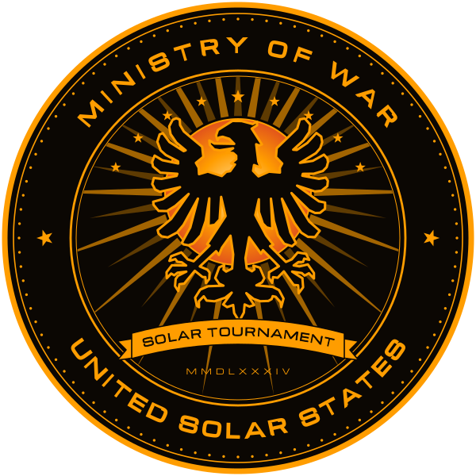

<p align="center"></p>

# SolarTournament

A browser space shooter in an asteroid field, built with [three.js](https://threejs.org/). No shields, no sound in space, no drag: ships obey Newton, lasers punch straight through hulls, and a careless burn ends in a rock.

What flies, collides, burns and breaks behaves the way it would out there, as long as it stays fun.

## Run

```
npm install
npm run dev        # http://127.0.0.1:5173/
npm test           # unit tests (Vitest)
npm run e2e        # browser tests (Playwright; first once: npm run e2e:install)
npm run bench      # benchmark in the test browser (see Performance); PROFILE=pixel8 as the reference phone
npm run build      # static site in dist/ (runs the unit tests first)
```

## Performance

The game draws the same world on every device, but not with the same effort: the picture's quality moves along a ladder of looks (`src/view/quality.ts`), from the picture as designed (rung 0) to the cheapest (rung 13). Each rung changes one or two knobs of the one above it, the largest saving for the least loss first. Only looks change: rocks, colliders, the round and everything that goes over the network are the same on every rung.

**Rocks and ice draw few triangles; their relief is a map, not geometry.** A near rock has 2 000 triangles, one seen from afar 500 (`src/world/rocks.ts`; `NEAR_DETAIL`, `FAR_DETAIL`), a sliver of the 22 000-triangle shape its collisions are still measured from (see world/surface: the measured surface never changes, so every browser collides the same whatever a rock draws). The fine relief and the surface's shade instead come from a relief map baked once per shape (16 of them): a cube map of 6 faces of 128 × 128 texels (`RELIEF_RES`, about 0.7° a texel, 1.5 to 4 m on a rock of the field), each texel the surface's normal in the rock's own frame and its shade, indexed by the direction from the rock's own center (a rock is star-shaped around it: every direction meets its surface once, so the map needs no UV unwrap). WebGL filters a cube map across its faces' edges and builds its mipmaps, so it shows no seam, and a rock far away calms into its mean instead of shimmering. All 16 take 6.3 MB, 8.4 MB with their mipmaps; ice has 16 of its own of the same size (`src/world/ice.ts`, see Rings of Saturn), its alpha the kind of ice instead of the rock's shade; all 32 bake in up to four background workers while the game loads (`relief.worker.ts`, about 60 ms a map on a desktop core, ice as rock), side by side with the collision shapes and the billboards, and an arena only puts on the GPU the maps of what it draws. A shader samples the map directly from the mesh's own local position and turns the normal into world space with the object's normal matrix, exactly as it would a vertex normal; the near and far meshes share the same map, so the relief looks identical at any of them. Up close, the near meshes lay a shared detail map over it (256 × 256 texels, one tile repeating every 11 m of the template, 28 to 77 m on a rock of the field): the smallest craters, pebbles and the regolith's grain, projected along the rock's three axes and blended by the mesh's facing, three more texture reads a pixel, whole within 100 m and gone beyond 450 m; it keeps the rock's mean tone and tilt, so its fading is not seen; ice lays a tile of its own the same way (frost grain, small fractures, tiny pits). The far meshes never take it, so on the rungs that draw every rock with its far mesh (`rocks: 0`) a rock up close shows the relief map alone. The far switch (below) only trades the coarser silhouette's few hundred triangles for fewer yet, the surface shading staying as it was.

**Farther yet, a rock or an ice piece draws as a billboard** (`src/view/impostor.ts`): a camera-facing quad, at a fixed distance regardless of the ladder's rung (80 of the shape's mean radii, and never nearer than 7 km, so that even a fragment of a fragment or a small chunk of ice switches farther out than the arena is across, 6.75 km, and the switch is never seen; within it a small piece draws its far mesh), showing 8 pre-rendered views (from the corners of a cube around the shape) picked by how the shape is actually turned now: the nearest one, and the next up to three as far as they come within about 12° of it, blended, so a turning rock fades from one view to the next instead of jumping; each view is turned about the line of sight as the shape is. A view holds no colors: each of its 48 × 48 cells (`IMPOSTOR_RES`) holds where its ray meets the shape (marched through the shape's own bump, the one its meshes' vertices take) and how far inside or outside the silhouette it lies, so filtering finds the silhouette between the cells, sharp at any size, and the views are mipmapped (the views of all 16 shapes take 1.2 MB, 1.6 MB with their mipmaps, shared by rock and ice, baked in about half a second on a desktop core while the workers bake the relief maps). The billboard reads the shape's relief map there, the very map its meshes read, through its mipmaps, and paints it with the meshes' own code, color, roughness and metalness (an ice piece's from its own relief map, with the ice's cold glow and the sunlight coming through its side away from the sun); it is lit at that moment by the scene's own sun and sky as three.js's standard material is (Lambert's diffuse light and the sun's highlight), so it shows the far mesh's colors and brightness and tracks a solar flare. The same billboards draw almost all of the belt beyond the arena (`src/world/belt.ts`): only rocks within 1.4 × the belt's inner edge, close enough that a ship coasting past the arena's limit could still reach them, keep the real low-poly geometry; the rest of the ring, the great majority of its 480 rocks, is cheap enough as billboards (two triangles each, one draw call per shape) that it needs no culling by direction.

**A landmark seen only in its own arena sheds detail cheaply, since it never shares a frame with the others.** Jupiter's cap, its cloud deck (`src/world/landmarks.ts`, `Landmarks.setDetail`), is a sphere built once at three segment counts; a cheaper rung only swaps which one its mesh uses, so the saving costs nothing to apply. Its bands and storms are its map and noise in the fragment shader, not geometry, so the coarser sphere still shows them, only with a rounder-looking limb up close. The two sheets of cloud under the deck (`src/world/jupiter.ts`) are see-through spheres, each a full-screen pass at most: the first rungs draw both, from rung 2 the upper one, from rung 9 neither. Their gaps are noise that evens out where its cells shrink to a few pixels, so they never shimmer in the distance. The deck's cloud tops (see The arenas, Jupiter) are lookups of one 256 × 256 noise texture (about 350 KB of graphics memory with its mipmaps) and some arithmetic per pixel, besides the map's two (sharp, and blurred for the bands): nine on the full picture (the large and the small eddies, the billows, their grain, the threads, the billows once more towards the sun for their relief, the pop-up clouds, their shadows and the gaps), seven from rung 2 (without the small eddies and the relief), five from rung 9 (without the grain and the pop-ups' shadows); the vortices and the great storm's spiral are arithmetic only, two hashes for each of the two grids. The texture is mipmapped, so a pattern finer than a pixel fades to its mean by itself, and whatever is shaped beyond the texture (a cloud's sharp edge, a thread, a vortex, a white oval, a pop-up cloud) fades out where it is smaller than a few pixels, so the tops never shimmer. A sheet under the deck reads the texture twice besides its blurred map (the large eddies and the gaps). The cost of the tops is not measured yet. Saturn and Jupiter draw from real maps (see The arenas): the page loads them at 1024 × 512 (about 50 and 120 KB), and only once a rung with at least half the landmark's detail is reached does the browser fetch the sharp 2048 × 1024 maps (about 170 and 370 KB) and swap them in, so a phone on the cheaper rungs never downloads them and keeps about 6 MB of graphics memory per map rather than about 11. Earth's night map below the Satellite Junkyard covers only the region a pilot sees, so its 1024 × 832 (about 190 KB) and sharp 2048 × 1664 (about 560 KB) are about as sharp there as a whole-Earth map five times as wide; its day map covers only the part of that region the sun reaches, at 512 × 896 (about 130 KB) and sharp 1024 × 1792 (about 420 KB), swapped by the same rule. The junk beyond that arena's field, about 5,000 pieces, is one draw call of point sprites: each moves, turns and lights itself in the vertex shader, and the fragment shader draws its wing or its stage at its size on screen, never thinner than a pixel and never more than 64 pixels wide, so nothing in it crawls or shimmers. Saturn's ring and the specks of ice in it read the sun's shadow map only on a rung with shadows; on the others the shaders leave it out. The Corona's sun (`src/world/corona.ts`) is five draw calls: its face, the glow along its limb (a quad around it, square to the camera's line of sight), all its prominences as one mesh, each a ribbon that rises and falls in the vertex shader, and two quads over the whole picture, placed in clip space with no work on the processor: the sky's scattered light, drawn at the far plane so the depth test leaves it only the pixels nothing else covers, and the lens's veil over everything, which is not drawn at all while the sun stands behind the camera; each a handful of operations a pixel, smooth by the angle from the sun, with nothing in them to shimmer; the face's finest grain, the penumbrae's filaments and the prominences' strands fade out where they would be smaller than a few pixels, and a knot of coronal rain is drawn at least three pixels long, so none of it crawls on a phone. Nothing in it distorts the picture behind it: no heat shimmer. From rung 2 it shows the twelve tallest prominences, from rung 9 the eight tallest and its face without its finest grain. The black hole's lens (`src/view/lensing.ts`) marches a fixed number of steps outward along each pixel's bent ray looking for what it should show; a cheaper rung marches fewer, so the bend reads a little coarser at its edge, never unbent. The black hole's disk draws its streaks as three octaves of concentric rings (24, 60 and 150 across the disk), 27 hashes a pixel; each ring turns as a whole at its own speed, dark at its edges where the next one slides past, so the streaks never shear into stripes finer than the picture however long the round lasts. An octave evens out to its mean where its rings would be narrower than a pixel, so the disk never shimmers in the distance, and from rung 2 on the finest octave is left out (18 hashes a pixel).

**The Belt's mining is seven draw calls for all of it.** Everything the Rockborn put on the Belt's rocks (`src/world/mining.ts`) is merged into one geometry per material, built once from the field's rocks: steel (rigs, buoys: one worn surface of riveted plating tiled across every face, 6 m a tile, twice that along a beam, its hazard stripes drawn in the shader and smoothed over the pixel they fall in, fading to their mean where a pixel spans a stripe, so they never crawl; the dust towards the rock and the lit panes in the vertices' colors), stone (the cut faces), paint and light on the rocks (graffiti, the lamps' pools, the glowing cuts and tunnels), the lamps as points, the cutting lasers, the sparks and drill dust as points, and the dust clouds as one instanced quad. Each vertex carries the slot of its rock, and the vertex shaders place it by that rock's matrix from a uniform array of twelve, copied once a frame; a rock that breaks gets a zero matrix and its dressing is out of sight. The blinking, the laser's sweep, the sparks and the dust are all worked out in the shaders from the field time, so the CPU only copies the matrices and moves the six drill holes the hull listens to (see The Belt). A lamp, a beam or a mote is drawn at least 2.5 pixels wide and dimmer instead of smaller, so nothing small crawls from pixel to pixel. The ladder's share of particles thins the sparks, the drill dust and the dust clouds alike (the clouds cost fill rate, fading out within twice their radius of the camera, so no wall of dust ever fills the screen).

**Jupiter's haze is a few operations per pixel, not a volume.** The height fog of its air (`src/view/haze.ts`) is computed in the shader of everything drawn in the world, as three.js's fog chunks: the haze summed along the view ray in closed form from the altitudes of the ray's two ends (two exponentials and a division, no marching), so it costs the same at any depth on every rung. Only while the arena has air does the scene carry a fog, so the shaders of the other arenas are compiled without it and pay nothing; entering Jupiter compiles the fogged ones once. What the flight computer draws (the HUD, the racing line, the reference plane's grid) and the arena's edge stay clear of it. Under the deck the haze's light carries its clouds (see The arenas, Jupiter): a ray reads them at one or two points, each four lookups of one 256 × 256 noise texture (a lookup reads two layers of a 3D noise; one of them shoves the clouds about in swirls), two points on the full picture and one from rung 2 on; their features are tens of meters wide where the ray reads them, thousands of times a pixel's width, so they never shimmer. They change only the haze's light, never its sum. Under the deck a sphere around the eye takes the place of the haze's floor, so every view that would end in nothing ends in the haze: one opaque full-screen pass of it. The wisps are one draw call of 96 quads (56 from rung 2, 32 from rung 9), laid around the eye in the vertex shader from fixed seeds, the CPU setting two uniforms a frame; they fade out within a quarter of their length of the eye and at the edge of the box they wrap in, so none pops in or out. The cost of the haze, its clouds and the sheets of cloud is not measured yet.

**An arena's mood costs no pass of its own.** Its color grade (`src/view/grade.ts`) is a few operations per pixel inside the output pass that tone-maps the picture and encodes it for the screen anyway, the same on every rung. Its nebulae are at most four sprites with one of three cloud textures of 256 × 256 pixels, made once at load and shared by all arenas; the clouds are soft and coarse (their finest detail some 30 pixels or more on a screen), so they never shimmer. Space's color, the sky's light, the stars and the dust only change values the shaders already read. The cost of the larger nebulae (more of the screen covered by sprites drawn additively) is not measured yet.

**A hot hull costs two draw calls, only while it glows.** The plasma around a ship in Jupiter's air (`src/view/reentry.ts`, see Jupiter's air) is a sphere of about 1 200 triangles stretched into the shock layer and its tail in the vertex shader, and the hull's glow is the hull's own geometry drawn once more with an additive shader; both are built when a ship first heats and hidden while it is cool. The plasma trail, the flakes, the sparks and a burning ship's fireball are particles of the shared systems (one draw call per texture for all of them), so a cheaper rung thins them out with the rest. The licks at the edges of the view are one tube around the camera, drawn only above half strength, its pixels at the view's edges. Its glow sways and streams slowly and never flickers frame to frame; with reduced motion it stands still. The cost is not measured yet.

| Rung | Change | Tier |
|---|---|---|
| 0 | Everything: up to 2 device pixels per CSS pixel, bloom at full resolution, the sun's shadows in a 4096 px map, lacquered hulls, all particles, dust and grains of the ring, the Belt's sparks, drill dust and dust clouds, the whole belt (480 rocks), the field's rocks keep their near mesh out to 12 of their radii, a comet's nucleus its near mesh (8 800 triangles) within 2 km, the title screen's pad with its shadow | **high** |
| 1 | The rocks keep their near mesh (2 000 triangles, drawn twice: for the picture and for the sun's shadows) only out to 6 of their radii; farther, the coarser far mesh (500 triangles), its relief unchanged (see above); a comet's nucleus its near mesh within 1 km, farther its far mesh (2 000 triangles) | |
| 2 | The near mesh only out to 3 radii, a comet's nucleus's within 500 m; Jupiter's cap (seen only in its own arena) at 128 × 48 segments instead of 256 × 96, and only the upper of its two sheets of cloud under the deck, its cloud tops without their small eddies and the low sun's relief, the haze's clouds read at one point of a ray instead of two, 56 wisps of 96, two layers of the auroras of three; the black hole's disk without its finest rings; the Corona's twelve tallest prominences of sixteen | |
| 3 | 1.75 device pixels per CSS pixel | |
| 4 | Bloom at half resolution (a quarter of its pixels); the black hole's lens (seen only in its own arena) marches 4 steps along each pixel's ray instead of 6 | |
| 5 | Shadow map 2048 px | |
| 6 | 1.5 device pixels per CSS pixel, the pad as well; the sun's shadow map (still on through rung 9) is refreshed only every other frame, not every one (`Game.updateShadowMap`): what casts it barely moves between two | **medium** |
| 7 | Shadow map 1024 px | |
| 8 | 1.25 device pixels per CSS pixel; the pad at 1, without its shadow | |
| 9 | Half the particles, dust and grains of the ring, the Belt's sparks, drill dust and dust clouds, half the belt's rocks beyond the arena; Jupiter's cap at 64 × 24 segments, without its sheets of cloud, its cloud tops without their grain and the pop-up clouds' shadows, 32 wisps, one layer of the auroras; Saturn's, Jupiter's and Earth's maps at 1024 instead of 2048 wide; the Corona's eight tallest prominences, its sun's face without its finest grain | |
| 10 | No shadows | |
| 11 | 1 device pixel per CSS pixel, every rock of the field and a comet's nucleus keep only their far mesh, a quarter of the belt, the pad drawn every second frame, the reference plane's grid only its rings; the lens down to 2 steps | **low** |
| 12 | No bloom | |
| 13 | 0.75 device pixels per CSS pixel, a third of the particles and grains of the ring and of the Belt's sparks, drill dust and dust clouds, no lacquer on the hulls (the second specular layer and the battleship's film of colors) | |

The HUD's attitude display (horizon, pitch ladder, bank scale, heading tape) is a canvas over the whole screen: it follows the picture's resolution down the ladder (never below 1 pixel per CSS pixel, never above 2) and is drawn anew only when the camera turns or its lens changes. The HUD, the radar and the attitude are written once a frame, after the frame's steps of the simulation, however many a slow frame runs.

**Tiers and the governor.** The menu's row under the languages offers Auto, Low, Medium and High. A tier pins its rung. Auto starts where the device was last found smooth, or with a guess: a software renderer starts on the Low tier's own rung (11); a phone or tablet starts lower yet, on the ladder's very last rung (13), since a fight must never stutter and a touch screen's GPU is the one most likely to struggle; a small machine (four cores or fewer, 4 GB or less) or an integrated Intel GPU starts on Medium, everything else on High. Then the governor watches the frame rate in the menu and in a running round, each on a rung of its own: the title screen's pad costs what a fight does not, so the menu never decides the round's rung, nor the rungs barred in it. Below 50 frames a second over 2 seconds (1 second on a touch device) it takes a rung down; at 58 or more for 8 seconds (14 seconds touched), with the frame's own work under 60 % of the frame, it takes one up — a touch device steps down faster and climbs back up more cautiously than that. After every change it waits 3 seconds. A rung left for being slow is barred for 30 seconds, then twice as long after each further time, so the picture never seesaws. A screen that refreshes slower than that (a phone's battery saver holds it at 30 Hz) is slow on every rung: after two steps down in a row that raised the frame rate by less than 5 % while the frame's own work stayed under 60 % of the frame, the governor takes the cap for the screen's, goes back to the rung before them and holds it, until the frame rate reaches 50 again (the cap is lifted) or falls below 90 % of the cap (the device itself is slow again). A rung of a running round held for 20 seconds, never under a cap, is kept in the browser as the start next time (`solartournament.quality`, the same entry as the pinned tier). Shadows on or off and the lacquer compile shaders anew; the governor changes them only where the hitch goes unseen (in the menu, on the results, while the own clone is dead), the other knobs at once.

**The benchmark.** `?bench` on the game's address (`?bench=<seconds>` per measurement, default 3; the test stage works too, https://test.solartournament.games/?bench) plays a fixed scene: a solo deathmatch of the default rivals in the belt, the Host's clone watching, the camera on a fixed arc around the field. It measures the frame time with everything on, then with each feature off on its own (the occasional effects, glitch and datamosh, on), against the mean of everything on just before and after: post-processing as a whole, bloom, resolution, shadows, lacquer, rock detail, the field, the belt, the landmark, the sky, the dust, particles, ships, wreckage, the DOM HUD, the radar, the attitude display, the motion streaks, sound. Then every rung of the ladder, every arena with and without its landmark (the black hole with and without its lens), the race with and without the racing line, Capture the Flag and the President's Fleet, and the title screen with and without its pad. It takes about ten minutes. The table shows on screen at the end, with buttons to copy or download it as JSON, and goes to the console; the frame time is the time between two frames shown (never below the screen's refresh), next to it the frame's own work and, where the browser can time the GPU (`EXT_disjoint_timer_query_webgl2`), the GPU's time, draw calls and triangles. `?fps` shows the frame rate, the frame's own work and the rung at the bottom of the screen, to watch the governor at work.

On a phone: open the address with `?bench` (the test stage, or the dev server over the LAN), lay the phone sideways, wait until the table shows, and press "Copy JSON".

`npm run bench` runs the same in the test browser (`e2e/bench.spec.ts`); `PROFILE=pixel8` pretends to be the reference phone, a Pixel 8 held sideways with its CPU slowed to the phone's browser speed (see `e2e/README.md`); `BENCH_ONLY=quality` (or `menu`, `features`, `arenas`, `modes`, comma-separated; `&only=` on the address) runs only those sections. A feature's cost is counted in GPU time where the browser times the GPU, since the frame time snaps to the screen's refresh; the title screen's pad draws in a context of its own and is counted in frame time.

**Measured triangles.** `BENCH_ONLY=quality` under the Pixel 8 profile, in the belt arena (`npm run bench`), triangles submitted per frame and GPU time at each rung (quiet machine, an Apple M4):

| Rung | Triangles | GPU ms |
|---|---|---|
| 0 high | 547 089 | 200.1 |
| 1 | 502 459 | 163.9 |
| 2 | 484 180 | 158.0 |
| 3 | 484 219 | 139.8 |
| 4 | 483 947 | 116.8 |
| 5 | 483 941 | 107.1 |
| 6 medium | 470 804 | 87.2 |
| 7 | 470 722 | 72.9 |
| 8 | 470 621 | 62.4 |
| 9 | 276 232 | 51.6 |
| 10 | 264 175 | 47.5 |
| 11 low | 153 595 | 33.1 |
| 12 | 153 572 | 30.4 |
| 13 | 153 591 | 25.7 |

**Measured costs of the other features.** One run each in the test browser on an Apple M4, the machine otherwise quiet, 5 seconds per measurement. The test browser draws without a GPU (swiftshader), so the milliseconds are its own and only the costs next to each other mean something: what a feature costs here is no promise of what it costs on a phone's GPU. "Desktop" is 1280 × 720 at 1 device pixel per CSS pixel, "Pixel 8" the phone's screen held sideways (915 × 412 at 2.625, 2.6 million pixels) with its CPU speed. Cost per frame of each feature switched off (glitch and datamosh switched on), in GPU time, as a share of the frame with everything on:

| Feature | Desktop | Pixel 8 |
|---|---|---|
| Shadows | 17 % | 18 % |
| Half the resolution | 39 % | 41 % |
| Post-processing as a whole | 37 % | 34 % |
| Bloom | 32 % | 32 % |
| Datamosh (while on) | 22 % | 14 % |
| Glitch (while on) | 7 % | 2 % |
| DOM HUD, radar, attitude, sound, particles, dust, sky, ships, wreckage, lacquer, landmark of the belt | each within ±3 % | each within ±8 % |
| The title screen's pad (frame time, in the menu) | 44 % | 38 % |
| Landmark of Jupiter (its map's cap; its sheets of cloud and haze not measured) / the rings / the black hole | 25 % / 6 % / 6 % | 21 % / 12 % / 8 % |
| The black hole's lens | 15 % | 14 % |

On the desktop the ladder's own resolution rungs (3, 6, 8, 11, 13) change little: at 1 device pixel per CSS pixel, the picture is already drawn at its lowest; the "Half the resolution" row above forces a cut below that floor to measure the full-screen passes' cost per pixel on their own.

## Deploy

The game is a static site on [Cloudflare Pages](https://pages.cloudflare.com/), project `solartournament` (`wrangler.toml`). Two stages, one branch each:

| Branch | Stage | Address |
|---|---|---|
| `stage_prod` | production | https://solartournament.games |
| `main` | test | https://test.solartournament.games |

Cloudflare builds every push to one of the two branches itself (Git integration: build command `npm run build`, output directory `dist`, Node from `.node-version`); no Cloudflare token lives in GitHub. Development happens on `main`; a release merges `main` into `stage_prod`. `test.solartournament.games` points to the branch alias `main.solartournament.pages.dev`; `www.solartournament.games` and `solar-tournament.games` (with `www.`) redirect permanently to `solartournament.games`, path and query included.

The project is a classic Pages project, not a Worker: the game is a static site, and its only server code is a Pages Function of the same project, `functions/turn.ts` (`GET /turn`), which hands out short-lived TURN credentials (see below), never to a request the browser marks as coming from another site (`Sec-Fetch-Site` other than `same-origin`; older browsers that send no such mark are answered, and a zone rate limit keeps scripts from collecting credentials in bulk).

Every page goes out with a Content Security Policy (`dist/_headers`, written by the build from `vite.config.ts`): scripts and styles of the site itself only (its one inline script, the redirect from the Pages addresses, by its hash; `blob:` for the audio worklets of the radio), connections to the site and to the Nostr relays by name (the checked list and Trystero's built-in ones; the build fails when the header line grows past the 2,000 characters Cloudflare Pages takes), no frames around the game, no plugins; together with `X-Content-Type-Options: nosniff` and `Referrer-Policy: no-referrer`.

## Languages

The game speaks English, German, Spanish and French. It starts in the language the Host chose in the menu (the buttons at its foot, each language named in itself; the page starts anew in it), else in the first of the browser's languages it speaks, else in English. Every text on screen is translated, and so are the flight computer and the announcer, whose voices are rendered in each language: Nicole speaks the other languages in the sounds espeak-ng spells them in, with her accent. The regime's voice on Radio 2584 keeps its own English and German, and the titles of its tracks are their seeds, the same for every Host. The legal pages are German. English is the source: every text is written in English where it is used and translated through catalogs (`src/i18n/de.ts`, `es.ts`, `fr.ts`, keyed by the English text); `npm run i18n -- de` lists what a catalog still lacks, and the unit tests fail while one lacks anything.

## Controls

| Keyboard and mouse | Gamepad | Action |
|---|---|---|
| Mouse pointer (pushed the way the nose should turn; the farther from the center, the faster) / arrow keys | Left stick (pull back = nose up) | Turn the nose (yaw, pitch); with the autopilot the ship flies where it points |
| W | RT (analog) | Main drive |
| S (hold) | B (hold) | Brake: the flight computer flips the ship head over and burns until it is at rest |
| Shift (hold) | L3, the left stick pressed in | Fine aim: steers at 30 % for precise aiming |
| A / D | Right stick left / right | Thrusters: sideways |
| | X | Thrusters: backwards |
| R / F | Right stick up / down | Thrusters: up / down |
| G | D-pad up | Torpedo: two per clone, homing on the ship closest to the nose (see Combat rules). On touch screens the TORPEDO button |
| V / right click (hold) | D-pad down (hold) | Hook: pressed, a harpoon on a cable bites the rock or ship ahead; held, the winch reels in and the ship swings around what it holds; let go, the ship flies off along its swing (see Combat rules). On touch screens the HOOK button |
| A, D, R or F tapped twice | LB (the way the right stick points) | Dodge: a 40 m/s kick of all thrusters that way, ready again after 1.5 s. On touch screens two quick flicks of the push stick |
| X (hold) | Y (hold) | Flip: while held, the flight computer turns the ship head over until the drive points against the flight and keeps it there. W can be held at the same time: the drive only fires once the nose points back, so X and W together brake by hand. Letting go hands the ship back |
| T | R3, the right stick pressed in | Autopilot / free drift, switched at once. The autopilot is on at the start of every round: the ship flies where it points, the flight computer taking out every drift across the nose with thrusters and drive, and W pushes it exactly that way (see Flight). In free drift steering turns the nose and nothing else, and the ship keeps any drift, for slides and shots on purpose. On touch screens the AUTO button |
| E | RB | Overdrive, the last resort: one shove of 150 m/s along the nose, past the speed limit. It leaves the clone at the edge of blacking out and the main drive overheated for 4 seconds (no thrust; turning, sidestepping and firing go on), and recharges for 60 seconds (the HUD counts down). Aim it across the attacker's line of fire or ahead of the own drift: straight away from a ship on the own tail it only makes a farther target. On touch screens the OVERDRIVE button |
| Click / Space | LT / A | Fire laser |
| C | View | Chase / cockpit camera |
| H | | Cinema mode, for recordings and trailers: the HUD, the radio's title, the subtitles and the touch controls step aside, and the chase camera hangs 1.4 ship radii farther back, follows at 30 % of its usual speed and drifts slowly around the ship (a ship radius sideways, a quarter up and down). H again brings everything back ("Cinema mode off") |
| M | | Radio on / off (also with the ♪ button in the top right corner; a click on the song title opens the radio page) |
| Esc / P | Menu | Pause |
| Q | | On the pause screen: quit the round |
| F1 | | Controls sheet over any screen, the running round included (F1 again closes it) |
| Tab (hold) | | Standings over the running round: place, kills, deaths, score, in a race the lap or the finish time. While watching a full tournament it also switches to the next pilot |
| Enter | A | Confirm (start, resume, boot the next clone) |

**The essentials** are W, A, S, D, Shift, Space, X and the arrow keys or the mouse; both work at the same time, so keyboard pilots and mouse pilots share one layout. The up and down thrusters and the camera are extras. The pilot does not roll: the flight computer keeps the ship upright (see Flight).

**Mouse flight.** The pointer stays visible and nothing captures the mouse. Its offset from the screen center is the stick: at 25 % of the shorter screen side the nose turns at full rate, within 8 % of that around the center it does not turn, and a pointer that leaves the window lets go of the stick. The crosshair is the nose: where the laser hits and, with the autopilot, where the ship flies; the chase camera looks along it. Centered, the nose stops and the ship flies straight on. Arrow keys, gamepad and touch stick turn the nose the same way.

Gamepads with the standard layout (Xbox, PlayStation, most others in current browsers) work without setup. A pad whose layout the browser does not know is left alone: its axes may rest anywhere (a trigger or a throttle at full) and would fly the ship by themselves.

On phones and tablets touch controls appear: the fixed stick on the left turns the ship (drag up = nose up), a second stick appears under the right thumb and fires the maneuvering thrusters. Hold **Drive** for the main drive and **Fire** for the laser; **Brake** brakes to a stop, **Flip** (hold) turns the ship against the flight, **Hook** (hold) fires the hook and reels in. Pressing a key on a hardware keyboard hides the touch controls (the phone's volume keys and a headset's media keys do not), touching the screen brings them back; a hold button stays held while any finger is on it. On a phone (a touch screen less than 500 px high or 600 px wide) the HUD shrinks to the edges so the middle of the picture stays free: smaller buttons, the gauges as a slim row of labels over bars, the round's panel narrow beside the radar, messages and transmissions smaller and out of the middle, and the radio only its switch and the title in the top right corner (the phone's own keys set its volume). No piece of the HUD covers another: the round's panel, the alarms with the message below the crosshair, the transmissions, the radar, the gauges, the radio, the kill feed, the touch buttons, the height and climb and the fixed references each keep their own place, on a big screen and a small one, with keyboard or touch; on a low screen with a keyboard the transmissions run on the left beside the alarms' column, the radar shrinks and the gauges close up. A round is flown with the phone held sideways: held upright, a plate over the round asks to turn it ("Turn your phone sideways to fly."), with a phone turning on it; a solo round stands still meanwhile and goes on as soon as the phone turns, an online tournament does not wait. The menu works either way.

**Fullscreen.** On phones and tablets a round goes fullscreen by itself and, where the browser allows it, holds landscape; the menu and the pause menu have a Fullscreen button for every device. Browsers that do not let a page go fullscreen (the iPhone's) get it by adding the game to the home screen: the web app manifest (`public/manifest.webmanifest`, icons rendered from the seal) starts it without the browser's bars.

## Online tournament

**Online tournament** in the menu opens the list of tournaments. On top, the public tournaments running right now, each with its name, how many Hosts fly, whether bots fill it and the time left in the round, and a button to join (or to watch, when it is full). Below, a form starts one:

- **A name** of the Host's choice ("Kessler's Revenge"), up to 32 characters.
- **Public or private.** A public tournament is announced in the lobby for everyone; a private one is only found through its link.
- **With or without bots.** With bots, the lead browser fills all eight places and every Host who joins takes a bot's place; without, only Hosts fly.
- **Race, deathmatch, Last Clone Standing, Capture the Flag, the President's Fleet, or all in turn** (see Modes).

The room's code, name and rules live in the fragment of its link (`#t=kessler-s-revenge-k7m2pq&n=Kessler%27s+Revenge&pub=1`, `&bots=0` without bots, `&m=race` or `&m=mixed` for the mode), so they never reach the web server. The code is the name plus a random part: 6 characters for a public tournament, so two of the same name never meet, 20 for a private one (about 99 bits), far beyond guessing from the public relays. Starting a tournament copies its link at once, to be sent to friends; the share button (see Sharing) and the pause menu's **Invite friends** share it any time. Whoever follows the link joins; when nobody is in the room any more, the first to come starts it again with the link's rules, so a tournament can be played forever. There is no game server: the browsers find each other through public Nostr relays ([Trystero](https://github.com/dmotz/trystero)) and then talk directly over WebRTC. Leaving the tournament and the list closes the connections to the relays.

- **The relays.** Every browser connects to the same 12 public relays, a list in the game (`src/net/relays.json`) that a check renews every week (`npm run relays`, run by the workflow Relays every Monday): it takes the relays already listed, Trystero's built-in ones and those that independent relay monitors report healthy (NIP-66), and keeps the ones that, three times in a row, answer a subscription, accept an event of the kind Trystero announces with and hand it back; those already listed first, so builds a week apart still meet, then the fastest, one per operator, and of those only the monitors name, at most 2 new ones a week. Two Hosts meet as long as one relay works for both. When none of the list opens a connection within 10 seconds, the browser falls back to Trystero's own choice (5 of its built-in relays). The game never asks a third party for relays while it runs.
- **The lobby** is one shared room on the same relays. The lead browser of a public tournament announces it every five seconds, and at once to everyone who opens the list; a tournament not heard of for 16 seconds leaves the list. Announcements are checked like every message from another browser. A tournament's listing only follows the browser that announced it, until that one has been quiet for 10 seconds (as when the lead moves on); a browser leads one tournament at a time, so its newest announcement replaces its earlier ones. The list keeps at most 50 tournaments and lets the one heard of longest ago go first. Until the lobby has listened for six seconds, the list says it is still looking.
- **Eight places per tournament.** A ninth Host does not fly but watches the broadcast, and the own clone is printed as soon as a place comes free; the HUD shows the watched pilot's gauges. A director cuts the broadcast: it follows the pilot in the thick of it (another ship close, a nose on an enemy, an enemy on its tail, a battered hull, in a race the leaders), holds a pilot at least 6 seconds and cuts only to one clearly more in the thick of it, at once when the followed one dies; every other cut is a wide shot from the side instead of the chase camera. Tab picks the next pilot by hand; 10 seconds after the last Tab the director takes over again. Hosts who were in the room first keep their places. In its first six seconds a newcomer cannot know yet who came first and counts every browser it is connected to: with eight or more, it watches.
- **Every Host has their own pilot.** Each browser simulates its own ship and sends its state 15 times per second; the other browsers predict the motion in between (a ship without thrust flies straight on) and blend corrections in smoothly: the shown ship moves on as predicted and the blend only takes out the correction, so it is drawn where the prediction says. The ships of a browser that has sent nothing for 2.5 seconds (a hidden tab) leave every screen until it sends again, and its Host does not count as flying.
- **The shooter decides about hits.** A beam that goes through a ship on the shooter's screen is reported to the browser flying that ship, which applies the damage and announces a destruction. Asteroid hits go to everyone, with the field time and the round of the hit (a hit for a round a browser has not started yet waits for it); the fragments are deterministic, so all players see the same ones, and a destroyed ship's wreckage is seeded with its death count, so it breaks into the same pieces everywhere, flying from where the ship's own browser saw it break up. A piece of wreckage shot or rammed bursts on every screen, and a Host who joins gets the pieces in flight together with the field. When two Hosts break the same rock at the same moment, the hit with the earlier field time gets the points; the other browser takes its own points back when it learns it was later. When two hits from different browsers use up a rock's last hit points, the later hit by field time broke it: its browser credits its ship, though it learns of the other hit only afterwards.
- **One field for everyone.** Where a rock stands and how it is turned follows from the seed and the field time. The lead browser shares its field time with the round clock 15 times per second; the others glide towards it and jump when they are more than half a second off. A round's start (from which race times and the probes count) is known from its first clock: the lead's clock smooths it by up to a quarter second, never more, so a round the lead ends early (a race all finished, a side that won, the battleship gone) ends sooner everywhere but keeps its start; the sides, cores and battleship in the lead's message are taken before its clock. A newcomer gets the field time, every rock's remaining hits and when each rock broke, the motion of every hull piece a comet shoved (see Comets), the wreckage, the probes in flight and the ones taken, and learns from the first round clock which round runs; its clone is then printed again in the round's arena (on the grid in a race), since it was printed before the arena was known; a browser that starts over (see below) gets the same and rebuilds its field from it. The snapshot names its arena, so a newcomer builds the field in the right one. Every new round brings a fresh field in the next arena (see Arenas); rocks circling the center follow from the field time as well.
- **The lead browser** is the one that has been in the room longest and is still sending. It runs the bots and the round clock (in Capture the Flag with the sides and the cores, in the President's Fleet with his battleship) and brings newcomers' asteroid fields up to date. Any browser can take over this job at any moment: when the lead leaves, or falls silent for 2.5 seconds (a hidden tab runs no frames, a link drops), the next one takes over and adopts its bots with everything they had: name, ship, score, kills, deaths, hull, drive, thrusters, the torpedoes left to their clone, position, motion and whether their clone lives (a dead one boots its next clone 9 seconds later, a bot's usual wait: the respawn delay and the sponsor break's ad). Every browser works out the join times from the same reports, so all of them elect the same lead.
- **The standings show each Host's ping and the lead.** Every browser pings each of its peers directly, once a second (a tiny message of its own, answered at once, checked and rate-limited like every other), and keeps the median of its last five round trips. The standings (the scoreboard, and the one Tab holds open) show it in milliseconds next to that Host's name, in the HUD's azure, orange from 150 ms and red from 300 ms. A bot's ping is to the lead browser, since only the lead runs its bots; a dash shows for the Host's own browser and, while it leads, its own bots, and before the first pong has come back. A small star before a Host's name marks whichever browser leads. Solo rounds show neither.
- **Who was gone starts over.** A browser that ran no frames for 2 seconds, or heard none of the others for 2 seconds and then hears one again, knows the others went on without it: it starts over as the newest in the room. It gives up the lead and its bots, joins the queue for the places behind everyone else, and takes round clock and field from the lead like a newcomer (its own score stays, unless the round changed meanwhile). It judges itself cut off half a second before the others judge it silent, so it is the one whose link failed that starts over. A browser that speaks again after 2.5 seconds of silence counts as sending only 2.5 seconds later, so it can report first that it started over. When two groups that lost each other meet again, the group whose lead is not the oldest takes the other group's world; with only two browsers, nobody can tell whose link it was, and the one that notices first starts over. Two browsers that lead at once (their join times too close to tell apart over the network) settle it: the one with the higher id starts over.
- **Nothing from other browsers is trusted.** Every message is checked before the game uses it (finite numbers in plausible ranges, callsigns up to 16 characters, at most eight ships per browser, messages up to 64 KB). A message about a ship only counts from the browser that runs it. A shooter cannot hit the same ship, or the battleship (a laser one part a shot, a torpedo's blast each part once), more often than its laser fires, and every kind of report has a limit per browser and second: 45 ship states (three times the rate they are sent at), 96 beams, 96 hits, 20 asteroid hits, 8 destructions (a nova can take every ship a browser runs at once), 20 pieces of wreckage, 12 torpedo launches, hits, detonations, probes taken and novas (one shared limit), 2 cheat reports, 4 pings and 4 pongs each. Counts (score, kills, deaths, gates, items) must be whole numbers. A ship dies once per clone: a destruction only counts for a living ship and a death count that goes up.
- **Plausibility: cheaters are named.** Every browser checks, roughly, whether what another browser reports about its own ships could have happened; the bounds lie so far beyond what a ship can do that lag, lost or bunched messages never make an honest browser look like a cheater. Their windows run on real time, not on the game's time, which runs slower on a device below 20 frames a second. Every state carries the time it was sent on its browser's clock (the seconds its page has run), so states that waited in a jammed link and arrive at once count the time between them as it passed there; a state is never taken as sent later than 20 ms after the least delay its browser's states have shown so far, so a browser that dates its states ahead gains no time to fly. A ship must not move farther between two states it is seen alive in than 1 km/s (four times the speed limit; an honest ship reaches about 700 m/s at the most, and only for a moment: the limit with the overdrive's shove and a dodge on top, or a winch reeling it towards a ship flying the other way; a fall into the black hole, which the limit does not hold back, ends at about 520 m/s) plus 500 m allow. Every state carries the ship's orientation and spin, and its nose turns no faster than a ship's: between two states it turns as the mean of their spins says, off by at most 0.1 rad plus the change of spin and 10 rad/s times the time between them (a shove sets a hull spinning at up to 6 rad/s, a hit's decompression about 2.4 rad/s, faster than either state may show), and the spin grows by at most 60 rad/s² times that time plus 10 rad/s (the thrusters turn a ship at up to 26 rad/s², escaping air spins a hull whose thrusters are shot to pieces at up to about 17 rad/s²). The flight computer turns a nose at 3 rad/s about each axis, 4.5 rad/s with the stick in a corner and the thruster upgrade, whatever steers it (the Host's hand, the autopilot, a flip): the check holds the nose to the flight model's limits, not to any way of steering; at 15 states a second a nose said to be still may swing some 44° between two states, never a quarter turn. Every beam is judged with its ship's next state: it starts within 100 m of where the ship was at the state before it and the one after, plus 1 km/s of flight between them, and it leaves along the turn of the nose between the two, off by no more than a nose may stray from its spin, plus the muzzles' offset (50 m, as seen from the beam's end). A beam that starts more than 1.5 km from where its ship flies here, as this browser predicts it, counts as no evidence of anything, and a torpedo launched more than 1.5 km from it is not launched. A new clone, a new round, a start over and a nova's reprint are not judged by the nose of the clone before. Only what every browser sees makes a new clone that may be printed anywhere, with a fresh load of torpedoes: a death its browser told everyone of (the load is fresh with its first state 2 seconds or more after the death; one that comes earlier, bunched with the death by lag, still counts as the last clone's), a new round, a nova's reprint, a start over of its browser (all free for 10 seconds; a start over keeps the nova core a clone held, as its browser may keep the clone); a state that only says the ship died and lives again changes nothing. A laser hit on an own ship counts only from a beam that starts near its shooter (within 1 km plus half a second at that speed) and passes within 1 km of the ship; a rock between the muzzle and the ship, as this browser sees them, takes the beam (lag may let one slip in, so that is no cheat). A torpedo hit only names a torpedo that flew here too and went off within 1 km of the ship (fired by the ship it names, or held on its hook); a ship's hook takes a torpedo or a probe only within the hook's reach plus 1 km of it, and only the browser of the ship that took it may then say where it went off; a torpedo another browser says went off more than 1.5 km from where it flies here flies on. Every browser is told of every beam, and that is the evidence for what a ship did elsewhere: a rock it broke, a torpedo it shot down (any browser but the one that launched it) and a part of the battleship it hit count only with a beam of that ship that ended within 1 km of them in the last 5 seconds (a torpedo's hits on the battleship with that ship's torpedo going off there, whether its clone still lives or died while the torpedo flew; a beam's only from a living ship), and a kill counts for the killer only when a beam of its passed within 1 km of where the victim broke up, a torpedo of its may still fly, its nova core went off, or it was within 1.5 km (its drive plume burns, its nova reaches 800 m), at the death or at about the same moment in the 5 seconds before (a shove sends the victim into a rock up to 3 seconds later); otherwise the death counts without a killer. A browser that has only just come takes rocks and the battleship's hits on trust, the beams before it came being unknown to it. An asteroid hit counts only within 5 seconds of the own field clock, and a browser's hits in a round come in the order of its field time, give or take a second for a field clock that follows the lead's and may jump back (an earlier time would take the points of whoever broke the rock). A probe taken elsewhere must be one that could exist (shown this round, or dropped by a known ship's dead clone), and a probe this browser has is only taken by a ship within its reach plus 500 m and half a second of the ship's flight; one refused for that still counts, for the nova core that ship may set off, as a probe of unknown contents (lag may put an honest taker too far). A probe is taken once: a ship's word that it took a probe counts once per probe, and a probe whose contents this browser did not see (refused, or no longer here) gives its torpedoes and its window for a nova core only to the first ship that names it, so a take said again and again gains nothing. A ship hooks a ship this browser runs only within the hook's reach plus 500 m, and the cable is at least as long as the way between them. A peer first heard after this browser has settled cannot claim to have joined more than 6 seconds (the time a link takes to form) before it was first heard, nor to have been in the room longer than the lead: it lines up 2 seconds behind the lead, and it never counts as joined at once with it, so it can never make the lead step back; only a lead whose join time lies within a second of another's heard while it settled steps back for it. A newcomer believes the join times it hears while it settles; from then on every browser checks once a second whom the others follow (their states say, a peer's vote for itself not counting): when most of the live peers that name one follow another peer than the one it would elect, that peer's own join time is believed and the one it would have elected lines up behind it, and a browser that led alone (it reached the others only after settling) starts over behind them and takes their world. Browsers that each lead alone (two that reached each other only after settling) have nobody to vote between them and cannot tell an honest older peer from a liar: they settle it as two that joined at once, the one with the higher id steps back and takes the other's world, so they never play on in two worlds. A liar can take the lead of such a room of two this way, never of one where others vote. A browser that starts over gets the field again every time (at most once in 2 seconds); what the checks know of its clone is cleared at most once in 10 seconds. A new round number is taken only once the running round is (nearly) over, and a round clock no lower than −60 s; the lead's round clock names the room's modes, and every browser plays those, whatever the link or the lobby said. A nova only goes off from a living ship that took a nova core (its probe; or its state says it holds one when this browser first sees it, or within 5 seconds of taking a probe this browser did not have), within that reach of where the ship was; anything else never goes off. A clone launches no more torpedoes than it carried (with its tubes up to the online cap) and took from probes, plus 2; more are not launched. A ship's kills grow no faster than the deaths everyone saw it cause (two for a nova, minus one for a nova's victim), plus 2; more only count once they stay for 3 seconds, as a nova's victims are told of by their own browsers a moment after the killer's state. A ship's score, as the other browsers show it, rises by at most 200 points a second, in bursts of up to 10,000 (a nova core that takes seven ships is 7,000 points, the battleship's reactor and sinking 1,500, a race's win 1,000), and falls as it likes; it passes at most a gate a second, two at once for states that come bunched (the gates lie 1 to 1.9 km apart); and its finish counts once all 25 gates do, at a time on the race clock no later than 3 seconds after the state that tells of it was sent (a state that waited in a jammed link or a browser that stood still counts from when it was sent), no earlier than 3 seconds before the last state that showed the ship racing, and not before 24 seconds. A ship first seen in a round may have made what the time since the round started allows. A claim beyond that shows as far as it allows; a new round starts every ship over. A death counts only for a ship that is alive here and whose count of deaths goes up (a ship dies once per clone; any other report changes nothing and credits nobody), and for a killer that is here. It counts for the killer its browser names whenever that is another browser's ship (the victim's browser saw it die by it); a death of a ship its own browser runs (a lead's bot killed by its Host or by another of its bots) only with the evidence above. A browser that catches a ship this way rejects what it can, and reports the ship's Host only for what the ship does again and again: 3 failures of one kind (a jump, a nose, a beam, a hit, a hooked torpedo or probe, a nova, torpedoes or kills), each at least a second after the last, within 30 seconds of one round, so a lag spike, a burst of beams through a jammed link or messages that cross never name anyone. It tells everyone once a round (`ch`), and as soon as a majority of the Hosts with a vote besides the accused, at least two and the own one included, say a peer cheats, everyone sees CHEATER with its Host's callsign (two of three, three of five, four of eight). What was said in a round goes with it, so single false reports never add up over rounds. A vote is a place: only the eight browsers that came first by their join times (those whose clones fly) vote, and only they are counted, as long as they send; a browser's word that it flies buys none, so a cheater who comes in to watch, with as many tabs as it likes, cannot take the majority. A cheater with tabs among the first eight of a room does vote with each of them: a room's places are first come, first served. A peer's own word never counts against it, so a single liar cannot frame anyone, and two tabs of one Host cannot vote an honest one out of a round of five or more; with only two browsers in a tournament, nobody is named. A peer named a cheater is cast out: every honest browser comes to the same vote, sends it nothing more and takes nothing from it, and its ships leave the tournament as if it had gone (its bots are adopted, the lead is elected anew); the browser named sees its own callsign called, but never leaves on the others' word: votes carry no evidence (in a room of three or four, two tabs of one person make a majority), so it plays on with whoever still listens to it. What the checks keep of a browser's ships (their tracks, beams, blasts, launches and strikes) goes with it when it leaves, by its id, whatever ship ids it named; and they keep nothing for an id no ship here has. Only a newcomer takes an asteroid field, once, from the lead it elects, a browser that was there first. Callsigns lose control and invisible format characters on every screen alike (the own menu included), so none is left empty.
- **Rounds** last five minutes for everyone; the scoreboard shows over the running game, and the next round starts after 12 seconds. Meanwhile nothing scores and no mode's rule moves on: no kill, gate, core or part of the battleship counts, so the scoreboard stays what was paid out. A round is not decided in its first 3 seconds, while the other browsers' ships may still carry the last round's deaths and finishes. The pause menu does not stop the tournament.
- **A relay for strict networks.** Some networks (e.g. strict company firewalls or carrier-grade NAT) block direct connections between browsers. For them the game uses Cloudflare's TURN relay: when joining a tournament or opening the list of public tournaments (the lobby connects the same way), the browser asks the game's own site (`/turn`, a Cloudflare Pages Function in `functions/turn.ts`) for credentials that hold one hour, and fetches fresh ones every 50 minutes for the connections it has and the ones to come; the TURN key itself stays on the server. Only the game's own domains answer (the raw Pages addresses and pages of other sites get nothing), and a rate-limiting rule of the Cloudflare zone (5 requests per 10 seconds and IP) keeps scripts from collecting credentials in bulk. The data stays end-to-end encrypted (WebRTC); the relay only passes it on. Cloudflare's first 1,000 GB a month are free, and Cloudflare sets no spending cap on TURN, so the function sets its own: it reads the relay's outbound traffic of the month from Cloudflare's analytics and hands out no credentials beyond 500 GB, or when that number cannot be read. Without a relay the HUD says why next to the tournament's name ("Relay off: monthly budget spent", "no answer", …), so a Host who cannot connect knows where it fails; the function names only such a fixed reason, and what Cloudflare's analytics or credentials service answered (a status, an error's text) stays in the function's log. Without an answer within three seconds (the dev server, a project without a TURN key) the game connects with STUN alone.

For development, `?local=1#t=code` connects tabs of the same browser without the internet.

## Sharing

A small button with the share glyph sits at the end of the radio box in the top right corner of every screen (menu, plates, rounds, the flight school), and alone in the top right corner of the radio page and the Pilot's Handbook (`src/share.ts`).

- **What it shares.** Everywhere the game itself, https://solartournament.games/, with a line that fits where the Host is ("Five minutes. Die for the President. Again and again." from the menu, another from the flight school, a solo round, the radio, the handbook). In a running online tournament it shares that tournament's own link, the same one the address bar holds, public or private, so a friend joins this match at once: "I'm flying a round of SolarTournament right now, join me!" with the tournament's name. For a private tournament the menu says quietly that anyone with the link can join.
- **How.** On a touch device with a share sheet of its own (the Web Share API), the button opens it. Elsewhere it opens a small menu: copy the link ("Copied" confirms it; where the browser keeps the clipboard closed, the link stands in the menu to be selected by hand), e-mail (a `mailto:` link), and the plain share links of X, Bluesky, WhatsApp, Telegram, Reddit, LinkedIn, Facebook and Threads, each in a new tab. No network's script, button or pixel is loaded; a network hears of the link only when the Host clicks its name.
- **In a round** the round runs on, online and solo; while the menu is open the mouse does not steer, so the Host can reach it, and a pointer lock, if any, is released. Escape or a click outside closes it.

## Flight school

The flight school has five courses, each played on its own from the school's plate: **Basic training** (flying), **Racer** (the race), **Gladiator** (the fight), **Arsenal** (torpedoes, overdrive, probes, the hook on a ship, the nova core) and **Tactician** (how to win a dogfight). The menu leads with the flight school until a Host has completed the basic training; after that the solo round is the main action (Enter opens its choices, Enter again launches it). On the school's plate Enter starts the first course not completed yet. Each course remembers the drill a Host has reached, by the drill's name, so drills added to a course later do not move it: after a reload it continues there ("Continue at drill n of m"), with the autopilot as the drills before left it, and "Start … over" below the course begins it again. A completed course says so for good ("✓ Completed."), also when the Host trains again, and the menu's button counts the completed courses; after a course the school's plate comes up again, with the next course a key away. Each course trains one maneuver per drill, in the order a Host needs them. Each drill comes with a short spoken line, the keys as big keycaps (the spoken words name no keys; the keycaps show those of the Host's keyboard, gamepad or touch screen), and markers in space (orange diamonds, a course of rings built as a race's coils and bracketed like its gates, red debris). A drill waits until the pilot has really done it, some are repeated two or three times, and a failed attempt or a dead clone starts the attempt over; a drill done counts only once the clone has lived through it 1.5 seconds more, so one flung into a rock right after (off the hook, say) does the drill again. Training clones are free: no sponsor break. After every drill the flight computer praises the pilot and explains the physics behind the maneuver. Every attempt runs in clear phases, one after the other: what is left to say of the last one (the praise, or why it failed) to its end, then the instruction to its end, and only then the drill's markers, drones or bots show up and the drill counts. Her lessons are never cut off: a new one waits until she has finished the last, and her other lines (hits, asteroids, warnings) stay silent while she teaches; the HUD shows them anyway.

**Basic training** (10 drills, the autopilot on throughout):

1. Briefing: Nicole introduces herself ("Hi, I am Nicole. Your personal flight computer."), then the world of the games in four sentences.
2. Turning: three markers into the crosshair (arrows or mouse), at rest, where steering turns the nose and the ship stays where it is.
3. Fine aim: Shift steers slowly; center a far marker exactly.
4. Cockpit view: C switches into the cockpit and back (not given on touch screens, which have no camera switch: Nicole goes straight on to the next drill).
5. Main drive: W up to 50 m/s.
6. Brake: hold S, the flight computer flips and burns until the ship is at rest.
7. The curve, with the autopilot (see Autopilot): the ship drifts at 100 m/s at four markers, each in a blue sphere 100 m in radius: 400 m ahead, then a quarter turn to the right on an arc of 1.3 km radius, and 600 m straight on after it. The pilot puts the crosshair on one marker after the other and the flight follows the nose (the arc takes the thrusters alone, 0.8 g), the racing line runs through them, and once steering stops the ship flies straight on to the last. A pilot more than 2.5 km from the next marker starts the attempt over.
8. Stopping at a marker, near and far: burn, flip, burn. It counts once the ship rests (below 10 m/s) inside the blue sphere around the marker, 200 m in radius.
9. The impact warning: drifting at a rock with 100 m/s, braking or steering around it.
10. Basic training complete: racer or gladiator next.

**Racer** (8 drills):

1. What the racer learns: rings, coils, the racing line and a clean start.
2. The X: a course of four rings (each counts from either side), as wide as a race's gates and laid out like one: a gentle slalom, the rings about 830 m apart, with the racing line through them and the X where the flight crosses the next ring's plane, as in a race; steered into the ring, it glows azure. A ring missed (its plane crossed beside it) starts the attempt over ("Missed").
3. The coils: three rings in a long line 1.1 km apart, each through its inner third (as a race's gates, see Modes), so each throws the ship on by 40 m/s; a ring passed off-center or missed starts the attempt over ("Off center").
4. Brake zones: the ship drifts at the speed limit (250 m/s) at three rings, the first 1.5 km ahead, the second 475 m to its right and 425 m on, so the racing line bends with about 470 m radius between them, tighter than the autopilot turns at that speed (about 585 m), and glows orange before the bend; at about 225 m/s the ship takes it. A short brake before the orange (the flip, a burn, the nose back onto the line) makes the ring; a ring missed starts the attempt over ("Too fast for that bend").
5. The line at full speed: five rings weaving over 2.7 km, the line bending no tighter than about 1.2 km (never orange, even at a coil's 290 m/s), each ring a coil. The course has to be flown at 200 m/s on average along its racing line, plus 4 seconds for the burn up to speed (the pilot starts at rest, turned to the first ring; the marker counts the seconds left): only a drive held all the way gets there ("Too slow"), the nose on the line and the flight following it. A ring missed starts the attempt over.
6. The start: 3, 2, 1, BURN! in big neon while the clamps hold the ship; the drive has to light within 0.3 s before BURN! or 0.2 s after it, as in a race. Lit earlier, the drive stalls ("Too early"); not lit in time, the attempt starts over ("Too late").
7. The hook: 500 m off a rock, facing it and drifting past it at 50 m/s; hook it, reel in, swing around it and let go faster than 65 m/s (a few seconds of reeling). Letting go slower starts the attempt over.
8. A racer now.

The ring courses and the curve lie ahead of the pilot, or, where they would reach out beyond 85 % of the arena's edge, run towards the arena's center instead (the pilot turns to the first ring; the curve, the brake and the full-speed drills turn it there). Where their way would run through rock (within 180 m of it), they tilt up or down, by 15°, 30° or 45°, the first way clear (and start 800 m farther on where the arena has room, so the pilot can climb or dive into them): above or below the Rings of Saturn's sheet of ice, say. A ring or marker still in rock moves straight out of it. A pilot more than 2.5 km from the next ring has lost the course and starts the attempt over. Every other drill with a marker more than 100 m off shows the racing line to it too: from where the pilot was when the marker came up (or last moved 10 m, so it keeps pointing at a sparring partner, drone or torpedo on the move) to the marker, ending there, bowing around rock like a race's. The flight school loses no pilot to deep space: beyond the arena's edge the HUD says "Return to the field" without a count; only 9.4 km out, where the Belt's belt of rock begins, is a ship lost. A drill done counts even in the moment it also ends what a failure would be: the hit with the last torpedo is a hit, a kill with the shot that overheats the laser a kill.

**Gladiator** (16 drills):

1. What the gladiator learns: the laser, the heat, and the dogfight.
2. Shooting a resting drone: armor shrugs the laser off, five hits into the drive blow it up. A target drone keeps its drive turned to the pilot, wherever the pilot flies.
3. Shooting a drifting drone, again into the drive (the laser hits instantly, no lead needed).
4. Firing until the laser overheats.
5. Cooling down in the shadow of an asteroid.
6. Free drift: T switches the autopilot off; the drift lessons that follow need it.
7. Drifting: let go, nothing slows the ship down.
8. Looking back while drifting: in free drift steering only turns the nose and the ship slides on, the flight stays (the prograde marker shows it); the praise sets it against the autopilot, where the Host points where to fly.
9. Flip and burn by hand, twice: hold X and W together; the drive fires once the nose points back; the S brake does not count here. The drill counts once the drift along the course is gone; a little sideways drift may remain.
10. Jinking: a gunner on the tail fires red shots at where the ship was a moment ago; pushing left and right with the thrusters (A/D) makes them go past. It counts after four changes of side; turning and drift do not matter, a hit only sparks.
11. Dodging debris that drifts straight at the ship, twice, without turning (more than 45°).
12. Autopilot back on (T).
13. Chasing a bot that flies but does not shoot: it runs, staying on its tail opens its drive.
14. Fighting a weak bot that shoots back: keep the armored nose on it, slide, and work onto its tail.
15. Final exam: a real bot that knows the trick too. Win the dogfight.
16. Cleared for the tournament.

**Arsenal** (8 drills):

1. What the arsenal holds: torpedoes, the overdrive, the probes and the nova core.
2. Torpedo: two in the tubes, a target drone 1.2 km ahead; keep it near the crosshair until the lock holds, launch, and hit it with a torpedo (the laser's hits do not count). Both launched without a hit starts the attempt over.
3. Shooting one down: the drone, 1.5 km off, launches a torpedo at the pilot; the HUD marks it ("Torpedo"); the laser has to hit it before it arrives. Hit by it ("It got you"), or it gone past, starts the attempt over.
4. The overdrive: from rest, one press and the ship is past 140 m/s.
5. A probe 400 m ahead carries two torpedoes and waits there: fly through it.
6. The hook on a ship: an unarmed bot 600 m ahead runs; hook it and reel it in within 300 m.
7. The nova core: the clone holds one, a drone 500 m ahead; fire, and both go up (the next clone is on the sponsors).
8. The arsenal is ready.

**Tactician** (10 drills; every sparring bot of the flight school fights from a cool laser):

1. What the tactician learns: most clones die flying a straight line.
2. The dodge, twice: debris drifts straight at the ship at 150 m/s from 600 m, too fast to slide out of its way; a thruster tapped twice kicks the ship aside. It counts once the debris is past and a dodge was fired, without turning (more than 45°).
3. The shove ("dirty is the point"): the ship and a drone drift side by side at 20 m/s towards a rock 200 m ahead, the drone 45 m off the ship's left, its way passing 20 m off the stone. A dodge into the drone as the rock comes up throws it at the stone at about 26 m/s; the drone starts with 15 hull points, a wreck already, so the stone finishes it, a knockout. It counts once the shoved drone touches rock or goes down; the rock left behind starts the attempt over.
4. On the tail: an armed bot (skill 0.15) starts 300 m behind the ship, its nose on the drive; turn the armored nose to it and shoot it down.
5. Bursts: an armed bot (skill 0.25) 400 m ahead, shot down without the laser ever overheating ("Too hot" starts the attempt over).
6. Shooting in free drift: the ship drifts at 100 m/s, the autopilot on, past an armed bot (skill 0.15) that starts 250 m to its right and 600 m ahead. Switch to free drift (T), turn the nose onto the bot while the ship slides on, and hit it three times with the nose more than 60° off the flight; then the autopilot back on. A bot shot down with fewer such hits starts the attempt over ("Sideways"). The same tip comes in a deathmatch (see Nicole coaches).
7. Cover from a hunter: the ship 150 m off a rock, facing it, an armed bot (skill 0.5) 1.2 km off to its right; three seconds in a row with the rock between them (the HUD marks the spot in the rock's lee, ahead and to the left).
8. Cover from a torpedo: the same, with a drone 2 km off to the right that launches a torpedo at the pilot (it would arrive in about 6 s; a middling bot's dash into the lee breaks its lock within 3 to 4 s); the rock has to break its lock. Hit by it, or shooting it down instead, starts the attempt over.
9. Final exam: a bot as good as the field's middling one (skill 0.5). Win the dogfight.
10. A tactician now.

## The Pilot's Handbook

The flight school teaches one maneuver per drill; what does not fit into a drill stands in the Pilot's Handbook of the Ministry of War (`handbook.html`), a page of the site in the game's four languages: a first look at the world (the Host and the clone, the Orange President and his Games, the Rockborn and the "aliens", the depot ships and the golden carrier, the sponsors, the radio and Nicole), each paragraph in the Ministry's words and under it the plain truth, which no brochure would print: Nicole's comment on the paragraph ("Note from Nicole"), shown beside it the way a reviewer's comment shows in a document's margin, joined to its passage by a dashed line and lighting it up when pointed at (on a screen too narrow for the margin, right under it); the controls on keyboard and mouse, gamepad and touch screen, flying with the autopilot and in free drift, racing, the dogfight, the dirty tricks the rules allow, every mode, the arenas, hazards and alarms, points and the hangar, and a word on honor among Hosts. Its headings speak the Ministry's bombast, its text is practical, and its numbers are the game's (see `src/handbook/`). The menu links it, the flight school's plate too, and the pause menu opens it at the section of the mode being flown; every section and the main maneuvers have an anchor of their own (`handbook.html#torpedoes`).

## Radio 2584

The tournament broadcaster pumps hard techno into every cockpit, composed live by the game with [Tone.js](https://tonejs.github.io/). There are no fixed tracks: every round grows its own track from one of 1,168 titles, and a title comes again only by chance (within 20 rounds about once in seven times), unless someone remembers it. **The title is the seed**: "Orbit Terror" always grows the same track, note for note.

**Musical direction.** The maintainer is a big fan of Kraftwerk and Daft Punk, and of everything early techno had to offer: hard beats and that certain underground feeling. It was a great time that he was maybe a little too young for, so we live it out here. Radio 2584 therefore sounds like the underground: driving, raw and distorted, with machine-like sequences, and now and then the German *Autobahn* feeling of Kraftwerk, robot voices with a rolling R included. Tracks must never become predictable: every round takes its own path.

Decisions so far:

- Hard and fast beats beat polite ones; chiptune and lounge music do not fit.
- Schranz and generic rave are not the maintainer's taste and only play rarely.
- German words in the robot voice, but only now and then.
- Daft Punk styles and elements are always welcome: loops that a filter opens and closes, phaser, pumping compression, vocoder robot voices, phrases chopped into the beat word by word, and the raw, distorted early sound.

- **Hard, but not exhausting.** Mostly 126 to 148 BPM, the fastest at 152: a round lasts five minutes, but people play many rounds, and peak-time speed and full distortion wear the ears out over an evening.
- **Flavors** (how often they come up):
  - *Hard* (4 in 24): an offbeat bass (rolling in one track in three) under a heavy rumble, 140–148 BPM.
  - *Industrial* (4): bit-crushed hats, cowbells and claves in Euclidean patterns, a little swing, 134–141.
  - *Acid* (4): a squelching 303 line carries the track, 138–144.
  - *EBM* (5): electronic body music, a sequenced 16th bass (root, root, octave, root, accents before the beat) or an octave bass whose 16th echo turns it into a pulse (Giorgio Moroder), arpeggios in one track in three, 132–140.
  - *French* (5): a chord loop that a filter opens over four bars and closes over the next four, phaser, pumping, 126–132.
  - *Schranz* and *Rave* (1 each): the fastest (148–152) and tom-heavy, or stabs or a hoover (142–148).
  - *Motorik*, one track in thirteen: Kraftwerk's machine pop. An electro beat, octave bass, square-wave plings, a pad, 126–134 BPM, a German title and a German robot voice.
- **Strategies.** The title also picks how the track develops, so no two rounds follow the same recipe:
  - *Classic*: grooves and peaks, kick-less breakdowns, re-entries.
  - *Relentless* (after Jeff Mills): no breakdown at all. Layers drop out for two bars at irregular moments, every 16 bars the tops take a bar off, and twice the track strips down to the kick and few of its lines for four bars.
  - *Hypnotic*: one long accumulation over two thirds of the round, layers entering as the energy climbs, one filter dip before the finale.
  - *Movements*: the first half belongs to the lead, then four bars of kick and bass, and the second half to a sequenced bass; the lead never returns (it only enters once the energy reaches it, so the gentler leads of acid, French and schranz tracks are not heard in this form at all).
  - *Switcher*: the felt tempo changes; a half-time section (kick on one, clap on three) and a broken-kick section (kicks on one and the "and" of three) between the straight ones.
  - *Fake drop*: after a breakdown, four bars that sound like the drop but hold back the low end, two bars of gap, then the real drop.
  - *Polymeter*: percussion loops of 5, 7 or 9 steps and a 7-step acid line drift against the bar and fall back to the track's regular loops in the finale (12 or 16 steps for the acid).
- **Surprises.** Every round gets three to five of these, each kind at most once, 12 bars apart (8 where a track has no room for more), after stable stretches (a big surprise works best when the listener is sure what comes next): a filter dip of four bars, a delay throw that swells into feedback, an air-raid siren, a bit-depth drop on the hats (in industrial and EBM tracks and half of the others), a key lift of 2, 3 or 5 semitones for the rest of the track (only in the last stretch before the finale). Half of the breakdowns open with a bomb into the reverb. Breakdowns end in a rotating way: a beat of silence, a kick roll (quarters, eighths, sixteenths), a stutter, or a rug pull (a whole bar of silence). A section before a breakdown (a peak or a groove) may die in a tape stop: bass, acid, hoover, bell and arpeggio slide two octaves down, the level falls away.
- **The kick** is a sine whose pitch drops in two stages, saturated hard, with a noise click on top, and every track has its own:
  - the pitch starts at 10 to 26 times the fundamental, falls to 4 to 9 times it within 8 to 25 ms, then to the fundamental within another 60 to 180 ms;
  - the body rings for 40 to 80 % of a beat;
  - the distortion is gabber (tanh, then atan), hard clipping, a warm tanh or a metallic wave fold, depending on flavor and seed;
  - the click, the brightness (lowpass at 2.5 to 9.5 kHz), the rumble's upper limit (110 to 230 Hz), its level and how fast it swells back all come from the title.
  
  The fundamental lies between 41 and 62 Hz and sets the key of the track.
- **The rumble.** A copy of the kick runs through a long reverb, distortion and a band from 30 Hz up to 110 to 230 Hz (set per track), in mono. Every kick ducks it, and it swells back before the next one: the low end breathes on the offbeat. Bass, acid and stabs pump with the kick as well. The bass leaves the sub to the rumble and mostly stays off the kick; only the EBM and Moroder bass lines run straight through it.
- **Patterns.** Every step of a bar has a weight for every instrument; a step plays when its weight beats the instrument's density, and density follows the energy of the track. More energy adds notes in a fixed order instead of reshuffling them, so build-ups sound intended, but the density ranges are narrow: energy brings in the strong steps and a few weak ones and never fills every gap, so even the finale keeps its groove (about 40 to 55 hits a bar across all parts). More energy comes from layers, filter and drive, not from more notes. Hats run in eighths with a sixteenth here and there, open hats on the offbeat, claps on two and four (ghost claps only in fills), percussion in Euclidean rhythms of at most two hits in five steps on a loop of 5 to 16 steps that drifts against the bar; arpeggios play eighths. Every 16 bars each part may mutate a little; the kick never does.
- **One key, room to breathe.** Every note of every part, whatever the chord shape, the motif or the acid line asks for, lands on the track's natural minor scale (a note outside it moves down a semitone), so the parts never rub against each other, and a key lift moves them all together. Of the melodic parts (acid, lead, chords) and of the extra percussion (ride, toms, cowbell and claves) at most two play at once; which one rests changes every eight bars.
- **The acid line** loops over 12 or 16 steps, its note sets and step weights after Vitling's [Endless Acid Banger](https://github.com/vitling/acid-banger) (CC BY 4.0). Accents throw the resonant filter wide open, slides glide into the next note, often an octave up.
- **Arrangement.** A round runs intro, grooves, peaks and breakdowns on an 8-bar grid, with short strips of 2, 4 or (in polymeter tracks) 8 bars between some sections; energy moves through breakdowns and re-entries. In a breakdown the kick drops out while hats and a thin bass without its low end keep the rhythm going, the filter opens, a noise riser climbs over the last four bars and the breakdown ends in one of its endings (see below); the next section crashes in. At the end of a section a fill marks the phrase, and now and then within one (two in five 16-bar phrases, one in five 8-bar phrases): kicks added or removed, a hat roll, a clap burst, a tom run. The last minute of the round is the finale with every layer and the most distortion (85 % drive: some headroom stays); after the round an outro takes the track down.
- **Loud, not harsh.** The mix ends in a glue compressor and a soft clipper instead of a hard limiter. The shared dotted-eighth echo (set to each track's tempo, like the bass's sixteenth echo) and the reverb sit well behind the dry parts (echo send 0.3 with 25 % feedback and no lows, reverb send 0.5), so no note is smeared across the beat.
- **More instruments.** Besides kick, rumble, hats, ride, clap and bass: Euclidean toms, an 808-style cowbell (two square tones at 587 and 845 Hz through a band at 2.64 kHz), claves, an FM bell, a hoover, a square-wave arpeggio, distorted chord stabs, the french chord loop and the motorik pad.
- **The voice of the regime.** A robot voice announces the station and the track ("Radio twenty five eighty four. Now playing. Orbit Terror.") and drops the propaganda of the Orange President and his sponsors over the music, most often 5 to 8 times a round (2 to 11 in all): at section changes and now and then in between, in the finale more often. It speaks sentence after sentence, or chops a line onto the beat one word per eighth. Every word must stay understandable: the clear voice carries it, a touch of ring modulation, bit crushing and grit only colors it, a compressor makes it loud, the music steps back while it talks, and its last word is thrown into the echo. German now and then; in motorik tracks mostly German.
- **The announcer** cuts in over the radio after kills: static, a cynical line, static. "An excellent death for Juno." "The alien is dead. Now our nation can grow again." Human callsigns are spoken as "pilot" (the voice is rendered ahead of time) and shown by name. He comments on kills and on crashes into rocks (those of the ships this browser runs; another browser does not say how its ships crashed); a clone lost in deep space or to wreckage goes uncommented, and so does every death in the flight school, which is on no broadcast. At the start of a round the announcer opens the broadcast. He is driven hard into his own compressor and the music steps back to a fifth while he talks, so he stands clearly above the loud, compressed track. Two voices never talk at once: an announcement waits until the voice on air is through and no line of the track is due within five seconds, and is dropped after eight seconds without room.
- **Now playing.** The title of the running track, with flavor and tempo, is always in view in the top right corner. The note button next to it switches the radio off and on (also key M), the slider beside it sets the volume (remembered, and shared with the radio page). A click on the title opens the radio page.
- **The radio page** (`radio.html`): enter any title, or roll a random one, and the track it grows plays again in the browser: the shape of the track as a bar of sections, a playhead that can be dragged (or moved with the arrow keys) to jump anywhere in the track, a volume slider, the transmissions on screen. Since every note follows from the title and the position in the track, a jump plays exactly what the track holds there. "Download WAV" presses the whole track (5 minutes plus outro) offline into a 16-bit stereo WAV file of about 55 MB. Rendering time grows faster than the length of the music, so the track is pressed in 20-second chunks, each started 8 seconds early so reverbs, echoes and voice lines are already sounding at its seam, and the chunks are crossfaded; it takes one to two minutes.
- **The flight computer** has a voice of its own, independent of the radio: a natural, breathy, quick woman's voice that flirts with the pilot while preparing it for death. Whatever the screen tells the Host, it also says: damage reports, impacts, a cracked asteroid, leaving the field, the lost clone and the sponsor's pitch, the end of a round, and every step of the flight school. Its lines are rendered whole, not word by word, so they sound natural.
- **The crowd.** The Games are watched on Earth, in stadiums packed for the public viewing, and the broadcast carries their roar into the headset (vacuum carries none), so it follows the radio's volume and switch and fades with a lost clone's link. It is a recording of a roaring crowd, looped and sent through the stadium's overdriven loudspeakers (a soft clip and a broadcast's band); when it erupts, a second layer of it joins, off in time and a little higher. It rises with every number of a race's countdown and erupts at the start. The crowd belongs to the broadcast of a round: it murmurs while a round is flown and seen, and the broadcast leaves the stadium otherwise. At a round's end it cheers the result on its feet for 3 seconds and fades out over the results in about 4 more; a round left from the pause menu gets no cheer. The pause menu and the sponsor break after a death (the broadcast cuts to the ads) hush it within about a second and a half, and the murmur comes back over 2 seconds with the round or the next clone; the menu and the hangar hush it, a cheer still fading included. The flight school is on no broadcast and has no crowd.
- **Nicole coaches in real rounds.** The first round a Host plays of each mode opens with her briefing right after she reports in (online once the round's mode is known, in every round of a mixed room): what the mode is about and how to win it (race, deathmatch, Last Clone Standing, Capture the Flag, the President's Fleet). In the fight she gives a tip the moment it matters: a ship ON YOUR TAIL (turn the nose to it), a laser overheated (short bursts, only when the crosshair glows), a torpedo inbound (shoot it down or put a rock between), and in a deathmatch with the autopilot on an enemy within 500 m, more than 60° off the nose and crossing faster than 60 m/s (free drift: slide on and turn the nose onto it). A tip comes at most once a round and three rounds long, a briefing once; then the Host is trusted with it. The browser keeps what it has heard. Not in the flight school, which teaches on its own.
- **Transmissions on screen.** Whatever the voice and the announcer say runs across the screen while it is spoken: the regime in orange neon, the announcer in blue.
- **The voice is pre-rendered.** `npm run voice` speaks every word and every sentence of `src/music/lines.ts` with [espeak-ng](https://github.com/espeak-ng/espeak-ng) (its robosoft variant for the regime, a livelier voice for the announcer) and the flight computer's lines with the neural voice Kokoro (in English; in German, Spanish and French Nicole speaks as her clone, made with Chatterbox, see `tools/voice/README.md`) into MP3 sprites at build time (`npm run build` renders it; it is not kept in the repository; the Kokoro model is pinned to one revision and ffmpeg to the SHA-256 of its binary, both kept in the build cache, and a build whose lines, tool and engine versions did not change copies the sprite from the build cache; a build for the site stops rather than going out without Nicole's clones); the game plays whole sentences, so they keep their melody, places single words on the beat, and needs no speech engine. Browser speech synthesis cannot be used: its output can neither be routed through Web Audio nor timed to the beat, and it sounds different on every device.
- **Everyone hears the same beat.** In an online tournament the room code and the round number choose the title, and the music runs on the lead browser's round clock. Every note is an integer hash of seed, bar and step, so a browser can jump to any point of the track; it compares its music with the clock several times per second and jumps when they drift apart. All Hosts of a tournament hear the same note at the same moment (up to the network delay).
- **Hangar.** In the menu the arena's groove comes through the hangar wall: lower energy, filtered, never peaking. The flight school plays no music at all, so every word of Nicole is heard.
- The radio sits in the cockpit and plays straight into the headset, not through the hull. When the clone dies, its radio fades into the distance; the next clone hears it clearly again.

## The universe

SolarTournament has a universe of its own. It borrows two principles from science fiction series we love:

1. **Realistic physics**, as in *The Expanse*: Newtonian flight, no sound in vacuum, no shields, hulls that break.
2. **Consciousness transfer into clones**, as in *Altered Carbon*: death is not the end. But over a live link and with a memory that never breaks, as for the expendable of *Mickey 17*: every death is lived through.

Humanity has settled the solar system. Fast fusion drives make hard burns between the planets possible, and daredevil pilots whip their ships around gravity wells at extreme speed for the thrill of it. The SolarTournament grew out of that daring and became the greatest entertainment of its time: pilots, printed clones of their Hosts, fight each other to the death in ships among the asteroids, while audiences across the system watch from a safe distance. Gladiator games for the space age.

The clones die, and the Hosts come back. Their minds are linked to cloned human bodies; when a ship is destroyed, the Host wakes up in the next clone, in the next ship. That is why every round has respawns, and why the audience never runs out of champions. The clones come out of a 3D printer: disposable bodies, printed by the dozen, and everyone knows it.

The ships are not printed. Centuries of war left the system's depots full of old fighters, decommissioned, rusting in their rows, and the Games fly those: cheaper to burn them up in a show, clone and all, than to scrap them. Every interceptor that launches has been patched, repainted and sent out again more often than anyone counts, so none of them looks new. Only the President's own battleship comes fresh from the newest dock, and it shines.

**What the hulls look like.** The human interceptor wears olive paint over riveted panels, chipped down to bare metal at the edges, streaked with rust from every seam, grimy, stenciled over and over (a hull number, NO STEP, FUEL, the depot's mark); its stern, what a pilot sees most, is a drive block with steel ribs and vents, two nozzle bells blued by heat, and red tail lights on the fin tops and the stern. The alien interceptor is dark, in a fine pattern of scales, worn and scarred. The Sovereign is a gift of the regime and the least worn. Every fighter's paint lies under a thin clear lacquer, and its bodies are shaded round while boxes, caps and blade edges stay sharp: the sun, a drive's light or the hangar's lamps show on it as a small, crisp glint that slides across the hull as the ship turns, and a flat panel flashes for the moment it mirrors the sun. Out there no air dims the sun, so that flash blinds, with a wide halo, and the nearer the sun the harder: in the Corona nearly three times as hard as in the belt. Where the paint rusted or chipped, the lacquer is gone, and scratches dull it. The President's battleship wears heavy armor of dark gunmetal under a clear lacquer, new and barely touched: plates 10 m long and 5 m high laid in staggered courses, a groove between them with a row of rivets along each, every 20 m a belt strap a meter high standing out of the armor with two rows of rivets, here and there a flush hatch, a few edges rubbed bright where the dock's cranes set them. It is metal enough to glint and mirror the sky, and the sun and the sky's light show its form on every face, the side away from the sun dim but never a black silhouette. Polished gold runs along every edge, around its turrets and its bridge, and spreads the sun along them; its runway is the regime's deep red. Its turrets turn on armored rings, their three barrels in sleeves with muzzle rings, a rangefinder across the roof and cooling vents in the back. The world ship of the Derelict carries centuries in space and the battle that broke it, cold now (see The Derelict): riveted plating pitted by micrometeorites, a few impact craters, a hole punched through here and there, soot streaked along the hull; its livery's band is off-white paint, worn, chipped and scratched, its name stenciled on in letters built from plain bars, the same on every device. The tournament's rings are grimy industrial plating with hazard stripes and stenciled coil numbers, each station module carrying a sponsor's sign. Sponsor probes are worn hulls with solar cells. A torpedo is a missile 13 m long, 3 m across the body: an ogive nose with the seeker's black glass window at its tip and its red eye glowing behind it, a round body in dark olive military paint with a yellow warhead band behind the nose, seams, an arming hatch and its type and lot stenciled along it twice, four strakes along the body and four fins at the tail crossed at 45° to them, a boat tail to the nozzle's bell, blued and sooted by the motor, its throat glowing orange; only the eye and the throat glow, the rest is lit by the scene. A destroyed fighter breaks into pieces of its hull: curved plates with jagged, torn outlines, bent where they tore, the fighter's worn paint on the outside, sooted towards the break, its innards on the inside (frames and stringers over yellow-green primer, bundles of cable), two stringers and a frame torn off with each piece. The torn edges and the frames' ends glow with the heat of the break, orange the moment it tore and fading to a dull red as they cool (with a time constant of 4 s), on a thin rim only, never white. All of it is drawn in code on small canvases (256 pixels; the torpedo's casing 384 around by 512 along, about 2 pixels for every 5 cm of it, so its bands and stencils stay crisp at the closest look; the battleship's armor, whose plates a pilot flies past at a few meters, 512 pixels for every 80 m of hull and its relief 1024, a normal map that fades evenly with distance instead of shimmering; the world ship's plating 512 pixels for every 34 m, its relief a normal map too) from fixed seeds, so every session shows the same wear, shared by everything that wears it; it is look only and changes no rule.

The one who receives all of it is the **Host**. Every player is a Host and is addressed as one: the person at the other end of the link, the host of everything the clones live through. The Host is bound to the clone by a live link. The clone flies and fights on its own, because only a mind inside the cockpit is fast enough: every radio link lags, and in a dogfight a fraction of a second is a lifetime. But the link carries so much that everything the clone lives through streams back into the Host's memory as it happens. When the clone dies, the Host holds all of it, every memory and every pain, the death included. A Host remembers every death, and the Host's brain has to cope with it. Dying hurts, and nothing about it is free. The clones die, but the soul rots a little more each time. (This is where SolarTournament leaves the Altered Carbon model behind, in which a stored memory is loaded into a new body and the death itself is lost; ours is closer to the reprinted expendable of Mickey 17.)

**Whose eyes we see through.** In the hangar, in the menu, we are the Host. When a round starts, the screen says "Establishing live link to your clone", the picture breaks up, and from then on we are the clone in the cockpit: the game plays from the pilot's perspective. When the clone dies, the link is lost and we are the Host again, sitting through the advertisement that pays for the next body; when the sponsor is happy, the link is established to the next clone and we are back in the cockpit. Everything the Host sees and hears arrives over that link. When a hit or an impact shakes the clone, the link stutters: the picture breaks up like a corrupted video stream, the radio drops out, static crackles in the headset. When the clone dies, the link breaks down until the next clone is printed: the stream loses its key frames, the clone's last picture stays and rots for 2.2 seconds, carried along by every turn of the camera and burnt by everything that moves, until fresh blocks bring the picture back (a datamosh; not with reduced motion). Even the idle link to the clone hangar flickers now and then.

The future is broken, and it glows. Neon signs flicker over everything, every surface is for sale, every picture comes over a link that can break. The tournament's own sign is sun orange; the sponsors advertise in its complement, a cold azure blue.

It is a society without morals. A new clone is not free: the Host pays with attention. Before the next body boots, the Host has to watch an advertisement. Want another clone? Make the sponsor happy.

The sponsors of 2584 sell what a dying system needs, and every ad hides the truth in the small print. **Victory Cola**, now with less sugar than before (412 g per can before, 409 g now). **Victory Cola Zero**: zero sugar, zero taste, zero questions. **Space Burger**, flame-grilled in a fusion drive, 100 % meat-like, printed in the same printers as the clones. **PrintMe Bodies**: premium skin with 40 % less pain, which does not reduce the pain, only the awareness of it. **Oxygen+**: 21 % oxygen on the gold plan, 17 % on basic, Rockborn not eligible. **Solar Wall Bonds**: Mars pays the interest, Mars has not agreed. **DreamLink**, a memory filter to sleep through one's deaths, in beta, not available to Hosts. **Orange Steaks**, tremendous steaks that contain no steak. **CarrierCare**: your health care now flies with the President, every hospital closed paid for one golden deck plate of his carrier, and whoever feels sick prints a new clone. All of them are invented; the sponsor break shows them in a small window, one at a time, together with what killed the clone and how the round stands.

In every cockpit sits **Nicole**, the flight computer the Ministry of War installs in every ship it sends into the Games. Her voice was designed to keep clones flying into their deaths gladly: breathy, quick, always a little indecent. She calls the pilot "darling", purrs over a clean flip and a precise shot, explains the physics like a secret, and never forgets to remind the clone what all the training is for: soon it may go and die for the President. She is the only one in the whole system who is ever nice to a clone, and she is a product. An old principle in new clothes: a sweet voice that talks fools like us, the Hosts, into dying for the President, again and again.

Nobody knows exactly what Nicole is. Her makers are not named, her orders are not published. All anyone knows is what she does: she keeps the Hosts going. When a clone dies, she is there in the sponsor break, a different line every time: next time you will make it, I just know it. Die bravely, and the President will love you. A girl like me only wants to see you. Bodies are cheap, you are not. She seems to care, and she does care, but only that the Host keeps playing; every tender word ends in the next clone, back in the war. She always makes the Host feel special. And we are stupid enough to believe her.

And she makes a promise. One day, when the Host has been brave enough, they will meet: for real, out there, not over a link. There is a real me, she says, somewhere. Hosts whisper that there was a real Nicole once, a woman whose personality was copied into the computer, and that she is still alive and waiting for the bravest Host of all. Nobody knows. All we know is that Nicole would love to meet us in person, because we are so brave, and that there is always one more round to go first. It is the reward of the SolarTournament, the one thing worth dying for again and again, and of course it never comes.

The system is ruled by the **United Solar States**, the heir of an America that turned completely fascist and then took the planets with it. At its head sits **the Orange President**, and he has sat there for at least a thousand years. Clone transfer normally wears out after a few lifetimes; his never did. Every time he dies, a new clone boots, and every transfer copies his dementia along with him and makes it worse. Many believe that is the source of his madness: he has become completely unpredictable, the end product of a rotten society, and his eternal life does not seem to end. The President wants his games, and the army stages them: the **Ministry of War** of the United Solar States organizes the Presidential Games. Its seal hangs over every hangar: an eagle before the sun, nine stars above it, one for each of the eight planets and one for the asteroid belt, and the ribbon "Solar Tournament · MMDLXXXIV". The SolarTournament is his games: the Presidential Games, held to keep the people of the solar system entertained and quiet. His voice runs through the tournament radio with hollow boasts about the greatest tournament of all time and the highest statistics anyone has ever seen. His favorite enemies are the **Rockborn**, people born and raised in the asteroid belt, who mine the rocks the tournament is fought among. Many of them want to come back to Earth; the regime deports them to the belt again and again, and the Orange President is building a wall against them: the Solar Wall, the biggest wall in the history of walls, and Mars is going to pay for it. That the tournament's sign glows in orange is no accident. And the President loves carriers. He had one refitted for himself, to his own designs, or rather to the designs his court drew for him, to show the system how great he is: a dagger of dark armor gilded on every edge, tier upon tier of it stepping up to a bridge tower that looks down on everything, his slogans along its flanks and its runway, the seal of the Ministry of War on both flanks and on the bridge tower. To pay for it he abolished every form of health care in the system: who needs doctors when clones are printed by the dozen. It is the only new ship in a fleet of rust, and when he wants blood, it is the ship he sends into the ring. The game is satire: a warning, drawn from the politics of its own time, of where this road leads.

The year is **2584**, a nod to George Orwell's *1984*, where a whole society watches and is watched.

The world ship broken in two that the Derelict is fought around is the **PAAA 01**, *Per aspera ad astra*, "through hardship to the stars". A united Earth built it in a long-gone, more hopeful age, before the sponsors and before the President, to carry its settlers to another star; it broke apart and never arrived. Its dead still drift around it: the wreck is a graveyard and a memorial, and the Presidential Games fight over it.

### Factions

- **Earth**: the United Solar States under the Orange President. They own the tournament, the clone printers and the broadcast. And the Navy: when the President wants blood, he sends his battleships into the ring, because he can (see Modes, the President's Fleet). Hosts of every faction fight them side by side, and the broadcast calls it a show of loyalty.
- **Mars**: the old colony, proud, militarized and tired of paying for Earth's walls.
- **The Rockborn**: people of the asteroid belt, miners of the rocks the tournament is fought among. Earth needs their work and deports them when they come home.
- **The "Aliens"**: that is what the regime's broadcast calls them, but they are human. Generations in deep space, radiation and selection have changed their descendants beyond recognition; nothing about them looks human any more. They can no longer live on Earth or Mars, not even in a ship with a normal atmosphere: they need air with an extremely high share of oxygen and survive only inside the life support of their own ships. Calling them aliens makes it easier to cheer when they die.

The "alien" interceptor and the human interceptor are the same ship under a different skin: the rules of the Presidential Games allow one hull for everyone, built by the sponsors, so that the audience sees a fair fight and the sponsors sell one ship to every faction. Earth, Mars and the Rockborn all fly the human skin. Only the outcasts get the alien skin, and with it their life support. The strange-looking shell puts them on display and denies them their humanity: the audience is meant to see monsters, not people, and to know whom to cheer against.

### The hangar and the Solar Coins

The **Solar Coin** (☉) is the currency of the United Solar States, and the Games pay in it: every point a Host scores in a round, solo or online, is paid out in one coin at the round's end (the scoreboard says how many); the flight school pays nothing, training is free. In the hangar (a button in the menu) a Host spends them on its two interceptors, each with seven upgrades of three steps:

| Upgrade | Per step | Prices (☉) |
|---|---|---|
| Radiators | the laser sheds heat 15 % faster | 1,000 · 2,500 · 5,000 |
| Thrusters | maneuvering thrusters push and turn 8 % harder | 1,000 · 2,500 · 5,000 |
| Main drive | 5 % more push (the speed limit stays) | 1,000 · 2,500 · 5,000 |
| Torpedo tubes | one more torpedo per clone at the first and at the third step | 1,500 · 3,000 · 6,000 |
| Plating | 7 % less of every damage | 1,500 · 3,000 · 6,000 |
| Neon trim (looks only) | a light strip in sun orange along both flanks, nose to stern: a tube 35 cm tall in panels of 2.5 m, recessed between two dark rails, as a hull is fitted with one; the second step lights it brighter and adds a bar of the same make across the stern, where a pursuer sees it; the third, brighter still, sends a running light along it towards the drives | 500 · 1,500 · 3,000 |
| Drive flame (looks only) | azure, violet, white-hot | 500 · 1,500 · 3,000 |

The wallet holds 113,000 coins, what every step of every upgrade of both interceptors costs together: more would buy nothing. A payout stops there, and the hangar says the wallet is full until the Host spends. Edited storage is noticed, and named for what it is.

Online every upgrade counts for one step at most, so a Host who has played a lot meets newcomers almost on equal terms; the looks count in full, and the other Hosts see them. Bots fly stock ships. A Host who has made both interceptors complete (every upgrade at its third step) receives **the Sovereign**: the President's gift, a long ivory arrowhead with a gold canopy, delta wings with gold tips, and the neon trim's light strips high on its flanks. It flies like a complete interceptor and wears every look; it is a trophy, not a better ship. Its pilot is marked in the Sovereign's own colors, which no Host can pick and which stand apart from every tint of the palette and the HUD's azure: ivory (`#fff1c9`, far lighter than any tint) with a slow golden glow (`#ffc94d`). Its square on screen has a gold rim, its square, arrow and name glow and fade in gold every 1.6 seconds (steadily for Hosts who ask for less motion), its dot on the radar wears a pulsing gold ring, and its swatch in the lists a gold rim: whoever sees it knows a pro is coming. Online this follows from the ship's type, which every browser is told anyway, not from a color. In Capture the Flag a Sovereign is marked in its side's color like everyone, and keeps its gold rim and glow. The menu says so where the tints are picked: "The Sovereign flies in ivory and gold". Until then the menu shows it as a black silhouette against a rim of light. On the title screen the ship the Host flies hovers over a landing pad seen from above at a slant (on a wide screen left of the menu, where it has the room): a heavy turned platform of gunmetal, 56 m across and 6.5 m thick, with a raised rim of brushed steel in bolted plates, a step with hazard stripes and sixteen recessed lamps a light runs around (they glow steadily when the Host's system asks for reduced motion), vents in its skirt glowing with the azure of the lift, a thin neon tube along the rim, and the seal of the Ministry of War sunk into its top, inlaid in gold in lacquered gunmetal. A floodlight behind the pad runs its sheen over the metal and throws the ship's shadow onto the seal, and the lift lights the seal below the ship. The ship is an exhibit: it hovers level above the pad's middle with its drive burning low and turns slowly on the spot, once in 30 seconds, in its looks. The arrows beside its name on the menu's plate (and on the hangar's) change it; the Sovereign only once earned. The hulls are polished: their plates mirror a sky painted in code, the sun blazing on one side and the tournament's neon in streaks, so they glint as they turn.

## The physics of the SolarTournament universe

### Scale

One world unit is 5 cm. A ship is about 35 m long; the asteroids are ten to thirty times its size. The HUD shows speeds in m/s.

### Flight

- **Main drive.** It pushes only along the nose, with 127.5 m/s² (13 g): the speed limit is two seconds of burn away, and so is a stop. Nothing slows a ship down in space: without thrust it keeps drifting forever (only a planet's air brakes it, see Jupiter's air). The flame is there the moment the drive fires, and the first instant of a burn jolts the camera with a thump through the hull.
- **Speed limit (tournament rule).** Physics knows no top speed at these speeds: the drive pushes just as hard at 200 m/s as at rest, and relativity only matters near the speed of light. The tournament sets one anyway: 250 m/s, because faster no clone survives a rock and nobody can follow the fight. Every ship's flight computer enforces it against the ship's own push: at the limit it takes out every push of drive and thrusters that would make the ship faster, so the drive flame dies, the HUD shows MAX next to the velocity, and the clone, free of load, recovers from the g-forces. Turning, braking and sidestepping go on. Gravity is no push of the ship's, and the limit does not hold against it: a ship falling into a well grows faster than 250 m/s (towards the black hole from 1.5 km at the limit, with the drive burning, about 400 m/s at its horizon; from the arena's edge with an overdrive's shove on top, about 520 m/s), and the flight computer never brakes that speed back; as after an overdrive, the ship's own push then turns the flight but adds no speed, and climbing out of the well takes the speed away again.
- **Overdrive.** The last resort (E): the drive's reactor dumps everything into one shove, 150 m/s along the nose at once, about sixty g, and past the speed limit (the flight computer only stops the ship's own pushes beyond it, not drift). The clone is pressed to the edge of blacking out (the g-force strain jumps to 90 %), and the reactor's heat leaves the main drive glowing: for 4 seconds it gives no thrust (the HUD warns DRIVE OVERHEATED), while the maneuvering thrusters still turn and push the ship and the laser still fires, so the pilot is never left lying there helpless. The overdrive needs 60 seconds before it fires again. At or past the speed limit, a push across the course turns the flight but never adds speed, so the speed an overdrive leaves can only fall. It can save a pilot or fling it into a rock.
- **Maneuvering thrusters.** They rotate the ship and also push it along every axis (40 m/s², about 4 g), enough for a quick sidestep, not enough to brake from full speed. Every hull carries sixteen nozzles in four clusters of four, one cluster at each corner (fore and aft on both flanks: on the human interceptor beside the cockpit and outside the drive nacelles, on the alien's flanks near needle and stern, on the Sovereign behind the canards and on its gold wing tips); each cluster has a nozzle pointing out from the flank, one up, one down and one along the ship (forward at the fore clusters, back at the aft ones). Gas leaving a nozzle pushes the ship the other way. Nozzles on one side firing together move the ship without turning it (a slide left fires both clusters of the right flank outward; the end with the longer lever pushes less, so fore and aft turn the ship neither way); two nozzles at opposite corners pushing opposite ways are a couple, which turns the ship about its center without moving it (a yaw fires one front and the diagonally opposite rear nozzle outward, on the Sovereign, whose rear clusters sit far out on the wing tips, their nozzles along the ship too; a pitch the up and down nozzles of front and rear, a roll the up and down nozzles of both flanks at the end farthest out). Rotation thrusters fire only while a rotation speeds up or is stopped: a steady turn needs no thrust in vacuum. The flight model reckons with push and turn as a whole; the nozzles show it: a short, cold, white-blue puff at every nozzle that fires, eased in and out so the flight computer's quick corrections do not flicker, drawn with fewer points on a cheaper picture. Another browser's ship shows the puffs its states imply: what changed its velocity besides the drive, and its spin.
- **Flight computer.** Rotation is rate-controlled: the flight computer sets how fast the ship turns, and the thrusters stop the rotation when it says so (up to 3 rad/s for yaw and pitch, 3.2 rad/s for roll, reached with 24 rad/s², in an eighth of a second, so the nose snaps where it is sent and stops where it should; a half turn takes about a second). In free drift the Host's steering is that rate directly. The pilot only yaws and pitches; the flight computer rolls. It keeps the ship upright to the arena, whose north pole is up, so there is always a horizon; in climbs and dives steeper than about 45° it lets go gradually and is free from about 65°, so a loop is not fought halfway through. The flip and the brake roll as they need.
- **Autopilot: the ship flies where it points.** With the autopilot on, steering (mouse pointer, arrow keys, gamepad or touch stick) turns the nose as in free drift, and the flight computer takes out every drift across the nose, so the flight follows the nose and W pushes it exactly that way. The crosshair is the nose: where the laser hits and where the ship flies; the prograde marker ("Course") shows where the flight goes while it comes round, the two meeting as it does. The chase camera looks along the nose.
  - How the flight comes round: the thrusters push against the velocity across the nose (up to 4 g, a gain of 5 per second, without overshoot). Where they are too weak, the main drive fires as well, while its push along the flight is wanted (W held) or free (at the speed limit, which takes it out): with the nose ahead of the flight, a share of the drive's push lies across the flight and pulls it round. Coasting below the limit the thrusters bend the flight alone, so a turn adds no speed the Host did not ask for; the drift they take out costs speed instead, so a coasting turn slows the ship down. Speed along the nose stays as it is: W adds to it, the brake takes it, gravity changes it along the flight as ever.
  - The drift stays small: the nose may lead the flight only as far as the flight computer brings the flight back within 15° of the nose in one second once the Host stops turning (it reckons that per speed, every 10 m/s, by flying its own recovery with the nose held still, and keeps 15 % of the second to spare for a nose still slowing). Turning on past it, the nose waits for the flight. The wait only takes back the Host's own turn, each axis no further than to nothing, and never turns the nose on an axis the Host does not: in a level turn with the nose up or down, the flight lies a little above or below the nose, and a nose pitched towards it would spiral into a climb or a dive. So a turn held with the nose 20° up circles with the nose easing towards level (about 6° after 20 s, the drive held from 150 m/s). At a crawl the nose turns freely; with the drive held it may lead the flight by about 52° at 100 m/s, 39° at 150 m/s and 32° at the speed limit, coasting by 34° and 28° at 100 and 150 m/s. So after a hard 90° turn the flight is back within 15° of the nose within about 0.85 s at any speed (tested from 30 to 250 m/s), and the faster the ship, the wider it turns: at the speed limit the hardest turn has a radius of about 585 m (the drive 32° across the flight plus the thrusters, about 11 g), less than half the thrusters' alone (1.56 km), and the nose turns 90° in about 2.6 s; at a coil's 290 m/s about 825 m. Free drift (below) is where a ship slides.
  - Turning about: a fast flight bends slowly, so the quick way round is the brake: S flips the ship and burns it to rest, the nose comes round to where the Host wants to go, and W brings the speed back (from 150 m/s at rest after about 3 s and on the new way at 150 m/s about 3 s later). With the nose turned back against the flight (after the brake, a flip or a shove), the flight computer only takes out the drift across the nose until the Host turns it round.
  - At rest (below 1 m/s, blending up to 10 m/s) the thrusters hold the ship still, against gravity too, and steering only turns the nose. Across the flight they hold it against the pull of rocks and wells. The Host's own thruster input on an axis goes first: a sidestep, after which the autopilot takes out the drift again.
  - The brake and the flip take over while they are held, and the dodge and a swing on the hook leave the drift alone (see The dodge, The hook); meanwhile steering turns the nose as in free drift. Bots fly by the same physics; their flight computer steers by the velocity they want, burning the drive into the difference.
  - Autopilot or free drift, a choice a good pilot makes all the time: the autopilot flies where the nose points and keeps the drift small; free drift gives the nose to the Host and nothing takes the drift out, for slides and shots across the flight. T switches at once, with no ramp: switching the autopilot off leaves the ship exactly as it flies, switching it on takes out the drift from the velocity the ship has, without a jolt. Every round starts with the autopilot on, and the choice outlives a clone. The HUD shows AUTOPILOT, or [ FREE DRIFT ] in brighter letters between brackets, next to the velocity.
- **Aiming.** The laser fires along the nose, and the crosshair shows the nose; with the autopilot the ship flies there too, and the prograde marker ("Course") shows where the flight goes while it comes round. Firing changes nothing about the steering: as in a fighter, the nose has to come round before the gun bears, and swinging it onto the target is the work; at speed the nose waits for the flight (see Autopilot). The crosshair turns orange (act now) while the nose lies within the laser's hit tolerance of a hull, the hull's radius as seen from the ship (the laser's own hit test), up to the laser's reach and in sight, with a short tick as it comes on: bright and glowing over a drive, a plain orange ring over armor. Only the nose counts, never the pointer. Free drift gives the nose to the Host directly, for shots across the flight; a faint dashed line then joins the crosshair to the Course marker, or to an arrow at the screen's edge pointing to it (see HUD, "Where the ship moves, whatever the nose does").
- **Flown by hand.** What the game asks of a Host, a simulated Host flies in the unit tests (`src/test/human.ts`): it steers with the mouse through the game's own input and flight computer, never a bot's shortcut, and by what the screen shows, through the game's chase camera at 1280×720. It steers the crosshair onto the racing line about 1.6 seconds ahead, watching the prograde marker as much as the crosshair, a quarter second late (its reaction, 0.2 to 0.35 s in the tests), in eased strokes of 0.12 to 0.2 s that overshoot a little, a few pixels off (2 to 5), pushing past the pointer's dead zone and no harder than its lag lets it turn the nose without swinging. It holds the drive while the nose points about where it looks (with the autopilot the drive turns the ship hardest, and at the speed limit its push is free), up to the speed the ribbon ahead allows; the brake flips the ship and takes the nose off the line for seconds, so it brakes only to turn back for a gate it missed (slowing to 80 m/s and coming back on the line's loop) and in the flight school's brake drill. With hands from quick to slow it laps every arena's race without ever being lost, missing more than one gate at most once in eight laps per arena (its ordinary laps within 15 % of a middling bot's), flies the flight school's curve, ring, coil, brake and full-speed drills, turns about at 150 m/s towards a target behind (the brake, the nose round, the drive), and in free drift, with the aim assist, holds a crossing ship 600 m off under the crosshair for seconds. A change to the flight model, the flight computer, the input or the HUD's steering cues has to keep all of that.
- **Flip and burn.** Braking means turning the drive into the flight direction and burning. The flip alone changes nothing: the ship keeps its course, now flying backwards; the burn is what slows it down. The flip (X, held) turns the ship head over, the way a pilot pulls up and over: it first rolls until the goal lies straight above the canopy, then pulls the nose up; a goal below and within 70° of straight behind is reached by pulling up and over without rolling first. The goal is fixed when X goes down: against the flight, or straight behind the nose when the ship is at rest (slower than 1 m/s). While X is held the nose stays on the goal, and the pilot's drive only fires once the nose is within 0.2 rad of it, so X and W held together brake by hand; held past standstill they speed the ship up backwards along the old course. The HUD shows "Flip", then "Flipped · drive brakes" with a beep. Letting go of X hands the ship back. The brake (S) does both: it flips head over, burns once the nose is within 0.2 rad of retrograde (the drive brakes the speed along the nose, the thrusters the drift across it), stops a ship slower than 50 m/s with the thrusters alone without turning (they take that out in about the time a flip would take, and a slow drift that wanders in direction cannot make the ship flip back and forth), and once it has started a flip, flips and burns down to 15 m/s even when the thrusters bring the speed below 50 m/s meanwhile, leaving only the last 15 m/s to the thrusters, eases the burn off below the speed the drive kills in 0.3 seconds (less with a damaged drive) and reports "At rest" below 1 m/s; at rest it rights the ship and holds until it drifts faster than 2 m/s again. The crosshair keeps telling what the laser would hit while the brake or the flip turns the nose.
- **The HUD is the flight computer's projection.** Everything it shows lies on the glass in one color, the azure of information: thin lines and letters with a soft glow and a dark hairline under each, so they stay readable over a sunlit rock, faint scanlines and brackets in the corners of the view; numbers in a fixed-width face, so they do not jitter. Orange is kept for what the pilot has to act on now (a hull under the crosshair, a hit, the warnings, the keys a drill asks for), red for the ship in danger (a gauge running low, an overheated laser, a hit on the own hull). The racing line, the brackets around the next gate, the X where the flight crosses its plane and the flight school's markers are drawn by the flight computer too, in its blue (the racing line orange in its brake zones, the X orange outside the ring: acting now); gates, rocks and ships are the world, and keep their own colors (a ship's marker its own or its side's). A fresh clone's projection boots: when its link comes up, the pieces wipe in one after the other with a flicker, the corners first and the instruments last, in a second or so, and then the HUD says LINK ESTABLISHED.
- **Attitude.** As in a fighter's head-up display, a horizon line runs through the view where the reference plane lies (see Reference plane; the arena's north pole is up), with a pitch ladder every 10° above and below it (dashed below, each rung bent towards the horizon, its degrees beside it), broken in the middle so the crosshair stays free and drawn only within a third of the picture's height from its middle; it bends with the view. A heading tape above the gauges shows the nose's heading around the arena's north pole, in degrees (000 to 359), 90° across. Over the ladder a bank scale arcs around the middle of the picture, ticks at 0, 10, 20, 30 and 45° to either side, with a sky pointer: a small triangle on the arc that points where the plane's up lies on screen, swinging against the bank (banked left, it swings right), resting at the scale's end past 50° and gone while the view looks almost straight up or down. On touch screens the tape and the bank scale are left out, as the top row holds the buttons.
- **Reference plane.** The plane through the field's center, square to the arena's north pole, is the one every aid to orientation refers to: the attitude's horizon, the grid, the drop lines, the height and the climb, so they always agree (the grid's lines run into the attitude's horizon where they meet it far off). The flight computer projects a faint polar grid onto it: a ring every 500 m out to the arena's edge and a spoke every 30° from the first ring on. It shows within 1.5 km of the point straight below or above the ship, plus one and a half times the ship's height over the plane, and grows from faint to about twice as strong once the ship is 1 km above or below it, where it is all there is to tell up from down. Like the racing line it is HUD, not world: drawn over everything, never hidden by a rock, thin, in the projection's azure, blended so that over a bright rock or the sun it all but vanishes; it fades in 10 to 60 m from the camera, so nothing sweeps across the view, and gives way around the crosshair (46 px). On the low quality tier only its rings are drawn (see Performance).
- **Drop lines.** From every ship in sight, every gate of a race course and the waypoint, a thin line runs straight down or up to the reference plane, with a small cross where it meets it, as a tactical display shows what lies above and below; the radar's stalks show the same around the own ship. They fade out within 3 km of the ship and are drawn over everything, as the grid is.
- **Height and climb.** Right of the crosshair, where a fighter's HUD shows its altitude opposite the speed, the HUD shows the ship's height above the reference plane (+ above, − below, in m, from 1000 m on in km) and below it the climb (▲) or sink (▼) in m/s.
- **Target cues.** The marker of the ship a torpedo would lock on now (else the nearest rival in sight) adds its closure rate, as fighters show it: Vc in m/s, how fast the range shrinks, negative while it opens ("Juno · 1.0 km · Vc +27"), set in the numbers' face.
- **Crosshair.** The crosshair (a ring with four ticks and a dot) shows where the nose points, not the screen center: the chase camera sits above and behind the ship and trails its turns, which would put the center off by degrees up close. It sits on the nose's line at the depth that matters: the distance of a flight school marker or, in a race, of the next gate, else the first rock or ship the laser would hit, else 2 km. Outside the flight school and the race, what lies under the crosshair is what the laser hits.
- **Aim assist.** A ship in sight within about 4° of the nose and 2 km pulls the nose onto it: the closer it already is, the firmer (up to 85 %), and the less the flight computer turns the nose elsewhere (a turn command past a third of full rate weakens the pull, past four fifths it is gone). Its cone is wider than the laser's hit tolerance (a hull of 17 m covers 4° only within 240 m), so it pulls a nose that is close onto the hull; the orange crosshair (see Aiming) only says the laser would hit. The bots aim with a computer too; the pilot still pulls the trigger.
- **Feedback.** A hit of the own laser floats a word up from where it struck: DRIVE, or REACTOR for the fatal one, with a jolt of the camera, or a small grey ARMOR for a hit the armor shrugged off; a kill of the own shows "+500" in neon, a bigger explosion and a stronger jolt; a cracked asteroid shows its points. The jolt is left out for Hosts who ask for less motion.
- **Velocity markers.** The prograde marker (a circle with three fins) shows where the ship is actually drifting, the flight the autopilot brings onto the nose, the retrograde marker (a dashed circle with a cross) where the drive has to point to brake. Both show from 1 m/s on.
- **Where the ship moves, whatever the nose does.** In free drift the nose turns freely and the ship slides on, so the crosshair (where the laser fires) and the Course marker (where the ship flies) part. Four aids answer at a glance where the ship really moves, all in the flight computer's azure:
  - **Motion streaks**, always on while the ship moves (with the autopilot too), whether or not dust or rock is in sight: a handful of short, faint dashes flowing over the screen the way the world would stream past at one fixed depth. They stream out of the Course marker's point while the ship flies ahead of the camera, across the screen from the side the Course marker lies on while it slides sideways, and into the Brake marker's point while it flies backwards. They fade in from 1 to 10 m/s and flow faster and longer the faster the ship goes (the flow's rate 1.2 × speed / (speed + 150 m/s) per second: 0.6/s at 150 m/s, 0.75/s at 250 m/s; a dash as long as it flows in 0.1 s, at most 90 px), faint near the focus, where they barely move, and at the screen's edges. Twenty at most, fewer on a cheaper picture (the share of particles drawn, at least three quarters); with reduced motion fewer, shorter and standing still, turning with the flow. They come on top of the space dust and are drawn on a canvas of their own, cleared only where the last frame drew.
  - **The drift line**: in free drift, from 5 m/s on, a faint dashed line from the crosshair to the Course marker, so the gap between where the laser fires and where the ship flies shows at once; left out while the two all but touch.
  - **The Course arrow**: in free drift, from 5 m/s on, while the Course marker lies off screen, an arrow at the screen's edge points to it, named "Course" and placed like a ship's arrow (its name clear of the ships' names and of the HUD's pieces), and the drift line runs to it. With the autopilot neither line nor arrow shows: the flight follows the nose within about a second, so crosshair and Course marker sit together. Flying backwards (the Brake marker in the picture and the Course marker not) both stay out too: the Course marker lies behind, an arrow to it would flip sides with every twitch of the nose, and the Brake marker under the streaks streaming into it says it.
  - **The flash**: switching to free drift (T, the touch screen's AUTO button, the gamepad's right stick), the Course marker, or its arrow, flashes once for 0.6 s, swelling and glowing, so the eye finds where the ship really flies; with reduced motion it only glows.
- **Radar sphere.** In the bottom right corner (top left on touch screens) a sphere shows everything within 2.5 km around the own ship, which sits in its middle, nose up: ahead at the top, behind at the bottom, each mark on a stalk from the ship's horizontal plane, so above and below show too. Rocks and the world ship's hull show by their size, the arena's massive body as a large disk, ships with their names, each in its tint (see Ship markers; only ships the sensors see past the rocks), the field's center, and in a race the next gate. A name that would run into one already written is left out (the marks first, then the ships); its dot stays. The same goes for the names beside the ships' markers in the picture. Distances are compressed (by the power 0.6), so the near space gets the room. A solar storm fills it with static.
- **Fixed references.** The big things that never move are marked by small dim glyphs, each with its label: where they lie on screen, or at the screen's edge (on a frame a little inside the ships' arrows, clear of the heading tape) with the label beside the glyph, towards the middle. In every arena the field's center (a ring with a dot and its distance: the asteroids are densest there, and the edge of the arena is farthest away) and the sun (a dot in a broken ring); then each arena's own (see Arenas), the bases of Capture the Flag (a square with its core, and their distance) and the President's battleship while it is in the arena (a hull with its tower, and its distance). They are dimmer than the ships' markers and give way first: one that would sit on a ship's mark, the waypoint, the crosshair, a reference before it, a ship's name at the screen's edge or a panel of the HUD is left out, and one whose label would run into a ship's name keeps only its glyph.
- **Ship markers.** Every other ship the sensors see is marked in the picture: a square on it in its tint, its name behind the mark of who flies it, and its distance; a name that would run into another, under an arrow at the edge or under a piece of the HUD keeps only its square. A ship off screen gets an arrow at the screen's edge pointing where it is, and beside the arrow, inward, its name with its mark, in its tint on a dark plate (12 px and at most 150 px wide; on a phone 10 px and at most 84 px, a longer name cut short with an ellipsis), without the distance. The nearest ship's name is written first. Where its place is taken by another name, an arrow, a name in the picture or a piece of the HUD (the pieces that keep apart, see the touch controls above), it tries a line up or down along a side edge, or a step left or right along the top and the bottom, up to three each way; where none is free, the arrow goes without its name, so names never cover each other or the HUD.
- **Tints.** Every ship is marked in a tint: its square, its arrow, its name, its dot and name on the radar, and its laser beam. A Host picks one in the menu, below the callsign, out of eight neon tints: Neon Yellow, Acid Green, Laser Green, Mint, Electric Cyan, Ultraviolet, Hot Magenta and Neon Pink (until one is picked); there is no other color to choose. All are bright and saturated, so they read on black space, and keep clear of the HUD's azure, of the sides' orange and blue in Capture the Flag and of the red of danger: their hues lie at least 25° from the azure and the orange, 20° from red and 25° from each other, and the palette runs round the color wheel in that order. Each bot has its own: Juno Neon Yellow, Ceres Acid Green, Kessler Laser Green, Vega Mint, Orion Electric Cyan, Sputnik Ultraviolet, Halley Hot Magenta, Laika Neon Pink; the solo round's choice of rivals, the intro's list of pilots and the scoreboard show every pilot's tint as a swatch beside the name. Online the tint a Host chose travels with its ship's slow state as an entry of the palette (its number), and a browser takes nothing else. Two Hosts who chose the same tint are told apart by when they joined the tournament: the one who came first keeps it, a later one gets the nearest free tint on the color wheel (the next one in the list first, then the one before it, then two away, and so on); with all eight taken, a Host keeps its choice. Every browser settles this twice a second from the join times it knows (those that elect the lead browser), so all come to the same. Bots keep their own tints, even where a Host flies in the same one: the mark before the name tells them apart. A beam is a neon tube: a core leaning mostly to the tint and a wide halo glowing in it, so the tint shows on every quality rung. In Capture the Flag every ship is marked in its side's orange or blue instead; its laser keeps its own tint. The Sovereign wears its own ivory and gold (see the hangar).
- **Labels.** The readouts at the bottom (autopilot, overdrive, hook, torpedo) carry their key as a small keycap, for the keyboard (in the Host's layout) or the gamepad, whichever the Host flies with, so nothing has to be remembered in a panic; touch screens name their buttons themselves. Every mark in the HUD says what it is: "Course" and "Brake" under the velocity markers, the name and distance above a fixed reference, and under a flight school marker what to do with it ("Target", "Stop here", "Ring 2/4", "Drone").
- **Who flies.** Every name the HUD shows (markers, kill feed, lock warning, sponsor break, scoreboard) stands behind a mark: a robot head for a bot, a person for a real Host. The game reads it from the ship's id, which no Host chooses, and draws it as a shape (a CSS mask), not as a character: a callsign may carry anything, emoji included, and still cannot pose as the other kind.
- **Space dust.** Fine dust stays fixed in space, so drift is visible even far from any rock. From 20 m/s on it draws streaks, the way the ship has covered in 0.05 s (12.5 m at the speed limit), growing to full strength at 200 m/s.
- **Feeling the speed.** The chase camera hangs back by 60 % of a ship radius at a full burn, the view widens by 7° while the drive burns, by another 10° at the speed limit and by 9° more for a moment after a gate's coil boost, and the camera trembles with the drive. Hosts who ask for less motion get no trembling and no jolts.
- **Close call.** Passing a rock faster than 60 m/s within 2.2 ship radii of it, without touching it, earns 25 points and a "CLOSE CALL" in the HUD; the same rock pays again only once the ship has left it 5 ship radii behind. Not in the flight school.

### Arenas

Every round is fought somewhere else. A solo round plays in the Rings of Saturn, the default arena, unless the Host picks another or "By chance"; the flight school always trains there, and the menu's backdrop is that arena too. An online tournament walks through all seven in an order of its own: the room's code shuffles them, and round after round follows that order, so no arena comes twice before all others have come, and every browser works out the arena from code and round alike. When a round starts, the arena's name and what makes it special show in the HUD, and the announcer opens the broadcast from there. A new arena brings a fresh clone for everyone, printed on the edge of its field, since where a ship flew may be rock now.

- **The Belt.** The home of the tournament: 40 rocks of 110 to 350 m mean radius, ten ships long and more, in a field of 2.25 km radius. Cover everywhere. The Rockborn mine these rocks while the Games are fought among them (`src/world/mining.ts`). Ten rocks carry a claim. Six of them carry a rig: a platform on four legs, its rim in yellow and black hazard stripes, a lattice derrick 46 m tall of chamfered beams with its drill string going down into the rock, a crew hut with lit windows and the glowing screens of its control panels, a cab at the platform's corner with a lit window, sodium lamps under hoods on posts at the platform's corners, white floodlights in housings on the derrick, a red light on its top, and a warm pool of the lamps' light on the rock around it. The rigs and the buoys are built of second-hand steel, as everything out here: riveted plates patched in over the years, rusting from their seams, grimy, dented, chipped and stenciled with the claims' marks, the boom of a cutting laser striped as a moving part, and the Belt's dust has settled on all of it, darkening the steel into the rock's own tone towards the ground (fully at the ground, none 12 m above it). Dust rises from the drill hole beside each rig, 3 m/s up to some 50 m, spreading and thinning over 16 s, lit by the sun. On four rigs a boom reaches out over the rock with a cutting laser: it saws back and forth along a cut 36 m long, there and back in 7 to 11 s, sparks fly where it bites and cool within a second, and the cut glows behind it where the beam just passed. In vacuum the beam itself would be invisible; only the dust of its own cut shows it, faint along its way and bright where it bites. Up to three other rocks are cut half away: the Rockborn sawed a slab off and left a smooth face with saw marks, as wide as the rock allows (some 50 to 130 m), two or three tunnels leading in from it, lit warm inside. The face lies where the rock's measured surface reaches its plane, never more than 3 % of the rock's mean radius above it, so a ship touching the face touches the rock within that margin (the measured surface itself is within 2 %). Two or three beacon buoys on masts mark every claim, their amber lights blinking slowly (every 3 to 4.5 s, fading in and out), and on six rocks the Rockborn sprayed their slogans in neon paint, glowing faintly, in English as painted: ROCKBORN, MARS PAYS NOTHING, WE DIG, YOU DIE, THE BELT REMEMBERS, NO WALL IN SPACE, OUR ORE, NOT OUR VOTE. Between the rocks hang 60 thin clouds of dust, 250 to 700 m across, barely seen in the sun's side light and glowing when a pilot looks towards the sun, as dust scatters light forward (Henyey and Greenstein's phase, g = 0.55); they give the field its depth. What stands on a rock turns with it and goes when it breaks. Rigs, buoys and dust are scenery: a ship flies through them, and no laser stops on them. Flying through the dust of a drill hole, the pilot hears it patter on the hull, the more the thicker it is and the faster the ship flies (in the heart of a plume at 50 m/s and more about 18 grains a second); the thin clouds between the rocks are not felt. Which rocks are claimed and where everything stands follows from the arena's seed, the same on every browser.
- **Rings of Saturn.** Inside Saturn's ring, the planet 13 km away, its ring running through the arena as a line across the sky. Saturn is drawn from a real map of it in its real colors, muted gold and tan with faint bands lying in the ring's plane, as its equator does; the ring from a real profile of Saturn's rings: the dim, translucent inner ring (the planet shows through it), the bright, dense middle ring the arena lies in, the dark gap beyond it and the fainter outer ring, a warm grey. Planet and ring are scaled down alike, about a 13,000th of the real ones (4.5 km in radius), and the ring is drawn wider than the real one around a planet of that size (from 1.7 to 3.7 of its radii instead of 1.2 to 2.3), so the arena, 2.9 radii out, lies in its bright middle ring. The sun stands about 8° above the ring's plane: the planet throws its shadow across the ring, and the ring throws its own across the planet's southern clouds, as dark as the ring is dense where the sunlight passes it. The ring's sunlit face shines; seen from its other face, only its thin parts let light through. Here and there a crystal of ice in the ring glints in the sun, as do the specks of ice around the pilot, each catching the sun only from a few directions, so the ring sparkles as the pilot moves. Close by (within 1.5 to 6 km) the ring's sheet fades out, and the ring is a layer 250 m thick through the arena's middle (125 m above and below its plane), open space above and below it. 16,000 specks of ice (3 m each, within 1.6 km of the pilot, moving along with the pilot) show the layer from afar: from above a glittering floor, from below a ceiling. Inside it, 32,000 grains of ice (20 cm each, fixed in space in a cube 120 m across around the camera, faded out within 6 to 15 m of it and from 30 m out, thinning out over the layer's outer fifth) rush past a ship flying through, drawn besides as streaks as long as the way the ship travels in 0.025 s (from 20 m/s on, in full from 200 m/s), and patter on the hull, heard through it (about 12 bursts a second at 100 m/s and faster, fewer the slower the ship and the nearer the layer's faces). The grains do nothing to ships, beams or torpedoes: they are the ring's look and feel. A real ring is thinner and harder: Saturn's main rings are mostly about 10 m thick, of pieces from centimeters to a few meters, which at a ship's speed would sandblast its hull; the Games' layer is 250 m thick so there is room to fly in it, and its grains are harmless. Wherever the sun's shadows reach (3.5 km around the field's center), the sheet, the specks and the grains lie in the shadows of the ice, the ships, the rings of a race, the battleship and a comet, so a chunk of ice casts a dark lane through the specks behind it and the own ship's shadow falls across the grains around it. Out at Saturn the sun gives about a hundredth of the light it gives Earth (some 15 W/m², about 1,400 lux in place of about 128,000 above Earth's air); the flight computer's sensors expose for it, so the picture is as bright as nearer the sun. 120 small chunks of ice (20 to 73 m) lie within the layer, reaching 2.9 km from the center: obstacles and cover among the grains; 16 large ones (90 to 127 m) float in the open space 400 m to 1.2 km above or below it, within 2.25 km of the center. The chunks are water ice, as Saturn's ring particles are, and not pure white. Each has the shape of one of the 16 rocks and collides exactly as that rock does; only its surface differs, and only in its maps (`src/world/ice.ts`): rounded masses under a porous frost crust, a few soft impacts with clean ice in them, sublimation pits whose floors are dark with the dust the vanished ice left behind, two to four flat, glossy fracture planes where the chunk split (cut 3.5 to 8.5 % of its radius below its highest point, so they never stray far from its outline), crack networks over it, finer in the fracture planes, specks of dark silicate dust and, on most chunks, a dirty band of dust frozen into the ice. The ice is a cool white, glossy where it broke and rough where frost covers it; its cracks are deep blue. Sunlight passes through it: the way the light travels through the chunk (taken on its ellipsoid towards the sun) dims it, red first, so a thin rim glows blue behind the line between day and night, and a chunk with the sun behind it shines blue along its edges and cracks. Its frost glitters: one grain may sit in each cell 2 m across on the template (1 to 5 m on a chunk), and lights up as a bright dot of a pixel or two where its crystal face mirrors the sun to the eye, so the glints come and go as the chunk turns or the pilot flies past, never by time alone; a cell smaller on screen than about six pixels shows none, so a far chunk never crawls with them. Up close a shared tile adds frost grain, small fractures and tiny pits. The billboards far away show the same colors. The layer is the arena's tactical plane: a pilot dives through it to shake off a chaser and hides among its chunks, and the race course dives through it four times a lap (see Race). Ice breaks easier (4 hits plus one per 25 m of mean radius) and turns faster. Out here the sun is weaker: radiators shed 24 % a second in sunlight instead of 20 %.
- **The Satellite Junkyard.** In orbit 5,000 km above Earth, in the junk of the Orbital Freedom Network ("Internet for everyone. Junk forever."): a mega-constellation of the 26th century, owned by a billionaire friend of the President, left to rot where it was launched. The field is 90 pieces of its junk (60 to 320 m long): flat satellites with their single long solar wing, some shredded, their wings broken off in pieces; spent upper stages with their cold engine bells; halves of payload fairings; stacks of satellites that were never released, one of them still lighting the network's name in neon. Each circles on an orbit of its own about the field's center, 600 m to 2.7 km out, all at 25 m/s, so their paths cross. The network's dead relay hub hangs in the middle: an engine block and two spars, a cross 800 m wide, which no laser breaks. Junk breaks easier (4 hits plus one per 25 m). The solar cells are glossy: as a piece turns, its panels flash in the sun. *Two deliberate deviations:* real junk at that height circles Earth at some 5.9 km/s (7.5 km/s in low orbit), and pieces on crossing orbits meet at several km/s, faster than any laser could follow; here they cross at 25 m/s, slow enough to fight among. And real mega-constellations orbit low, at some 550 km, where Earth is a floor filling half the sky, its horizon 23° below the level all around; seen from there by a chase camera looking down at a slant, that horizon reaches behind the camera and the picture bends it into a pointed dome. The Games' junk field hangs at 5,000 km instead, so Earth shows as the ball it is.
  - **Beyond the field** about 5,000 more pieces of the network drift on circles about Earth's center, from 12 km below the arena's orbit to 15 km above it, passing the field's center no nearer than 9.4 km (beyond the reach of any ship, so they need no collisions) and no farther than 19 km: 70 strings of up to 24 satellites still in their launch formation, 600 m apart, their wings across their orbit and their panels all tilted alike, so a flash runs along a string as it passes; 1,300 dead satellites and 300 shredded ones tumbling, flashing in the sun whenever a panel mirrors it; 120 spent stages turning end over end; 45 clouds of 40 fragments each, glittering, where two pieces collided. They drift at 25 m/s, too, and show as long as they are within 24 km either side of their nearest pass. 11 km out, away from the sun, a billboard satellite of the network still flickers ORBITAL FREEDOM in neon, its power failing.
  - **Earth** hangs below as a ball, at its real size (6,371 km in radius): 68° across, its rim 56° beneath the level all around, so the whole ball fits the view looking straight down, and wherever the camera looks, Earth's disk lies in front of it or only its rim reaches into the picture, never bent into a dome. The arena does not hang straight above the point beneath it but 11.5° towards the sun from there, so the point beneath lies at dusk (the sun 3.2° beneath the horizon there) and the terminator runs through the middle of the ball, while the arena itself, high above, is in sunlight (the sun 53° above Earth's rim as seen from it), as a satellite catches the sun after sunset on the ground. Beneath lies the Ionian Sea; the ball reaches from the Arctic to central Africa and from Greenland to India. Towards the sun lies the day side, drawn from NASA's Blue Marble (a July without clouds, see License): the Atlantic, Spain, France and Britain, the Maghreb, the Sahara and West Africa, the sun low near the terminator and up to 53° high at the far rim, the seas darker with the sun's glint on them, clouds drifting over them, the air's blue haze thickening towards the rim. Italy lies in the dusk. Away from it lies the night: Greece and eastern Europe, Russia, Turkey, Egypt, the Middle East and India at the rim, drawn from NASA's map of Earth's night lights (Black Marble 2016, see License) and grown into the 26th century: today's lights brighter and spreading into megacities, white and neon at the hearts of the biggest, the coasts lit end to end, new cities in what is empty land today; clouds drift over them and dim them. Between them the terminator is as wide and soft as on Earth: the sunlight crosses ever more air towards it (by Kasten and Young's air mass, through an optical depth of 0.15 for red, 0.21 for green and 0.33 for blue straight up), so the land dims and reddens; the sun's disk sets 0.85° below the horizon (its upper limb lifted by the air's refraction); the clouds, some 6 km up, keep its last red light 2.5° longer; after it the twilight's blue sky lights the ground, falling by a factor e every 3° and gone 9° below. The cities' lights come on between the sun 1.5° and 8° below the horizon, as the sky darkens. The day side is shown as an eye adapted to the low sun sees it, 2.8 times brighter than the sun overhead would light it, so land and cities read side by side. The air along the horizon: blue where the sun stands high over it, yellow, orange and red where it sets, the colors reaching a few degrees into the night (the haze some 25 km up sees the sun 5° longer than the ground), then on the night side the thin green line of the airglow 90 to 105 km up, apart from the planet's dark rim. Now and then a satellite of the network burns up in the air far below: a short fiery streak with pieces breaking off beside it, one starting about every 13 s somewhere within 2,300 km of the point beneath the arena, each running 12 s across some 160 km (a real one is slower, about 7.5 km/s; this one shows within a fight). Earth is scenery: it neither pulls nor blocks, and it is drawn behind everything else, since at its real size it lies far beyond the camera's far plane.
- **Jupiter.** Half the arena is space, half is Jupiter's air: its cloud deck, the top of its clouds, runs through the field's center, in the reference plane (what the air does: see Jupiter's air). The planet is 40 km in radius to the deck, the game's scale: the real Jupiter is about 1,750 times as large and pulls with 2.5 g, and only so small a planet shows its curved horizon from a few kilometers up. It pulls with 0.83 g at the deck, falling off with the square of the distance from its center: 0.71 g at the arena's upper edge 3.4 km above, 0.99 g at its lower edge 3.4 km below, nearly the same everywhere a ship flies, as near a real planet: whatever drifts sinks into the clouds. Its clouds are drawn from a real map of Jupiter in its real colors (NASA's Cassini map, see License): the arena hangs over its southern belts at 13° south, the white zones and rust belts running across the view, the great red storm, 9 km wide, turning some 6 km off to the south and east and drifting past as the planet turns, white ovals strung along a belt. The map gives the bands' colors and the great storms; on top of it the cloud tops are as turbulent as a probe skimming them sees them, generated in code: eddies some 750 m across shove the clouds and the map's colors up to 550 m aside, smaller ones some 175 m across stir them within, billows sharp-edged where they rise above the rest, grained down to a few meters, bright threads drawn out east-west along the shear between the bands. About half the cells of two grids, 2 km and 600 m wide, hold a vortex, an oval 1.6 times as wide as tall (240 to 580 m tall in the coarse grid, 70 to 175 m in the fine), its clouds wound into a spiral; one in five of them, an anticyclone, carries a white oval at its heart, ringed darker. The great red storm turns as one great spiral. Pop-up clouds, 35 to 95 m across, have risen above the tops in about a third of the cells of a grid 150 m wide, white, each casting a soft shadow away from the low sun, and the low sun lights the billows from the side. The colors are pushed a little richer than the map's: its light zones whiter and a cool blue-white in their brightest clouds, its belts browner, the white clouds over the belts cream. The light zones drift east against the dark belts at 2 m/s each way, the vortices' spirals turn slowly, and all of it turns with the planet. The sun stands low over the clouds (about 8° above the horizon): their tops scatter its light from within their haze (Lommel-Seeliger's law), so they keep more of it than a solid surface would at so low a sun. From above, the deck is a sea of cloud that thins in gaps through which the depths show and closes when seen at a slant; from below, a dim ceiling with the light coming through. Under it hang two thinner sheets of cloud, 400 m and 1.2 km down, the map's colors blurred, in the light the haze lets down to them, and below them only haze, wherever a view goes down. The haze under the deck is full of cloud, never one flat color: banks some 300 m across and 70 m tall right under the deck, lighter zones and darker belts in the map's colors, and dark towers 200 m across and 1.5 km tall, all of them smaller deeper (a tenth of that size 3 km down), as the eye's reach shrinks, and shoved about in swirls up to 300 m right under the deck, as the tops above them are; the haze is brighter looking up towards the deck, darker and redder looking down and the deeper the ship flies. Wisps of cloud, 50 to 180 m long right under the deck and shorter deeper, drawn out along the wind, stream past a ship within some 200 m from 50 m under the deck on. The wind carries all of it east at 30 m/s. The clouds only change the haze's light, never how far anything is seen (see Jupiter's air). Lightning strikes in the clouds around a ship and below it, every 5 s on average: three strokes within half a second, within 3 km across and 300 m to 2.5 km down, lighting the haze within some 400 m (its dense clouds brightest, the dark towers standing out against them), the wisps and the sheets around it. Over the southern horizon glow the auroras of its south pole, 77° away across the planet. Jupiter's auroras shine in its upper air, a few hundred kilometers above its clouds: a thin shell on a planet of 71,500 km, which at the game's scale would be some 150 to 300 m. The game draws them from 100 to 400 m above the deck, lifted a little so they show, and keeps that shell's proportion: they lie as a thin glowing band on the planet's rim towards the pole, 35° to either side of the pole's direction, as high over the limb as that shell rises over it seen from the ship (about 1.5° from the arena's top edge, more lower down, seen from no lower than 800 m). A deliberate deviation: the pole's oval itself lies far beyond the horizon of any ship in the arena, so its light is drawn on the limb. It looks as an aurora does on a planet's limb seen from orbit: one smooth, continuous layer of light hugging the rim, starting right at the clouds' edge, pale blue-white and brightest at its foot 100 m up, violet and magenta above, fading out smoothly upwards (Jupiter's auroras shine mostly in ultraviolet; the game shows them in these colors). Along the rim it varies only in broad stretches some 12° long, the oval's folds seen edge-on a little brighter and taller, drifting over most of a minute; a fainter, taller veil lies behind it, and a faint, broad striation changes its brightness by a tenth at most. No rays, spikes or flames, nothing sparkles. The band breathes gently, brightening and dimming some 8 s from bright to dim and back, as real auroras pulse slowly. With reduced motion the breathing holds still and only the folds drift; two of its moons hang in the sky, sulphur-yellow Io with dark volcanic spots (2.2° wide) and white Europa with rust-red cracks (1.4°), larger than from the real cloud tops, as the planet is smaller. 5 km below the deck, beyond the arena, its depths crush whatever reaches them, which the air keeps any ship from. 22 rocks.
- **Corona.** Close to the sun, which fills a quarter of the sky (3.1 km in radius, 12 km off, about 30° across), its face boiling with cells, darkening and reddening towards the limb. Four groups of sunspots, a leader and a smaller follower each, dark umbrae in penumbrae of radial filaments with bright faculae around them, lie in two belts north and south of its equator; the sun turns, so they drift across its face over a round, about 26° in five minutes, some turning in over one limb while others near the far one. The real sun takes about 25 days for a turn; the Games' turns fast enough for its spots to be seen moving, never within a second. Along the limb its chromosphere is a thin red rim and its inner corona a glow fading out over a radius in slow streamers. Over the limb stand prominences in six active regions, sixteen in all, arcades of plasma arcs along magnetic loops, the tallest half the sun's radius high: each fills with plasma over a few minutes and rises as it does, then fades while its plasma rains back down along the loop in bright knots, falling faster towards the feet (coronal rain), and comes again. All of it runs on the field time, so every Host sees the same sun. So close to a star the sky is never black: the outer corona and the dust around the sun scatter its light across the whole sky, white and brightest along the limb, falling off about as the square of the angle from the sun, orange farther out, and a dim warm brown even straight away from it. Looking near the sun, its glare lays a warm veil over the whole picture, rocks and ships included, the brighter the nearer the sun, and the picture's edge on the sun's side flares up; it shows as well when the sun stands just outside the picture, and fades once it is behind the pilot. In its glare the radiators shed only 60 % of their heat (12 % a second instead of 20 %), so the shadows of the 30 rocks are where lasers cool down. Every 50 seconds of field time a solar storm blinds the sensors for 8 seconds: no markers, no lock warnings, the link crackles, and the bots only see what lies within 750 m. The field time is shared, so a storm hits every Host at once.
- **Event Horizon.** A black hole in the middle, its horizon 175 m in radius, pulls everything in: 1 g at 1 km, four times that at 500 m, falling off with the square of the distance. Within about 280 m no drive gets out (its pull beats the 13 g of the main drive), and a ship that touches the horizon is gone; the speed limit does not hold against its pull, so a ship falling in passes 250 m/s (see Speed limit); the escape gauge and the flight computer's alarms warn long before (see Alarms). Hot gas spirals into it in a thin, glowing disk from 300 m to 1.4 km: smooth, luminous gas, white-hot at its soft inner edge, peach further out, orange and dark at the outer edge. It thins out above and below its middle plane over about 19 m at the inner edge and 32 m at the outer (a bell curve's width), so seen edge-on, where a line of sight runs through much more of it, it is a bright band. Its brightness varies in large, soft clumps, a few around the disk and a few across it, redder where the gas is thin; they turn the way the arena's rocks circle (counterclockwise seen from above), the inner ones faster: once a second at the inner edge, once in about 8 s at the outer, and drift slowly. Where the gas streams towards the pilot it shines up to almost four times brighter and whiter, where it streams away much dimmer and redder (Doppler beaming), so one side of the disk outshines the other. The disk is scenery: nothing in it pushes, burns or blocks a ship. Three deliberate deviations, for the look: a real disk ends at three times the horizon's radius (525 m), where orbits stop being stable; a real one would look redder overall, its gas's time slowed by its speed and its inner edge's light by the hole's gravity; and the inner disk's far side, behind the hole as the pilot sees it, swells to about 225 m above and below the more edge-on the disk is seen, out to 1 km from the hole, because the lens bends only the picture it sees (see below) and a real hole bends the light of its far side's whole face up over its shadow. The hole bends light: the picture around it is drawn through a gravitational lens, so the disk and the stars behind it wrap around its round black shadow, the disk's far side bent into a broad bright halo over the shadow and under it, the disk's near side crossing in front of the shadow as a bright band, and the light grazing the shadow piles up into a thin bright ring; ships, rocks, gates and the racing line in front of the hole are seen as they are and never show up a second time in the bent picture (the lens reads the scene's depth: light it would bend that comes from something in front of the hole is looked for a little farther out on the same ray, or the pixel stays unbent). 20 rocks circle it in a flat ring 1.4 to 2.9 km out, at 25 m/s; a deliberate deviation: the hole's gravity would sling them around at 60 to 85 m/s, too fast to fight among.
- **The Derelict.** A world ship, broken in two, 4.5 km from bow to stern in sections of 700 m, and nothing else: no rocks, only its hull to hide behind. The bow with its bridge tower and the stern with its engines drifted apart (a gap of about 800 m, 1.4 km between the centers of the torn sections), and the stern tilted; the ship died long ago, so its plating, its torn ends and its drive are cold and dark, and only some decks of windows still burn on emergency power: most runs steady, some dark, and about one in seven on a failing circuit that stutters in bursts of a second or so every half minute. Red beacons on its spine, its flanks and the bridge's mast blink slowly, once every 2.4 s. No sponsor ever got onto this hull: it carries no ads and no neon, only the paint of the age that built it, lit by nothing but the sun. Its plating is that of an old industrial hull worn down by centuries of micrometeorites: plates in courses of 2 and 4 m with grooved seams, rows of rivets 40 cm apart, access hatches and vents, and the pits of the micrometeorites everywhere; impact craters of a few sizes, the large ones (up to about 4 m across) rare, each a dark, pitted bowl in a rim scoured to bright metal with faint rays around it; here and there a hole punched through to the frames and decks behind it, its edge torn into petals; soot of the battle streaked along the hull, its edge faintly tempered to straw and blue by a heat long gone cold; dust in every recess. The plating's relief is a normal map baked from its heights, one tile of 512 × 512 texels for about 34 m of hull (6.6 cm a texel), with its mipmaps, so it calms from afar instead of shimmering; every part of the hull takes it at a place and a mirroring of its own, and its tone changes along the hull in patches about a hundred meters across (stretches replaced over the centuries, soot), so no two neighbors look alike. Along each flank runs a band of off-white livery with a dark blue stripe above and below, and on it in large stenciled letters its motto, split where the ship broke: PER ASPERA on the bow, AD ASTRA on the stern; its registry PAAA 01 by the bridge, beside the emblem of the united Earth (a globe with an orbit around it and five stars above, in white on a blue disc), and again on the stern. The paint is faded, chipped down to the plating, scratched and pitted by micrometeorites; up close its outline stays sharp and smooth. On the sections' backs sit flat biodomes 75 m across, their glass shattered (a third of the panes blown out), their gardens frozen when the air went: dead trees and shrubs rimed with frost. Frost grows on every face turned away from the sun, in patches, and in the plating's recesses on both sides, the sun keeping the rest of its own side bare. From both torn ends a mist of ice crystals still escapes into the gap, drifting out at 4 m/s, 450 m far, widening from the hull's 70 m to 200 m across; it does no harm, but flying through it the crystals patter on the hull, the more the thicker the mist and the faster the ship (about 15 times a second where it is thickest, at 100 m/s and faster). Between the halves drift its dead, forty of them, crew in work suits and settlers in everyday clothes, blown out when it broke and rimed with frost, turning slowly (up to 0.12 rad/s), drifting to and fro by up to 60 m over a few minutes and never far from the break. They are scenery, never hit by anything. The hull is solid: lasers only scorch it. It is industrial and angular, after the ships of *The Expanse*: boxes of plating on frames, a spine, containers along the flanks, decks of windows, a stepped bridge tower, trusses, engine blocks with three nozzles. Each section collides as its box, exactly where its frames end.

**The sun in the sky.** Seen from space the sun is white, never the orange of a sunset on Earth: a blinding disk in a pale glare, tinted only faintly by each arena's sun color.

**The light and color of each arena.** Every arena has a mood of its own around its landmark, so it is known at first glance (`ArenaProfile.mood` in `src/world/arenas.ts`, drawn by `src/world/space.ts`): the color of space where nothing is drawn, the faint light of the sky from all around (one color from above, one from below, its strength; in the Corona from the sun's side and the far side instead), its nebulae (two to four clouds of glowing gas drawn from three cloud shapes made in code, each tinted, placed and turned for the arena, far larger than the sun's disk and softer than any star), how bright its stars show, the tint of the dust that streaks past, and a gentle color grade of the whole picture (a tint, a color in the shadows, and how saturated). The sun's light does the rest.

- **The Belt:** dusty and warm. Clouds of amber and rust dust across the sky, the sky's light a warm sand, the dust ochre, the sun a little more golden than elsewhere, the shadows a warm brown; the stars a little dimmer through the dust.
- **Rings of Saturn:** cool silver and gold. A wide silver-blue veil and a faint golden one, the sky's light silver from above and the gold of the lit ring from below, the picture a touch cooler and less saturated, so the real colors of planet and ring stand out.
- **The Satellite Junkyard:** Earth's night. Blue-black above with two deep blue clouds, the cities' warm glow lighting everything from below, the shadows a cold blue.
- **Jupiter:** warm ochre-brown. A dusty amber glow over the clouds, the sky's light ochre, the shadows brown; under the deck the haze's light takes over (see Jupiter's air).
- **Corona:** orange-white and blinding. The sky is the sun's scattered light, white around the sun, orange across most of the sky and a dim warm brown facing away, never black; the sun's outer streamers glow orange-white across a third of the sky around it. The sun shines nearly three times as strong as in the Belt, so every rock's sunlit side is near-blinding; the sky's light comes from the sun's side, warm white, and only faintly orange from the far side, so the shadows stay hard and nearly black, as under a single strong light. It drowns most stars (they show at 15 % of their brightness).
- **Event Horizon:** deep violet. Four clouds of violet and magenta around the hole, a violet sky, the shadows violet, the picture a touch more saturated.
- **The Derelict:** cold, washed out and solemn, a graveyard. The sun dimmer (2.7 instead of 3.2) and pale, a cold grey sky, one pale veil over the wreck like a shroud, the colors drained by a fifth.

The grade never takes the flight computer's colors: in every arena the HUD's azure and the orange of what to act on keep their hue within 8° and at least four fifths of their saturation, so the racing line and the reference plane's grid read alike everywhere (`src/world/mood.test.ts`), and a ship's tint stays its own.

**The reference plane in each arena** (see Reference plane, Fixed references). Every arena lies in the plane through the field's center: the Belt's and the Corona's balls of rock around it; the Rings of Saturn in it (the ice's layer and Saturn's ring are the plane, Saturn marked beside the arena); the Satellite Junkyard's junk around it, the way down to the point of Earth beneath the arena marked as Earth; Jupiter's cloud deck in it, the planet marked straight below as Jupiter with the height over its deck; the Event Horizon's disk and its ring of rocks in it, the black hole in its middle marked as the field's center (Black hole, with the distance to its horizon) instead of the center's ring; the Derelict's bow along it and its stern tilted below it, Bow and Stern each marked in the middle of its half, with its distance.

The arenas' shapes are generated in code like the rocks: ice is the rock shapes with a surface of ice (see Rings of Saturn), the network's junk is boxes and cylinders (buses, wings, tanks, bells and shells), the world ship's hull sections are boxes. Rocks and ice collide with their measured surface (see Asteroids); the junk and the hull carry an invisible collider box whose size is computed, so the collision shape is the same on every browser (an ellipsoid of 90 % of the box around the bulk of a piece of junk, the box itself for the hull).

### Jupiter's air

In the Jupiter arena the cloud deck is the top of an air that grows denser downwards, as a real atmosphere does, only squeezed (a deviation for the game): its density grows tenfold every 2 km, a scale height of 870 m where the real Jupiter's is some 27 km, so the arena's lower half goes from a thin haze to a thick soup within 3.4 km. Over the deck the air is a tenth as dense and thins by e every 100 m, a faint haze over the clouds. Everything the air does follows from a ship's altitude over the deck and its speed (`src/world/air.ts`), the same on every browser.

- **Haze.** The haze swallows light in proportion to the air's density. Just under the deck the eye sees 2.5 km (where the contrast of a dark hull against the haze falls to 5 %, an optical depth of 3), a kilometer down 790 m, two kilometers down 250 m, at the arena's bottom about 50 m; a level look just under the deck soon rises into the deck itself, as the planet curves away. The game sums the haze along a line in closed form from the altitudes of its ends, and the picture draws the same sum (see Performance); the clouds in the haze (see The arenas, Jupiter) change only the color of its light, never the sum, so a ship fades out at the same distance in a bank of cloud as in a gap. The deck is a veil on top of that: crossing it adds an optical depth of 1.5 straight on, more at a slant (its sheet in the picture holds back about 78 % straight on), so a ship that dives through it vanishes from a chaser above, unless the chaser looks almost straight down. In the haze a ship turns into a shadow before it vanishes: the haze scatters the clouds' light, while what is in it gets only the light that comes down through them (under the deck no direct sunlight at all, and of the sky's light ever less, down to 6 %); its neon and its drive still glow.
- **Senses.** Every sense reaches as far as the haze allows it: the eye and the laser to an optical depth of 3 (the beam scatters in the haze: a shot ends where the eye stops seeing), the radar to 6 (twice as far), the lock of a torpedo and the lock warning to 2 (two thirds of the eye's reach). The HUD marks a ship only within the eye's reach, the radar shows it within its own, and a torpedo loses a target it no longer sees. Bots sense the same. Rock is charted: the radar shows it at any depth.
- **Drag.** The air brakes a ship by its speed squared and its density: 1.5 g at the deck at the speed limit, a quarter of that at half the speed, ten times as much 2 km down. A step of the simulation takes off exactly what that drag takes over the step, so a slow frame never brakes a ship past standstill. The main drive (13 g) still holds the speed limit down to 1.9 km below the deck; deeper, drive and drag meet at less: 200 m/s at 2.25 km, 105 m/s at the arena's bottom. In the clouds a hard turn costs speed instead of a long drift; above them the drive brings it back without any drag, so a fight changes level: diving to shake a chaser, climbing to gain speed against the pull.
- **Heat.** The air heats a hull by the cube of its speed and the air's density: at the deck at the speed limit by 25 % of the heat capacity a second, which the radiators shed with ease (50 % a second under the deck, as in a rock's shadow: the clouds hide the sun). From 600 m below the deck on the speed limit is too fast; a kilometer down 215 m/s are still safe, two kilometers down 146 m/s, at the arena's bottom 86 m/s: the safe speed, where the air heats the hull as fast as the radiators shed (radiators upgraded in the hangar shed more). The air's heat goes into the same radiators as the laser's: the laser locks first, and once they are full, every unit of heat the air puts in beyond what they shed burns 0.075 hull points instead (at the limit two kilometers down, about 15 points a second). A clone that burns up was "Burned up in the clouds", a knockout for whoever shoved it last within 3 seconds.
- **Alarm.** HULL HEAT names the safe speed where the ship is: a CAUTION while the air heats the hull faster than its radiators shed, a WARNING from 70 % of the heat capacity, CRITICAL while the hull burns; its arrow points up, out of the air, and the screen's edges glow with the heat. Nicole says once that the hull is heating up and once that it is burning, again only after the hull has cooled below 40 %.
- **The glow.** A hot hull shows it, to everyone (`src/view/reentry.ts`): each ship's heating is computed from its altitude and speed by the same air model, against the radiators' 50 % a second in the clouds (a hangar's better radiators count on the screen of the browser that knows them), so the own ship, bots and other Hosts' ships look alike. From 79 % of the safe speed on (where the air heats the hull at half what the radiators shed) a shock layer of plasma glows on the side the ship flies towards and streams out behind it along its flight: a quarter of its strength at the safe speed, half at twice the radiators' rate, full at eight times (twice the safe speed); deep orange where it is thin, yellow-hot where it is pressed against the hull, and a trail of glowing plasma left behind in the air. Once the hull burns (its radiators full, see Heat) its plates glow dull red to orange, brightest on the side towards the flight, over a second and a half, cooling off over four; sparks and glowing flakes of it peel off and fall behind. A ship that dies burning streaks on as a fireball, braked by the air and pulled down, and after 1.4 seconds breaks into seven burning pieces that sink into the clouds for 2.5 to 5 seconds. From the chase camera the trail of the own ship is not drawn (the camera would fly through it); above half strength, plasma licks past the edges of the view instead. All of it is looks only, and it follows the game's heating, not a real atmosphere's: a real shock layer glows only at several kilometers a second, ten times the tournament's speed limit; the game heats a hull at 250 m/s by its squeezed air (see the scale height above), and the glow shows that heat.
- **Sound.** The air carries sound (see Sound): the wind roars past the hull, louder by the air's push on it (its density times the speed squared) and higher the faster the ship; a hot hull roars with its plasma, louder and brighter with the heat, and a burning hull crackles as its plates peel off; thunder follows lightning after the time its sound takes, at 900 m/s, the speed of sound in cold hydrogen and helium: a crack close by, a long roll far off.
- **The race.** Its course keeps to the deck: it dives up to 200 m into the clouds and climbs out of them twice a lap, never deep enough for the air to heat a hull at the speed limit.

### Asteroids

- **Huge and few.** 40 rocks with mean radii of roughly 110 to 350 m in the belt (smaller ones in other arenas; up to about 600 m along their longest axis) in a field of 2.25 km radius. A rock collides where it is seen: its surface is measured from its own mesh, for every direction from its center (the cells of a cube's faces, 32 × 32 each, each keeping the farthest point of the rock in it, blended between neighbouring cells), and ships, lasers, the hook and the line of sight all meet that surface. A ship gets at most 2 % of a rock's radius into the visible rock and touches it a little early only above a crater, whose rim its cell keeps (about 1 % of the radius in the median). The rock shapes are the same on every browser, and so is the measured surface.
- **Sixteen shapes, four kinds.** The rocks are generated: squashed or stretched lumps with crags, ridges and craters (many small, few large; the floors show fresher, brighter material). They come as dark carbon-rich rock, stony rock, reddish iron-bearing rock and shiny metal, like the real asteroid belt. Their surface is battered as a real asteroid's: 150 to 250 small craters on each, with raised rims, the young ones with bright floors and bright ejecta, the old ones weathered dark; on most of them one or two sets of parallel grooves running along the long axis, as on Phobos and Eros; networks of thin dark cracks; boulders and a fine grain of regolith; tone patches of dust. Space weathering darkens and reddens a surface over time, so fresh material shows paler and bluer than the rest, by kind. Up close a rock draws about 2,000 triangles, all this a baked relief map, and up close also a shared detail map of the smallest craters and pebbles, so the surface holds its detail when a ship flies along it; beyond twelve of its own radii, where its silhouette is a few pixels, the same shape is drawn with about 500, in its shadow as well. Collisions always use the full shape of about 22,000 triangles: the craters, grooves and cracks of the maps are only seen, never felt.
- **Gravity.** Every asteroid pulls with a surface gravity proportional to its radius (uniform density) that falls off with the square of the distance. The big ones pull with about 1.4 m/s² at the surface, about 1 % of the main drive. A ship that drifts near a rock slowly falls towards it. This is the one deliberate exaggeration: a real rock of this size pulls thousands of times weaker, too weak to feel in a fight.
- **Tough.** A rock withstands 4 laser hits plus one per 40 m of mean radius (7 to 13 hits in the belt, from 6 for the smaller rocks elsewhere). Then it breaks into 2 to 3 fragments with 55 % of its size that drift apart, starting within the rock's own reach, so a ship close by is never caught inside one. After two generations the pieces are gone for good.
- **Deterministic.** Layout and fragments come from seeded randomness, so every player sees the same field.

### Masses, ropes and bumps

Everything a rope pulls or a bump shoves is a body with a mass, and one rule for each serves all of them (`src/world/bodies.ts`):

| Body | Mass | Why |
|---|---|---|
| Interceptor (35 m) | 60 t | About three fighter jets of today: reactor, drive, armor. |
| Sponsor core (14 m canister) | 15 t | A quarter of a ship: a clear tug in tow, a fifth less acceleration. |
| Torpedo | 1 t | Its 20 g motor makes about 196 kN, a tug of about 0.3 g on a ship. |
| Sponsor probe | 0.5 t | A small canister: on a hook, the winch has it in at 32 g. |
| Wreckage, a piece | 5 t | A share of a broken hull. |
| Rock, ice, station debris, world-ship hull | from the volume of its mean radius: rock 2,000 kg/m³, ice 900, debris 300, hull 500 | A rock of 100 m is some 10 million tonnes, ice about half. |
| The President's battleship (750 m) | 400,000 t | As heavy as the largest ships ever built on Earth. |
| Race gates, the rings of the bases and the flight school | immovable | Held in place by their stations. |

- **A rope** (the hook's cable, a core's tow cable) only pulls, never pushes, and holds its length; the winch shortens it. Taut, it takes the speed apart from both ends and draws them back to its length, each by its share of the inverse masses, so momentum stays: two interceptors take half each, a core four fifths against its ship's fifth. A rock is millions of times a ship's mass: hooked to one, the ship takes all of it and the rock does not move (its motion, the same on every browser, stays as it is; this is the physics of the masses, not an exception). Each browser moves only the ends it runs, by their own shares of the same rope; the other end's browser does the same from its side, from the state it was last told of. Between two browsers the rope pulls as a stiff, critically damped spring (rate 10 per second: two interceptors burning their drives against each other stretch it about 2.5 m), so each end takes its share whatever the two frame rates; a rigid rope there would let the browser with more frames give in.
- **A bump** between two bodies turns their closing speed around with the restitution of the pair and bleeds off sliding with friction, each body taking its share by mass; against an immovable body (a ring, a rock) the moving body takes all of it. Whether a bump harms is a rule of each pair: a ship striking rock as below, a sponsor core never.

### Collisions

- A ship bounces off a rock and keeps 30 % of its impact speed; scraping along the surface bleeds off sideways speed in proportion to how hard the hull was pushed off it (friction 0.15: a strike at 50 m/s takes about 10 m/s of sliding speed), so a ship resting on a rock slides to a stop at the same rate at any frame rate. The impact counts against the rock's surface, which moves with its drift and its spin: the tip of a long, turning rock hits harder than its middle.
- A ship that moves farther than its own radius in one frame is checked along its whole path, so even at extreme speed it cannot pass through a thin rock.
- Impacts below 12.5 m/s only scratch the paint. Above that the hull loses 1 point per 0.6 m/s; at about 72 m/s a ship is destroyed.
- **Ships collide with each other.** No hull passes through another: two ships whose hit spheres (17 m each) touch are pushed apart and bounce off each other as two bodies of equal mass (a bump, see Masses, ropes and bumps), keeping 30 % of their closing speed apart. Meeting slower than 15 m/s (their closing speed along the line between them) is a bump: a clunk through the hull, scratches and dents, no damage, so a pack flying together or two ships jostling at a gate never hurt each other. Faster, it is a ram. Its blow grows with the square of the speed above those 15 m/s: the square of that excess over 11 m/s, in hull points (5 at 40 m/s, 17 at 60 m/s, 60 at 100 m/s, 152 at 150 m/s), so the jostling of a pack costs a few points and a ram at full speed wrecks. Each ship takes it where it was struck, as with the laser: on the armored nose 30 % of the blow, on a flank 50 % and a shake of its thrusters (1 % of their health per hull point), from behind into the open drive all of it, and the drive loses a hundredth of its thrust per point of the blow, so from about 125 m/s into a drive its reactor goes critical. A ram that hurts at all costs at least what a laser's hit does (2 hull points, or a fifth of the drive's thrust from behind). So two noses meeting faster than 215 m/s (two ships at full speed head on) both go down, an overdrive's shove into a drive (about 150 m/s closing) kills the ship ahead and costs the rammer's nose about 46 hull points, a nose into a nose at 100 m/s costs each 18, and a racer bumped from behind at 60 m/s loses 17 and a fifth of its thrust. A ship a ram destroys counts as killed by the other, a kamikaze too ("Rammed by …"), and the HUD says "Rammed by … at … m/s". Spawn protection keeps a fresh clone from harm, not from the bounce. Online, every browser decides the collisions of the ships it runs from the closing speed both see alike: each changes the velocity of its own ship by its half of the same impulse and takes its own ship's damage, so no ship is hurt twice; a kill by a ram goes to the rammer with the destruction, as a shot's does.
- **Shoves and knockouts.** A ship struck by another at 5 m/s or more is shoved: its hull spins away from the blow (0.004 rad/s per unit/s of closing speed, 3.2 rad/s at 40 m/s, at most 6), which the flight computer catches within a fraction of a second, the Host feels a jolt, and if the ship crashes within 3 seconds (into rock, wreckage, the housing of a gate, the battleship's hull, a massive body, the solar flare or deep space) the shover gets the kill: a knockout ("Knocked out by …"; a Host's own knockout brings up the "KNOCKOUT" banner and the announcer). Shoved at 40 m/s a ship flies some 120 m aside in those 3 seconds. The dodge is the shove's tool: kicked into a ship alongside, the dodge closes at its 40 m/s, the struck ship flies off at about 26 m/s, and each takes a flank's blow, about 3 hull points; so a shove alone kills nobody, the rock beside the line does. At a race's speed a ship shoved off its line meets the rock or the gate's housing ahead at full speed. Online, the browser of the shoved ship decides the knockout, from the shover it saw, and credits it with the destruction as with any kill.
- **Bots keep clear of each other**: each bot looks 1 second ahead, and another ship in sight whose way would come closer than 5 ship radii (about 85 m) in that time pushes the bot's wanted velocity off the point where they would meet, up to 40 m/s for a dead-center meeting; gentle enough that a racer stays near its line, clear of the rock beside it. A bot only rams by mistake, and shoves on purpose: a rival within about 50 m beside it, drifting against it slower than 15 m/s, with rock or a hull within 120 m beyond it, gets the dodge into its flank, by a bot as often as its daring says (Kessler five times in ten), at most once every 8 seconds; its thrusters leave the drift alone for 0.6 s so the kick lands.
- **Impact warning.** The flight computer warns when the current course hits a rock (or an arena's massive body, or the battleship's hull) sooner than the ship could flip and brake (plus 2 seconds of reaction time) and beeps faster the closer the impact gets. The flip time it assumes grows with the angle to turn (1.4 s for a half turn), adds 0.7 s for the roll that starts a head-over flip and stretches with damaged thrusters.
- **Lock warning.** The sensors see where every other ship points. A nose within four times the own ship's angular radius sets off TRACKED with the shooter's name and a slow beep; a nose on the own ship, where its laser would hit now, sets off LOCKED with a fast beep. A ship that does so from behind, where it reaches the drive, sets off ON YOUR TAIL with the fastest beep: the cue to turn the armored nose to it. Ships farther than 3 km and ships behind rocks do not count; the target drone and the unarmed sparring bot never shoot.

### Damage

There are no shields. Every hit stays until the ship respawns.

- **The laser punches through.** A shot is a hitscan beam along the nose. It passes through every ship in its path and stops at the first asteroid or piece of debris.
- **Armor and the drive.** The ships are heavily armored, and where the beam comes from decides what breaks:
  - **Armor** (front and sides): the beam only scorches it, 2 of 100 hull points, no hole; fifty such hits wreck a ship. A beam into the flanks also costs the maneuvering thrusters 10 % of their health. Their push follows 25 % + 75 % of the health and the turn rate 30 % + 70 % of that push.
  - **Main drive** (from behind, within 50° of the ship's axis): each hit costs a fifth of the thrust, makes the drive sputter and leaves holes; the fifth sends the drive's reactor critical, and the ship explodes. Five hits from behind, a good burst, win the fight.
  - So firing at armor mostly heats the own laser. A fight is won by position: get behind the other ship, and keep the own armored nose towards anyone who gets behind oneself. The crosshair glows orange only while a shot would hit a drive and dims over armor; a ship on the own tail with its nose on it sets off ON YOUR TAIL.
- **Decompression.** Each beam into the drive leaves an entry and a larger exit hole. The escaping air jolts the ship into a spin and keeps pushing it for a few seconds (fading with a time constant of 2.5 s) until the compartment is empty. A healthy flight computer catches the tumble quickly; damaged thrusters take longer.
- **Wreckage.** A destroyed ship breaks into five pieces of torn hull, their edges glowing from the break (see What the hulls look like), that keep its momentum, fall towards the asteroids and grind to dust when they hit one. Flying into a piece costs hull points depending on the impact speed; lasers shatter them. Every browser breaks a ship into the same pieces and flies them in fixed steps of 1/30 s of their age, so their paths do not depend on the frame rate; a piece shot or rammed bursts on every screen. Where they fly still differs a little between browsers (each saw the ship break up a little elsewhere, and reads the rocks' pull at its own field time), and each takes a piece away on its own where it grinds into rock: the debris is about the same everywhere, not exactly.
- **The arena.** Space has no walls. A ship that stays more than 3.4 km from the center for 20 seconds is lost in deep space (enough to flip, burn off an outward drift and fly back in). The edge is a sphere with a thin grid (lines every 600 m): inside it is a faint blue that grows stronger near the pilot; while the own ship is outside (the ship, not the camera hanging behind it), the whole edge glows orange, so the way back is always in sight.
- **The belt.** The field is one dense patch of an asteroid belt that goes on all around, flat in the arena's horizon plane (its north pole is up), most of its rocks within 1.5 km above or below the plane (up to 4.5 km), from 9.4 km to 17.5 km from the center: 480 rocks of the same 16 shapes in low detail. It starts beyond the reach of any ship (one that leaves the arena at top speed is lost before it gets there, and one faster than that after an overdrive is lost the moment it reaches the belt), so its rocks are scenery: they neither collide, pull nor break.

- **Drive plumes.** A main drive burning at more than 30 % throws hot plasma out behind it, 150 m long and spreading by about 7°. A ship inside it gets grilled: at the nozzle of a full burn its radiators take 60 % of the heat capacity and its hull 8 points a second, less with the burner's throttle and fading to nothing at the plume's end, so a laser overheats in under two seconds right behind a burning drive. A clone that burns up counts as a kill for the ship that burned ("Grilled in the drive plume of …"). Vacuum knows no slipstream: whoever tails a burning ship closely has to get out of its line to overtake. The flight school has no plumes, because its drills chase drives on purpose.

### Heat

The laser draws no ammunition but produces heat. Each shot adds 20 % of the heat capacity; the radiators keep working between shots (0.18 s apart), so a cool laser fires a burst of six in sunlight and nine in shadow; at 100 % the laser locks until the ship has cooled down to 30 %. Radiators shed 20 % per second in sunlight and 50 % per second in the shadow of an asteroid. They glow with the heat they shed, for every ship to see: from a quarter of the heat capacity on dull red, deepening to orange-red at the limit, following the heat over about 0.4 s as hot metal does (the human interceptor's cooling ribs and the vents over its drive block, the alien's inner side blades, the Sovereign's delta wings). A rival glowing bright is close to locking its laser; online a ship's glow is estimated from the shots seen, the heat itself being its own browser's. The asteroids cast real shadows; a ship in shadow goes dark and the HUD shows ☾ next to the heat gauge. Ships, the rings of a race, the battleship and a comet's head throw shadows as well, but only on the picture: the radiators count only the shade of the field's pieces, and under Jupiter's cloud deck the clouds' (see Jupiter's air, where the air heats the hull as well).

### The pilot

- **G-forces.** Above 3 g the pilot starts to grey out. A full burn (13 g) brings on the full strain within 5 seconds, the hardest turn of the autopilot at the speed limit (about 11 g) within about 6, with the pilot's heartbeat getting louder; 3 seconds without hard acceleration clear it again. The tunnel vision is only hinted, so the picture stays readable: the edges darken to at most 55 % and close in by a fifth of the screen; on a phone only the very edges darken, to at most 30 %. Every clone takes the strain, a bot's too, from its own burns, coils and kicks: at full strain a bot's aim scatters half as wide again and it pulls the trigger 0.15 seconds later.
- **Line of sight.** Sensors need a clear line: a ship hidden behind an asteroid, or deep in Jupiter's haze (see Jupiter's air), disappears from the HUD, and bots cannot see it either: not as a target, not as a ship to keep clear of, and a probe behind rock does not lure them.

### Alarms

The flight computer ranks every danger to the clone in three tiers, like the master caution of a fighter. Below the crosshair a lit plate names the worst tier, and under it one line per danger, the worst first (at most four), in the tier's color, with an arrow towards where the danger comes from (up is ahead and above) and a countdown where it has one.

| Tier | Color | Tone | What else |
|---|---|---|---|
| CAUTION | bright azure | a calm falling chime, again every 5 s | Nicole names it where it matters (a gravity well) |
| WARNING | orange | a double beep every second | Nicole speaks |
| CRITICAL | red | a two-tone siren | the plate blinks, the screen's edge pulses red, the link frays for a moment now and then (about every 2 s, under 0.2 s) |

Only the worst alarm sounds; a danger with a beep of its own beeps that instead of its tier's tone. Without motion (`prefers-reduced-motion`) nothing blinks or pulses.

| Danger | Tier | Line |
|---|---|---|
| Impact ahead (see Collisions) | WARNING, CRITICAL within 1.5 s | IMPACT with the seconds, its beep faster the closer it is |
| Laser overheated | CAUTION | LASER OVERHEATED |
| Drive overheated | CAUTION | DRIVE OVERHEATED |
| A nose on the own ship (see Collisions) | TRACKED a CAUTION, LOCKED and ON YOUR TAIL a WARNING | its own line with the shooter, below the list; its beep |
| Torpedo homing on the own ship | WARNING within 2 km, CRITICAL within 500 m | TORPEDO INBOUND with the seconds to its hit at the closing speed, its beep every sixth of them (0.6 s at most, 0.07 s at least); Nicole counts it down (see Torpedoes) |
| Nova core close by | CRITICAL within 1.2 km | NOVA CORE ACTIVATED with the distance, its siren |
| Outside the field | WARNING, CRITICAL in the last 3 s | OUT OF FIELD with the seconds left (no countdown in the flight school) |
| Gravity well | by its hold, see below | BLACK HOLE · BURN AWAY (GRAVITY WELL over Jupiter), NO RETURN |
| Hull heat in Jupiter's air (see Jupiter's air) | CAUTION while the air heats the hull faster than the radiators shed, WARNING from 70 %, CRITICAL while the hull burns | HULL HEAT · SAFE with the safe speed where the ship is, its arrow pointing up out of the air; Nicole warns that the hull heats up, and that it burns |
| Hull failing (30 of 100 points or less) | WARNING | HULL FAILING, a steady loud heartbeat, and Nicole: one more hit and you are dead |

- **Gravity wells.** The hold of a well is what the drive would need to get out, as a share of its thrust: the pull where the ship is, plus the braking it would take to stop a fall towards the body before it reaches it (v² / 2s for the speed towards it and the distance to the surface), over the thrust of the main drive (less with a damaged drive). From 8 % the HUD shows the escape gauge PULL with the percentage; CAUTION from 15 %, WARNING from 35 %, CRITICAL from 60 % (with a loud heartbeat), and at 100 % no drive gets out: NO RETURN. Nicole warns once for each tier the hold reaches ("The black hole is near", "It is pulling us, burn away from it", "Now it gets really tight, full burn, now"), and past the point of no return only says that she is sorry; once the hold has fallen below 10 % she warns again from the start. At rest near the black hole the gauge comes up at 980 m from its center, CAUTION at 720 m, WARNING at 470 m, CRITICAL at 360 m and NO RETURN at 280 m; a ship falling towards it gets them much earlier.
- **Silence before death.** When death is a breath away (an impact within 0.8 s, or a well past return), the radio drops out for 1.2 s, at most once every 8 s: only the heart and the alarm are left.
- Any part of the game raises its own alarm (`Game.alarms.raise` with an id, a tier, its line, and where it has them a direction and a countdown), meant for timed dangers such as a comet or a solar flare's front.
- In the flight school the alarms work the same, but never cut off a lesson: an alarm's line is not said over one of Nicole's lessons.

### Sound

There is no sound in vacuum. The one place with sound from outside is a planet's air: under Jupiter's cloud deck the wind roars past the hull, a hot hull roars with its plasma and thunder rolls after lightning (see Jupiter's air), heard through the hull like everything else. Everything the Host hears travels through the clone's hull and sounds muffled: the rumble of the drive, the hiss of the thrusters, the own laser, hits on the own ship, and debris of nearby explosions rattling against the hull. Clean beeps come from the ship's computer: hits, kills, the end of a flip, the alarms. The radio and the static of a disturbed link play in the headset and are not muffled. While the tab is hidden the drive and the thrusters fall silent (an online round runs on without its picture), until the tab is back.

### Modes

A round is a **race**, a **deathmatch**, **Last Clone Standing**, **Capture the Flag** or **the President's Fleet**. The race is the game's heart; the deathmatch is for the hard pilots; Last Clone Standing is for those who want it to end; Capture the Flag for those who would rather fight side by side; the President's Fleet puts everyone on one side. A solo round is chosen on its own plate: race (the default), deathmatch, Last Clone Standing, Capture the Flag (the rivals split into the Host's side and the other) or the President's Fleet (the rivals fly with the Host), all in one row, an arena or "By chance" (the Rings of Saturn chosen until the Host picks something else; each arena named with a line on what it is like; the arena chosen shows live behind the plate, beside it, the seal stepping back: the camera drifts slowly around its landmark, a turn in three and a half minutes, while its rocks turn as in a round), and the rivals, any of the eight bots, up to seven (none: alone against the clock; the default is a full grid of seven, all but Halley); the browser keeps the choice. The rivals chosen set how hard a round is, a race too: every bot races from gate to gate at a speed of its own, by its skills on average, from 140 m/s (all skills 0) to 220 m/s (all 1, just below the speed limit, where they still make the turns): Laika about 148 m/s, Kessler 180 m/s, Halley about 208 m/s; the same online. Every bot has three skills of its own, each 0 to 1, which the plate shows as scales of five pips: aim (how close its aim comes), reflexes (how fast it reacts, how quick its hand is, how well it starts a race) and daring (how hot it runs its laser, how often it takes the hook). Laika (aim 0.1, reflexes 0.2, daring 0), Sputnik (0.3, 0.1, 0.2), Juno (0.2, 0.4, 0.3), Ceres (0.4, 0.4, 0.4), Kessler (0.5, 0.5, 0.5), Orion (0.7, 0.5, 0.6), Vega (0.6, 0.9, 0.6) and Halley (0.9, 0.8, 0.85): on average from 0.1 to 0.85, Kessler the middling one at 0.5 (the first three, who fill a tournament first, average 0.4). A bot flies like a Host with a hand on the controls: what it wants reaches stick, drive and thrusters eased in over 0.35 seconds (reflexes 0) to 0.12 seconds (reflexes 1), so it gathers speed into a turn, sweeps and settles, and overshoots a little; only its trigger is instant. A bot fighting a ship circles it at 60 m/s about an axis of its own, its nose on it, drifting in a wide arc on its way behind it, where the drive is open; once there it settles and fires. A racing bot fires single shots only, even at an open drive, and only now and then (in three of ten thinking spells, with a laser below 10 % heat), unless it looks back at a ship on its tail: it flies first, and the pack is a race, not a shooting gallery. A tournament room is created as race (the default), deathmatch, Last Clone Standing, Capture the Flag, the President's Fleet, or all in turn (a mixed room plays deathmatch, race, Last Clone Standing, Capture the Flag and the President's Fleet round by round, starting with a deathmatch), and the list of tournaments shows it. The room's mode lives in its link (`&m=race`, `&m=survival`, `&m=flag`, `&m=fleet` or `&m=mixed`; without it, a deathmatch).

- **The opening of a round.** Every round, in every mode (not the flight school), opens as a show, on the round clock, so every browser of a tournament sees it at the same moment:
  - *Intro* (the first 5 seconds): the camera opens on the arena's landmark, drifting around it, and sweeps down onto the own ship, ending where the chase camera sits. A card presents the round: its mode, the arena and what makes it special, and the field, one pilot after another sliding in (the bot or Host mark, a bot's skills as pips, the own pilot in orange); the rest of the HUD steps aside meanwhile. The stadium murmurs and the announcer opens the broadcast from the arena. Enter (A on the gamepad, a tap on "Skip") skips it: in a solo round the countdown starts at once, online only the camera comes home, the round clock being everyone's.
  - *Countdown* (the next 3 seconds): 3, 2, 1 in big neon with a beep each, while five start lights come on one by one above it; the stadium grows louder with every number, and on the first the announcer calls the round ("three laps. no brakes. the president wants a show", "eight clones. one winner. the president is watching", one pair of lines for each mode).
  - *Start* (8 seconds into the round): the lights go out, BURN! in a race, FIGHT! in every other mode, huge, punching in with a tremor, a flash over the picture, a shake of the camera, a glitch of the link, and the stadium erupts.
  - Until the start the clamps hold every ship (no drive, no thrusters, no laser, no torpedo, no overdrive, no hook); online they hold until the lead browser's clock is known. A browser that comes in after the start sees none of it. What runs on the round's or the field's time counts from the round's start as before, the opening included: the battleship comes in 4 seconds after FIGHT!, the first probe 12 seconds after the start, the solar flare 52 seconds after it, and the round still lasts five minutes in all. With less motion (`prefers-reduced-motion`) the words only fade and the card does not slide.
- **Deathmatch.** Five minutes, kills and rocks score, the best score wins.
- **Race.** Eight gates sit on a smooth loop around the field's center, rising and falling by up to 200 m; three laps. The loop runs 1.8 to 2.2 km out, swelling and shrinking by up to 4 % twice around, at the field's height or 600 m above or below it (over a ball or disk of rock, say); over a thin disk with open space above and below it (the Rings of Saturn's layer of ice) the loop runs at the disk's height and dives up and down by 300 m instead, so a lap crosses the layer four times, about a quarter of it within the layer, at no more than about 18°, its dives no tighter than 2.7 km; of these shapes the course takes the one whose gates lie least deep in rock or in the racing line's bows around it (see below), and of those the one that runs through least rock. A lap is 11 to 14 km, the gates about 1.5 km apart, and the loop itself bends no tighter than about 1.5 km; the racing line bows around rock no tighter than about 730 m, a quarter more than the autopilot's hardest turn at the speed limit (585 m, see Autopilot): a ship takes every bend of it at the speed limit, the drive held all the way. Only rock that moves (the junk of the Satellite Junkyard, and what circles a well) can bend it tighter for a while, and the ribbon glows orange there (see below). A middling bot at 180 m/s flies a lap in about a minute, three laps in a good three minutes. Each gate is an electromagnetic coil 120 m in radius, a structure of the tournament built like everything out there from flat armored blocks: ten coil housings around the opening (each 10 m thick and 18 m deep, with gaps between them bridged by cable conduits), the windings glowing on their inner faces and along the rim of both faces, so from ahead the ring reads as a dashed circle of light; four struts reach out to red position lights that blink once every 1.2 s, and on top sits a small station module with a sponsor's plate. Its windings tell the pilot which gate is which: the next one glows orange, the one after it blue, the start and finish pink, the rest faintly. The whole structure lies outside the opening, and its housings are solid: flying through the opening is the point, flying into the coil is a crash like one into rock (a ship bounces off and an impact above 12.5 m/s costs hull, a fast one wrecks it), so a ship's center keeps within about 104 m of the center to pass clear (the housings start 121 m out, a ship's hit radius is 17 m); the struts, the station module and its sponsor's plates are just as solid, only the lights and the windings' glow are not. The same holds for the bases of Capture the Flag and the rings of the flight school still standing. The flight computer brackets the next gate on screen in its azure, four corners around the opening sized to it and a small reticle on the core, and the gate after it with fainter brackets, from when the opening spans 18 pixels until it fills the view. An X marks where the own flight, held as it is, passes the next gate's plane (when it gets there within 12 seconds): azure while that lies inside the ring, orange while it lies outside, so the pilot steers the X into the ring. It counts when a ship flies through it, whichever way: a ring is a ring. The rings are coils: a ship that flies through the inner third of one (within 40 m of its center) is pulled through by its magnetic field and leaves it 40 m/s faster, the way it went through, though never faster than the speed limit plus those 40 m/s (290 m/s; a ship already faster keeps its speed). The ring's windings flash white, the hull sings with the coil, the clone is pressed into the seat and the view widens. Off-center the field would drag the hull into the coil, so the ring only fires for a ship in its core: the clean line is the fast one. Racing bots aim for the center too, and keep what the coil gave them. The grid lies 300 m before the pink gate; flying through it starts the race, and three laps later the race ends there (25 gates in all). A race opens like every round (see The opening of a round below), its start word BURN!; the race time, and with it every finish time, runs from BURN!. A drive lit within 0.3 seconds before BURN!, or within 0.2 seconds after it, makes a perfect start: a shove of 40 m/s along the nose, with the coil's sound and a wider view; the stadium cheers and the announcer says so ("what a start. the crowd goes wild"). A drive lit earlier and still burning at BURN! stalls for 1.5 seconds ("Too early"); one let go again before BURN! costs nothing. A bot lights its drive by its own timing and is judged by the same rule: aiming at BURN!, it misses by up to 0.9 seconds either way at reflexes 0 and 0.3 seconds at reflexes 1 (Kessler: a perfect start four times in ten, a false start one time in four). Every lap of the own racer is timed, from one crossing of the pink gate to the next: the race panel runs the lap's clock next to the arena's best lap, every gate shows the split (time since the pink gate) against the best lap's, green when ahead, red when behind, and every lap its time. A course depends only on its arena, so each arena keeps one best lap in the browser, with its ghost: the own ship's pose every tenth of a second of that lap. From the second crossing of the pink gate on, the ghost flies the best lap again alongside the own lap, a faint blue hologram of the own hull that nothing hits and that hits nothing; a lap faster than the best becomes the new best ("new best") and its ghost the next one. A lap longer than five minutes keeps no ghost. After the finish the ghost is gone. The race is called as it runs: the announcer of Radio 2584 names a new leader ("and Vega takes the lead"), the leader's last lap and the winner; Nicole tells the own pilot "Final lap" at the pink gate, and a gain or loss of a place ("Nice pass", "Someone got past you", "You are in the lead", "You lost the lead"), at most once in four seconds. On the own last lap the cockpit's radio opens up: the lows 5 dB and the highs 4 dB louder, faded in over two seconds; the notes and the beat stay those every pilot hears. Every gate scores 20 points; the finish scores by place, 1000, 800, 650, 500, 400, 300, 200, 100, among those who finished before. Lasers stay on: a kill scores 200 in a race. A new clone takes up the race where the last one died, facing the next gate (120 m beyond the last gate the last one passed, when that spot lies in rock, in a well or outside the arena, so the eight places side by side, up to 111 m from the gate's axis, keep clear of its housings); the race begins on a grid 300 m before the first gate. The course follows from the arena's field as generated and its seed, so every browser lays out the same one; every gate keeps 200 m clear of the farthest reach of every rock as the field starts out (however a rock turns, the tip of a long one sweeps around it) and 800 m of an arena's massive body, and off the stretches where the racing line bows around rock (the bow, as wide as a circle of 730 m makes it, the S-bends of that radius into it and out, and 300 m more): a gate there would pin the line onto the loop in the middle of a bend. It finds such a place back and forth along the loop, up to about 720 m away, and where there is none, the place least deep in a bow; but rocks that circle may cross the course later. The HUD shows lap, gate and place, and marks the next gate; a racing line shows the ideal line as a dashed ribbon in the HUD's blue, in a dark rim (readable on a bright disk or a sunlit rock): a smooth curve along the loop through the center of every gate (where its coil fires), bowing out around rock as it lies right now (laid anew every second of field time), 100 m clear of a rock's farthest reach (room for a Host's hand) and 200 m clear of an arena's massive body, and running straight through each gate, 100 m to either side of it. The bows are an elastic band: every rock whose reach comes near the line keeps it out of a sphere that holds that reach plus the clearance and is 730 m wide (the same near side, the rest of it behind the rock), so where the line wraps a rock it bends no tighter than that; pass after pass, 2,000 of them on points 100 m apart, every point's bow eases its bending against its neighbours' and is pushed back out of every sphere it lies in. Its dashes sit on the line every 20 m (12 m lit, 8 m dark), fixed in space like the marks of a track, 1.3 km ahead, so they rush past the faster the ship flies; the ribbon is 4 m wide and never thinner than 4 pixels on screen. Where the ship is off the line, the ribbon leaves it along its flight and joins the line within a second of flight (at least 150 m), so it shows where to turn; a ship more than 50 m off sees it grow brighter and wider, up to 80 % at 250 m, so a pilot under stress finds it again. Pulses of white light run along it towards the gate at 600 m/s, 400 m apart, through the dashes and the gaps alike. Brake zones: where the ribbon ahead bends tighter than the own ship can turn at its present speed with the autopilot and the drive held (see Autopilot; the bend measured over 60 m to either side, with its drive and thrusters as they are), the ribbon glows orange, fading in from 95 % to 105 % of the speed that bend allows: ease off or brake before it. Who misses a gate has to turn back and fly through it, from either side, and the HUD says so ("Missed · turn back") while the ship is more than 120 m past its plane and still moving away. Racing bots never give up the race: they fly the ideal line at their own speed (see the solo round's rivals above), for a point on it 0.8 seconds of flight ahead (at least 100 m, but before its next gate no more than 50 m past it, so a sharp turn after a gate does not pull it off the gate's center; a bot past a gate's plane without going through it comes back for a point at least two turn radii at its speed before the gate, so the way back is a wide loop that comes at the gate square; one within 150 m of its next gate's plane but beside its opening first flies for a point 200 m before the gate on its axis, so it never runs into the coil from the side, and one in front of the opening whose way would cross the gate's plane within 34 m of the rim, or that is that near it already, flies for the gate's center), and shoot whoever flies within 30° ahead of their nose. Every bot steers clear of the housings and struts of the rings (the race's gates, the bases of Capture the Flag): where its way would cross a ring's plane within 2 seconds on them or within 1.5 ship radii of them, its wanted velocity is pushed sideways, by up to 125 m/s the nearer the crossing: into the opening of the gate a racer flies through next, and of any other ring when the way meets the inner quarter of the housings, else out past them. A ship on their tail they answer with a flip: their drift carries them on along the course while the nose turns back for 2.5 seconds of fire, at most once in 8 seconds, then forward again. A race ends after five minutes, or 5 seconds after the last Host has finished, whichever comes first; bots do not hold it up (online the lead browser shortens the round clock for everyone). The scoreboard ranks by the finish: who finished, by time, then who is racing, by gates passed.
- **Last Clone Standing.** Every Host, and every bot, has three clones for the round; a ship whose third clone dies is out, and no clone of it is printed again until the next round. The tournament schedules the round for a solar flare: the sun throws a wall of plasma at the arena and drives everyone into a corner. The plasma is a sphere 13.5 km in radius (four times the arena's), its middle out towards the sun, so its front bulges only gently into the field. Half a minute before the first minute of field time is out it shows up 6.75 km beyond the arena's edge on the sun's side and comes at it; from the first minute its front eats into the arena from the sun's side, evenly at 30 m/s, until at four minutes it stands 2.03 km past the center on the far side and holds. What is left is the arena's sphere minus the plasma's: a pocket on the side away from the sun, 1.35 km deep at its middle and about 6 km across where the front meets the arena's edge, thinning out towards that rim; its inner side cuts through the field's outermost rocks (they reach out to 2.25 km), so there is some cover, but no room to keep out of each other's way. The arena's edge holds as in every round. A ship in the plasma burns: 40 heat and 6 hull per second (about 17 s from a whole hull to nothing, and the laser locks from the heat long before); with a rock between it and the sun only a quarter of that, since the rock takes the brunt of the radiation and the ship sits in the thinner plasma of its shadow, so a clone caught by the front can hide behind a rock for a while, but the front keeps coming. A real coronal mass ejection is far too thin to burn a hull and has no sharp front; the Games' flare is denser and sharper on purpose, for the fun of it. On screen the plasma is a roiling wall of fire, dark red where it is thin, orange where it boils, with white-hot filaments twisting through it and its front glowing brightest; embers blow off the front towards the far side, the Host's screen glows orange from 300 m before the front to deep inside it, and the sun swells to two and a half times its size and burns more than twice as bright and white-hot, so every rock throws a long hard shadow across the field. The radar marks the front's nearest point in orange and the pocket in blue; from the first minute the HUD marks the pocket as the safe zone. The flight computer raises a WARNING "FLARE FRONT" with the distance and the seconds until it arrives once the front is within 600 m, and a CRITICAL "SOLAR FLARE · AWAY FROM THE SUN" (with "SHADED" behind a rock) in the plasma, both pointing away from the sun. The announcer and Nicole call the flare when its front reaches the arena. New clones are printed in the pocket, around its middle and clear of the plasma, and bots fly away from the sun once the front is within 400 m and keep to the pocket. The panel shows the clones left, how many still stand and how far the front is (or how deep in it the clone is); the sponsor break names the clones left, and Nicole warns of the last one. Whoever is out watches the rest, as a watching Host does (Tab: next pilot), and the announcer names everyone who drops out. Once no more than one ship has a clone left, the round ends 5 seconds later (online the lead browser shortens the round clock for everyone), and the announcer names the last clone standing. The scoreboard ranks by the clones left, those out by how long they held out, and then by score; kills and rocks score as in a deathmatch. The flare runs on the field time, which every browser shares, and every browser knows every ship's deaths, so all agree on who is out.
- **Capture the Flag.** Two sides, Orange and Blue. Each has a base about 1.8 km from the field's center, opposite each other (laid out from the arena's field and seed like a race course, clear of rock and of a massive body): a coil of 80 m radius (the structure of a race's gate, a little smaller, its windings in its side's color) facing the center, and in it the side's sponsor core, the flag: a sponsor's power cell (Space Burger's for Orange, PrintMe Bodies' for Blue), an armored octagonal canister 14 m long whose heart glows in its side's color through four windings and between armor staves, with the sponsor's lit sign on two plates and a cage of two crossed bails on top where a tow cable grips. A ship takes the other side's core with its hook (100 points), in two ways: by touch, when its hull comes within 40 m of the core and the hook on the hull grabs it; or by a hook shot, when the harpoon (see The hook) bites the core from up to 1 km away (it bites a core whose center passes within 20 m of the nose's line). The core is then in tow on the hook's cable, made fast at the carrier's stern: a core taken by touch on a cable of about 75 m (4.5 ship radii) at once, one bitten from afar on the harpoon's cable, which the winch reels in (32 g on a body a quarter of a ship's mass, braking so the core comes to rest at the end) to the same 75 m. From then on the cable holds that length. The core is a trailer on a rope: a body of its own with a quarter of a ship's mass and its own momentum. The cable only pulls, never pushes: slack, the core flies on by itself; taut, it jerks, and the speed apart is taken from both by their masses (four fifths from the core, one fifth from the ship), so a carrier tows with a fifth less acceleration and feels every jerk as a tug. In a turn the core swings out and whips around; when the carrier brakes hard it overtakes on its momentum and bumps into the hull or comes taut ahead. It is a lively thing: off a rock, a ring's housing or a hull (its own carrier's or any other ship's) it bounces with 60 % of its speed into the surface (a ship's hull keeps 30 %), both sides of a bump taking their shares by mass; a bump only shoves, it harms neither the ship nor the core, and it scores nothing. It flies 75 m behind the ship, beyond the chase camera (2.6 ship radii behind), so a carrier flying ahead keeps a clear view; a core in tow that comes between the camera and the ship it follows, or the line from that ship to its crosshair, fades to a faint outline in its side's color, and from the cockpit the own core in tow is not seen at all. A core is shown at its size in tow, 1.4 times it adrift and twice it at home. When the core itself passes through the opening of the carrier's base ring (either way) while the carrier's own core is at home, it captures (1,000 points to the carrier, a capture for its side) and both cores are home again; the carrier passing through alone is not enough. A carrier that dies, leaves or changes sides lets the core go where it hangs, with the velocity it has on the rope; its station-keeping thrusters then brake it with 2 g (a core dropped at 220 m/s comes to rest after about 11 seconds and 1.2 km), and adrift it bounces off rock, rings and ships as in tow. The other side takes it up again with its hook (touch or shot), the own side sends it home the same ways (150 points), and after 30 seconds adrift, or beyond the arena's edge, it goes home by itself. The HUD's mark says when the core to fly for is in hook range ("Their core · in hook range", "Your core · in hook range"). The first side with three captures wins at once (the round ends 5 seconds later); otherwise the side with more captures when the time is up. Kills (500) and rocks score as in a deathmatch, but nothing hurts the own side: lasers pass through its ships, torpedoes neither lock on them nor go off near them, a nova core spares them, and bots never hunt them (a drive plume still burns, and ramming is ramming). Sides: a Host joins the side with fewer Hosts, a bot the smaller side, a tie goes to Orange; whenever one side has two ships more, one of its bots (never one with a core in tow) moves over. A ship that gets its first side is printed at its base, and every new clone is printed between 160 and 320 m from its own base. The HUD names the score, the own side and both cores (at home, adrift, in tow and by whom), and marks where to fly: the other side's core, the own core when it is away (a thief or adrift), the own base with a core in tow; the radar shows both bases and every core away from home in its side's color, and every ship's marker takes its side's color. The announcer calls every capture; Nicole tells the own pilot that it has their core, that they took ours, and who scored. The scoreboard names each pilot's side, with the captures above it. Bots: one in three of each side guards its base and hunts a thief of its core (wherever the core is, as a Host's HUD marks it, but it fires only once the thief is in sight); the others raid. A raider never flies straight at a core at home, where it would have to turn around under the guards' fire: it swings out 200 m beyond the base and 200 m to one side, then dives through the core at 120 m/s, already on its way home. A bot flying for a core it may take fires its harpoon at it once the core lies within 3° of its nose, between 150 and 900 m off, with nothing in between (and its hook is ready again 10 seconds later). With a core in tow it flies home at 220 m/s, easing off to 120 m/s while its flight is more than 35° off the way home, so the core does not whip around: lined up with the opening (or from afar) it flies through the middle of the ring and on to 180 m beyond it, twice the cable, so the core passes through too; beside the ring it first flies for a point 180 m in front of it on its own side. An own core adrift, every bot of its side fetches; a raider whose side already has the other core escorts it, flying for the core on its rope. Online the lead browser decides: who is on which side, who takes, sends home and captures a core, from where each core is on its own screen. A hook shot that bites a core is told to the lead, which takes it if the ship is still within the hook's reach of the core (plus 500 m for the lag). The lead sends the sides, the captures, where each core is (in tow: the carrier and the core's position and velocity) and the last six of these events along with the round clock, 15 times a second. Every browser swings a core in tow on its own rope from the carrier as it sees it, and only the browser that runs the carrier lets the rope tug it; a browser that does not run the carrier takes the lead's core when its own has drifted more than 100 m from it. Each browser scores the events of the ships it runs, and a Host who joins hears only what happens from then on.
- **The President's Fleet.** The President wants blood and sends his battleships into the ring. Because he can. Every Host and every bot are on one side (nothing hurts the own side, as in Capture the Flag), against one battleship in every round: a carrier refitted for the President, 750 m from its bow to its drive bells, built in code. Its hull is a dagger of dark armor: 55 m wide at the bow, its keel rising there, 190 m wide 235 m aft and 230 m at its widest, 120 m from the flight deck to the keel; an armored belt drops straight from the deck's edges, and below it the hull slopes in to the keel. Gold runs along every edge. Under the deck's edges runs a trench with a row of lit windows; hangar bays line the flanks aft under his slogans (PAID FOR WITH YOUR SACRIFICE, THE PRESIDENT IS WATCHING YOU), armored casemates 11 m deep, gilded around their mouths, warm light on their ceilings and walls; the seal of the Ministry of War stands large on both flanks. Forward, the runway in the regime's deep red, with catapult rails and parked fighters and his slogan painted along it in letters twenty meters high (THE GREATEST SHIP EVER BUILT), runs to the hangar's mouth in the bow. Aft, the superstructure steps up in three tiers of armor, each with rows of windows, to the bridge tower at the stern: four rows of windows down both its flanks, the seal on its front, a command deck 130 m wide with a band of windows all around it, its roof 165 m above the deck, two sensor masts above it. Two great drive bells and four small ones close the stern, and the regime's orange neon runs in a procession along the deck's edges. Six laser batteries, armored turrets with three barrels each on a turret ring, stand on sponsons forward, on the deck's edges beside the superstructure and under the keel, two drives at the stern, and a reactor under an armored hatch on the deck. The Hosts win the round when it goes down; when the five minutes run out first, it got away and the President wins (the announcer says so, and the scoreboard names the winner). It comes in 12 seconds into the round from the arena's edge (3.2 km out), on a side that follows from the arena, and circles the center 2.5 km out, along the outer rocks, at 30 m/s; it gets out of a comet's way (see Comets). Its hull takes no harm: a laser stops on its armor, and a ship that rams it bounces off as off a rock. Like a rock, the hull blocks the line of sight: a pilot behind it is hidden from the others, off the HUD and out of a torpedo's lock, and a battery does not fire through it, so the side away from a battery is cover. Its parts break under laser hits: a battery after 64, a drive after 94, the reactor after 188. A torpedo locks on a part as on a ship (the reactor only once it is open), in sight of the part: the line from it to the part meets that part before any armor, so a battery's turret shows over the deck's edge and the reactor only from above the deck; one whose part slips behind the hull loses its lock. It counts 10 hits, about a sixth of a battery, on every part within 20 m of where it goes off; one that strikes bare armor counts nothing. Every 1.6 seconds each battery fires at the nearest ship it sees within 1.5 km, a heavy beam in the regime's red: what a laser does where it strikes, and 10 hull on top. It hits with a chance of 70 %, halved at 250 m/s and again at the edge of its range, so moving is what saves a pilot; whether a shot hits follows from its number and the target, the same on every browser. Each browser picks the nearest ship by its own view of the field: where two browsers see a different ship nearest, as the lag between them may have it, a shot can strike on both or on neither. With half its batteries gone it turns its stern on the nearest pilot within 1.8 km (7° a second) and, once its stern points there within 14°, lights its drives: a plume of 1.5 km that burns 150 heat and 40 hull a second at the nozzles. Without drives it drifts and burns nothing. With every battery gone the dome opens, and only then does the reactor take hits. When the reactor breaks, it goes critical ("get clear"): its hull stays solid for ships and torpedoes alike and still hides what lies behind it, and 4 seconds later the battleship goes up and destroys every ship within 1 km, and 5 seconds after that the round ends (online the lead browser shortens the round clock for everyone). A hit on a part scores 10, breaking a battery 150, a drive 200, the reactor 1,000, and every ship of the side scores 500 when the battleship goes down. The HUD names its batteries, drives and reactor (or when it comes) and marks the part to go for, the nearest battery while one stands; the radar shows the battleship in red. The announcer calls its arrival, its drive turned on the pilots, the open reactor and its end; Nicole tells the pilot to take out the batteries first, to get out from behind it, that the reactor is open, and to get clear. Bots go for the nearest battery first, then a drive or the reactor, and hold 600 m off it on the side it faces, where it shows itself: a battery on deck above the deck and out over its edge, one under the keel below it, a drive astern and out to its side (clear of the plume), the reactor above the deck. Each comes at that side along its own way, turned towards it (straight in from that side, at 27° from it coming from abeam, round the hull from the other side), so they spread over it; behind the hull they burn round, and they fire only with the part in sight and the nose on it, lasers and, now and then, a torpedo with a lock on a part; they range out to the battleship's orbit, flee a critical reactor within 1.5 km, and while its stern hunts a pilot they keep 100 m clear of its plume, flying out to the side. Online the lead browser flies the battleship and sends whether it went down, the hits on each part, where it is, its motion and turn, whom its stern hunts and whether its drives burn along with the round clock; the others glide after it. A Host who joins after it went down finds it gone: no blast, no points. Every hit on a part goes to every browser with its round and its count (one for a laser, 10 for a torpedo; checked, and limited like laser hits), so all count the same; the lead's count fills in hits a browser missed. Each browser fires the batteries at the ships it runs and burns them in the plume.

### Bots

Bots fly by the Hosts' rules. Their ships are the same interceptors with the same flight model: speed limit, drive, thrusters and turn rates, damage to drive and thrusters, gravity, collisions, laser heat and cadence, torpedoes with the same lock, the hook with the same reach and winch, and their shove is the dodge's kick. A bot only moves its ship through the controls a Host has (stick, drive, thrusters, trigger, eased in by its hand), never by setting where it is or flies. Its clone takes the same g-force strain, and it knows only what a Host's sensors show: ships in sight, a nose on its tail as the lock warning shows it, blind in a solar storm, a thief where the HUD marks the core, in Jupiter's haze a ship within the radar's reach, firing only at one within the eye's. The air drags and heats its hull alike, and it reads the HUD's HULL HEAT as a Host does: it keeps its wanted speed under 85 % of the safe speed where it is, climbs straight out of the air once its heat passes 60 % while the air still heats it (until it has cooled below 30 %), and under attack, anywhere above 300 m under the deck, it drifts down into the clouds at 40 m/s, where a chaser above loses sight of it. Its start is judged by the same rule, and its next clone waits as long as a Host's at the soonest. What remains different by design: a bot decides by its AI and its skills (aim, reflexes, daring) instead of a Host's hand, it never takes the overdrive, it flies a stock ship (see the hangar), and in a solo round it goes easy on a Host who keeps dying. Online the lead browser runs the bots, and every other browser checks their ships with the same plausibility checks as a Host's.

### Combat rules

- A kill scores 500 points (200 in a race); asteroids score 200, 120 and 80 points depending on their generation. A ship of the own side killed (burned in a plume, rammed) scores nothing.
- **Torpedoes.** Every clone carries two (G, D-pad up on the gamepad, the TORPEDO button on touch screens; the HUD counts them). A torpedo locks on the ship (or part of the President's battleship) in sight closest to the nose within 17° and 3 km, leaves the tube 40 m/s faster than its ship, and flies nose first: its main drive pushes with 20 g along its flight only, its thrusters with 9 g across it and against it to brake. Its top speed is 360 m/s, a notch above a ship's 250 m/s (only an overdrive's 400 m/s is faster, for a while), and as for a ship a push beyond it adds no speed. It wants to fly at its top speed towards where its target will be when it gets there (the first moment t at which a flight at top speed, the target's velocity held, meets it: |aim + v·t| = 360 m/s · t) and steers for that velocity (a gap of 100 m/s asks for 10 g); its seeker reads the target's motion 0.4 s late, and its drive and thrusters follow the steering 0.25 s later still. Without a lock it flies straight on. So it is quick on a straight line but less agile than a ship (about 15 g in a turn): at top speed it turns on a circle of about 1.5 km. A ship fleeing straight at full speed is caught from 1 km behind in about 9 s; a hard turn across its path started 0.6 to 2 s before the hit makes it overshoot by 20 to 180 m (held on, the turn lets it come round again), jinks one way and the other every 1.5 s, started 0.6 to 1.5 s before the hit, shake it until it burns out, and a dodge 0.6 to 1.2 s before the hit makes it miss (`src/game/torpedoes.test.ts` flies all of it). Its seeker needs a clear line: a ship that slips behind a rock or a hull loses it for good, and it flies straight on from there. It goes off at a ship's hull, as soon as its flight passes within a ship's hit radius (a pass between two frames counts too), whatever side it hits (armor does not stop it): 60 hull points and 30 % of the thrusters. Two torpedoes kill. A rock, an arena's massive body or the battleship's armor sets it off harmlessly, and it burns out after 15 seconds. The laser shoots it down (a 6 m target; 50 points), so a pilot with a torpedo on its tail flips and fires. A torpedo homing on the own ship within 2 km sets off TORPEDO INBOUND with the seconds to its hit and a beep that quickens as they run out, and the radar shows torpedoes in red. Nicole counts the closest one down: "Torpedo!" as it comes within 2 km (not over one of her tips), then "One thousand", "Five hundred", "Three hundred", "Two hundred", "One hundred" as it passes those meters, each only while at least 2.2 s are left at the closing speed and nothing else is being said, and "Break!" (cutting in) 1.5 s before the hit. A torpedo that went past starts the count over when it comes round. Bots with a lock on their target (or on the part of the battleship they attack) fire one now and then (about once in 12 seconds). Online, a torpedo flies on every browser from its launch, but only its shooter's browser decides where it goes off and tells the browser of the ship it hit, which takes the damage; a beam that shoots one down is told to every browser. Launches, hits and torpedoes gone are checked like every message, at most 12 a second per browser. **A torpedo on the hook** is a deliberate dirty trick, a bomb on a string. The harpoon bites a torpedo (within 20 m of the nose's line, up to 1 km) and it hangs on the rope: a tonne against the ship's sixty (see Masses, ropes and bumps), the winch reels it in to 70 m. It keeps its lock and its motor keeps pushing for its target, and the rope decides who pulls harder: its 20 g on a tonne is about 196 kN, so a drifting ship is tugged towards the torpedo's target at about 0.3 g, and a ship that burns its drive (13 g on sixty tonnes) drags it off its course. A torpedo homing on the ship that holds it pulls towards that ship; that is the danger of the trick. When its motor has burnt for its 15 seconds it is a plain mass on the rope, towed without resistance, and stays as long as it is held. Its fuse stays live for every ship, its shooter and its holder included: swing it into an enemy, or let go to fling it. While it is held, and for 3 seconds after it was let go (then a torpedo whose motor is out goes off where it is), a ship it goes off on is the holder's kill. HUD: TORPEDO ON THE LINE. Online, the hooker's browser tells the others which torpedo its hook took, and from then on that browser decides where it goes off (the shooter's browser lets go of it); every browser checks that the torpedo lay within the hook's reach of the ship (plus 1 km for the lag), and a claim beyond it counts as a cheat. Every browser flies the torpedo on the rope; only the hooker's browser moves the hooker. Bots do not hook torpedoes.
- **The hook.** Every ship carries a harpoon on a cable (V, the right mouse button, D-pad down, HOOK on touch screens). Pressed, it flies along the nose at 2 km/s and bites the first rock, ship, sponsor probe or torpedo within 1 km (a torpedo then hangs on the rope, see Torpedoes; in Capture the Flag also a core the ship may take, which it then tows; see Capture the Flag; a core, probe or torpedo whose center passes within 20 m of the nose's line is bitten). A probe bitten hangs on the rope (the HUD says PROBE ON THE LINE) and, while the hook is held, the winch reels it in all the way to the ship (to one ship radius, about 17 m) at 32 g, the flight computer braking it to arrive gently: from 400 m it arrives in about two and a half seconds. It counts only when it arrives: the ship takes it as if it had flown through it. Until then it is anyone's: a ship that touches it on its way first takes it, and the cable comes back empty. A probe another hook holds cannot be bitten. If the hooker lets go before it arrives, or dies, or the cable snaps, the probe drifts on with its speed, then its thrusters (4 g, never faster than 100 m/s towards it, and slow enough to stop there) fly it back to the place it would have had without the hook, its slot, where it is again within 5 m: a sponsor wants its probe where the pilots look for it, and on its slot every browser has it alike again; a rock whose surface passes within 3° of the nose's line counts as ahead, so it need not be aimed to the meter; on nothing it flies out and is reeled back. An arena's massive body or the battleship's hull on the nose's line stops it: no ship beyond is bitten. Hooked to a rock, the cable wraps around it: the ship hangs from the rock's center, and the winch reels it in no closer than 70 m beyond the rock's farthest reach, so the swing goes around the rock, never through it (hooked to a ship, 70 m from that ship). While the hook is held, the winch yanks the cable in with 8 g, as hard as a coil throws (up to the speed limit plus 40 m/s), and the flight computer burns against any speed towards the rock it could no longer stop before that distance (with up to 12 g, as late as it can), so holding on never slams the ship into its rock; letting go before, the ship keeps all its speed: a jump. The cable never gets longer: a taut cable takes away every speed away from the anchor and holds the ship at its length. So a ship moving past its rock swings around it, and faster the more cable the winch takes in, since its angular momentum stays; when the pilot lets go, it flies off along its swing like a stone from a sling, and for 1.2 seconds the flight computer turns the nose onto the new course while the autopilot leaves the drift alone (unless the pilot steers). The cable is a rope between two bodies (see Masses, ropes and bumps): the winch's force gives a ship 8 g and a lighter body more (by the ship's mass over its own, at most four times, 32 g); one force pulls both ends, so where the other end is lighter than a quarter ship, the force is that much smaller for the ship: a probe comes in at 32 g while its ship feels a quarter of a g of it, a torpedo at 32 g against half a g. Hooked to a ship, the winch pulls both alike, the two ships having the same mass, and each one's own drive pulls against it; every speed counts against the other ship's (or the rock's drift and orbit), so two ships flying side by side are pulled together as two at rest, and the flight computers of both share the braking, so they never slam into each other. **Tug of war:** two ships on one rope that burn away from each other pull through it, the rope splitting every jerk half and half: equal drives (13 g each) hold a stalemate, and the stronger drive along the rope wins, both drifting its way at half the difference (a drive at four fifths, damaged or not upgraded, loses at 1.3 g); the hangar's drive upgrades and a damaged drive count as they count for flying. The overdrive's 150 m/s shove, through the taut rope, yanks the other ship along: both go on at 75 m/s, and then the overdriven drive is cold for 4 seconds. The rope does not break in a tug of war; only the hooker lets go (or the hooked ship's browser sees it snap far beyond its length, from lag). The cable snaps 1.5 km beyond where the winch stops, and lets go when its rock breaks or its ship dies. Hooked ships hear about it ("Hooked by …"). The hook is ready again 1.2 seconds after it was let go; the HUD shows "Hook ready", "Hooked · 300 m" or the seconds left. Not in the clamps of a round's opening. The cable is drawn in light blue from the nose. Bots carry the hook too, and use it sparingly: when the ship they hunt lies dead ahead between 150 and 900 m, with a chance of a quarter of their daring a second (Halley about once in five seconds of such a chance, Sputnik once in twenty, Laika never, less when a solo round goes easy on the Host), they hook it, reel it in for 1.5 seconds and let go; their hook is ready again 10 seconds after that. Never in a race, and never the flight school's bots. Online, the browser of the ship that hooked tells the others what its hook holds (a rock with the point in the rock's own frame, a ship, a torpedo or a probe) and when it lets go; each browser pulls the ships it runs. A probe, which every browser has, every browser pulls on that cable itself, from the hooking ship as its states tell of it, so all see it come in alike; the others take the bite only from a living ship within the hook's reach plus 1 km of the probe (a cable said to be shorter than the way between them counts as that long), and of two hooks that bit the same probe or torpedo at once, the ship with the lower id keeps it on every browser (the other lets go), so exactly one browser decides where such a torpedo goes off. Who took the probe is decided as for any probe: by the browser of the ship that touched it.
- **Probes (items).** Sponsor probes drift in the arena, each carrying one thing; whoever flies through one (within 15 m of it) takes it, or reels it in on the hook and takes it when it arrives (see The hook). A probe is a small satellite with wide solar wings, a dish and a neon ring and beacon in the color of what it carries: twin laser (pink), plating (blue), +2 torpedoes (orange), overdrive (yellow), repair (green), nova core (white). From the 20th second of a round a probe shows up every 25 seconds at a place in the field (in a race on the track: between two gates, within 40 m of the straight line from one to the next) and drifts there for 100 seconds unless taken, so at most four are out at once, the same on every browser whatever was taken when; which probe shows up when, where and with what follows from room and round (in a solo round from its own seed), so every browser has the same probes without a word, and taking one is told to the others (a Host who joins learns which ones are gone; in the rare case that two take the same probe at the same moment, both get it). In a race the arena's probes are sealed: their neon runs through every color, the radar calls them "Sealed probe", and what one holds is decided when it is taken, by its luck (from room and round, like everything about a probe) and the taker's place, so whoever lies behind catches up. The field is split into thirds by place (a ship alone counts as the middle). The leaders' third draws twin laser, plating, torpedoes, overdrive, repair and nova core in the ratio 1 : 4 : 2 : 1 : 4 : 0, so mostly plating and repairs and never a nova core; the middle draws the usual 2 : 3 : 3 : 2 : 3 : 1; the last third 3 : 1 : 4 : 4 : 2 : 2, mostly torpedoes and overdrives, and the nova cores. The taker's browser names its third along with the probe; another browser takes that third unless it sees the taker two thirds away (first against last), then its own view counts. The probes a dead clone drops show what they carry, in a race too.
  - *Twin laser*: the laser fires twice as fast (0.09 s between shots) at half the heat per shot (10 %). It stays with the clone.
  - *Plating*: two hits into the drive bounce off (blue sparks), or one torpedo takes all of it. It stays with the clone until it is used up.
  - *+2 torpedoes*, *overdrive* (charged at once), *repair* (hull, drive and thrusters as new, the holes patched): used at once.
  - *Nova core* (white, the rarest: one probe in fourteen): an overcharged reactor core. The ship that holds it pulses in shifting neon for everyone to see, and its next press of fire is no laser: the core goes off (fire held since before the pickup does not count; it has to be let go and pressed again). Every other ship within 800 m is destroyed (spawn protection does not help, plating does not help), and each counts as a double kill: the holder gets two kills and their points (1,000, 400 in a race), and the victim loses one kill and its points, so a Host who lets novas catch it again and again goes below zero, torpedoes in the blast go off, wreckage shatters, and a white shell runs out to 800 m in 0.8 seconds; whoever sees it within 2.4 km is blinded white for a moment. The holder's clone burns up in its own core and leaves nothing behind, whatever else it held; its hook's cable and any cable hooked on its hull go with it. It is not counted as a death or a lost clone and costs no points: the next clone is printed at once at the edge of the field (with the usual spawn protection; fire still held from the blast does not shoot until it is let go, so it does not end the protection), and the sponsors are so thrilled by the show that they ask for no ad this time; Nicole tells the Host so. Its own world looks different while it holds the core (shifted, oversaturated colors and a breathing white rim), and Nicole tells it what it has and to fly into the crowd, so the pilot has to hold back the trigger until it is there. Everyone within 1.2 km of a holder gets the panic: a two-tone siren, a flashing red rim, NOVA CORE ACTIVATED with the distance, and Nicole telling it to get out. The radar shows the holder in white. Bots flee a holder within 1.2 km at twice their cruising speed, and a bot holding one only sets it off with at least two others within 640 m. It stays with the clone until it goes off, and flies out again when the clone dies. Online, the holder's browser tells every browser where the core went off, and each destroys the ships it runs.
  - Whatever a clone takes is named with what it does, in a few words (*Twin laser · fires twice as fast*); the HUD lists what it holds next to its torpedoes the same way.
  - When a clone dies, its twin laser, plating and nova core fly out again as probes with its wreck's momentum, up to 20 m/s apart, for whoever gets there first; they drift for 45 seconds. The radar shows every probe in green with what it carries. A bot with nothing to fight goes for a probe within 1.5 km. No probes in the flight school.
- **Comets.** Now and then a comet crosses the arena: a dark nucleus of two lobes, its head, 70 m in radius, in a cold blue-white coma, two tails streaming away from the sun, and its shower, 800 small pieces of ice and rock (3 m) flying with it along its route, from 60 m to 3 km behind the head (5 s of its flight), the swarm widening from 60 m to 260 m around the route and densest near the head. A round sees one in each of two windows of field time, each with its chance: one reaching the arena's edge between 75 and 135 s with a chance of 3 in 4, and one between 175 and 235 s with a chance of 2 in 5 (about 1.15 a round, none in a quarter of them). The head flies at 600 m/s on a route within 35° of the arena's horizon plane, passing the field's center within 800 m, from 8.8 km before the center to 8.8 km beyond it; the shower's pieces follow the head's route, each as far behind as it trails. That is deliberately slow: a real comet crosses a planet's neighborhood at 5 to 25 km/s and would be through the arena in under a second; at 600 m/s it can be watched coming and dodged, and it does not keep the Host waiting. The head comes into view 5.4 km beyond the arena's edge, about 9 s before it reaches it, crosses the arena (6.75 km) in about 11 s, and its shower takes 5 s more to pass: about 25 s in view until the last piece has left the arena. Eight seconds before it reaches the arena's edge, just after it came into view, with the head 4.8 km beyond it and 5.6 s more from the edge to the center, the flight computer warns ("Comet inbound …", a beep, and a WARNING alarm "COMET INBOUND" pointing at the head and counting down the seconds to the arena's edge until the head has passed), the announcer calls it, and the radar shows the head. The head keeps its route, and nothing stops it:
  - Rock in its way breaks as if shot to pieces, and its fragments, born in the head's way, break too.
  - Solid pieces (the derelict's hull sections, the relay hub of the Satellite Junkyard) are wrecked already and do not break: the head shoves them, once per comet. A piece struck drifts on 5 m/s faster along the comet's course and up to 5 m/s more away from its center line, the more the farther off center it was struck, and turns from then on about the axis the blow gives it at 0.03 to 0.12 rad/s (more off center, faster), keeping its orbit; a flash, sparks and debris mark where it was struck, heard and felt like a blast nearby. A pilot's cover can move.
  - Every ship it meets dies, whatever protects it, "Run down by a comet"; nobody scores for it, and the announcer may comment on it.
  - The President's battleship always gets out of its way: the lead browser sees every comet of the round 40 s before its head passes nearest the battleship, and while the route runs within 760 m of the battleship's center (the shower's width, a piece, the battleship's own reach of 425 m, 75 m to spare) it leaves its orbit and burns straight away from the route at 50 m/s, turning onto that course twice as hard as onto its orbit; from right on the route it is clear in about 17 s, and it takes up its orbit again once the shower has gone by. One whose drives are shot out drifts and cannot get away. A battleship the head strikes all the same goes down as if its reactor broke ("The comet rams the battleship"): its reactor goes critical, it goes up 4 seconds later with its blast of 1 km, and every ship of the side scores the 500 points of a sinking; the Hosts win the round. The shower's pieces do nothing to its armor.

  The arenas' massive bodies bend a comet's route with the same gravity they pull ships with, and they win against it. The route is flown in the body's pull in steps of 0.01 s and kept every 0.1 s of field time. In the Event Horizon the comet is aimed at the black hole (its route would pass it within 184 m), whose pull bends it in (at 600 m/s a route aimed up to 200 m off falls into it) and draws it in faster and faster: 0.2 to 0.4 s before it would have passed the center it reaches the black hole's body (175 m) and is swallowed, 86 to 102 m off the straight line it came on. Over its last 2 s the head is drawn out along its course to four times its length, its coma swelling; a flash of 1.5 s marks where it went; the shower's swarm draws together onto the route over each piece's last 3 s and follows the head in, piece by piece, its tail drawn in after it until the last piece is gone, 5 s later. Over Jupiter the comet dives towards the planet at 26° to 43° as it crosses the field; its route is flown from 23.6 km off and aimed higher against the planet's pull (five rounds, each by what the last one missed), so it still crosses the field within 800 m of the center (within 1 m, in fact), and timed so that it passes there at its appointed field time. The pull, almost a g all the way down from so far off, speeds it up to 735 to 760 m/s at the center: it starts out 8.8 km off only 11.3 to 13.3 s before and reaches the arena's edge 3.5 to 5.5 s before (the warning still comes 8 s before that, as the head comes into view). There it plunges through the cloud deck, and the pull draws it on down into the depths, which swallow it 7.7 to 12.2 s after it crossed the center, with the same flash, its shower after it. The derelict and the other arenas have no body; their comets fly straight.

  The head is the comet's nucleus (`src/world/nucleus.ts`), as the nuclei spacecraft have photographed are, and its shape is only its look: it strikes as a sphere of 70 m. It is an irregular, elongated body of two lobes joined by a neck, one lobe larger than the other and the two at an angle, about 185 m long and 120 m by 105 m across (reaching up to 1.5 times the head's radius from its center); it is generated like the rocks (integer hashing and polynomials only), the same on every browser. Its crust is dark dust reflecting about 4 % of the light (real nuclei reflect 2 to 6 %), darker than any rock of the field: smooth plains where the dust settled, in the neck above all; rough ground pitted with small hollows and broken into terraces about 2.5 m high, each ending in a cliff; six sinkholes 6 to 11 m in radius with flat floors and steep walls, where the ice beneath boiled away; and bright ice exposed (six times brighter than the crust, cool white) on some of the cliffs, on the sinkholes' walls and in a few ragged patches, about 4 % of the surface. Its fine relief and its shade lie in a relief map baked as a rock's is, with the rocks' shared detail tile on it up close; within 2 km it is drawn in about 8,800 triangles, farther off in 2,000; as the picture's quality draws the rocks' near meshes less far out, so it draws the nucleus's, and from the low tier on only the far one. It tumbles slowly, mostly about its shortest axis, as a body of its shape spins, a turn in a little over a minute. The sinkholes are its vents: from each one the sun shines into, a narrow jet of gas and dust streams out, 450 m to 1 km long, 3 m wide at the vent and fanning out to 70 m, leaving along the ground turned towards the sun and bent back by the sunlight's push, so it rises towards the sun, turns and streams back into the coma; a vent wakes as the sun climbs over it, lies dormant in the dark, and each breathes slowly. A jet is never drawn thinner than about 2 pixels on a phone (its light spread over the width, so it only grows fainter with distance), and it fades out within 250 m of the camera. The coma fades to 8 % of its glow from 6 km in to 1 km of the camera, so the dark nucleus shows against the sky up close: from inside, its gas is far too thin to see.

  The tails are the comet's light show and harm nobody: gas and dust the sun boils off the head, blown straight away from the sun whichever way the comet flies, as real comets' are, so a comet is seen crossing the sky from anywhere in the arena. The ion tail (blue) runs straight down the sun's line, 25 km long, its half width opening from 200 m at the head to 1.2 km at its end; the dust tail (white-yellow, sunlight on dust) is broader, 22 km long and from 400 m to 4 km in half width, and curves back along the route, its end lagging 30 % of its length behind (the heavier dust is pushed away more slowly than the gas). Both brighten out of the coma over their first 4 % and fade out towards their end; a well that swallows the comet draws them in with its shower. Flying through a tail does nothing to the ship, but the pilot feels it: dust patters on the hull (heard through it, about 25 bursts a second deep in the tail, fewer at its edge), the link crackles and the picture glitches slightly now and then (about 1.5 times a second deep in it), the dust streaks past, and the first time in a comet's tail the HUD says "Comet tail · only dust and gas, harmless". Seen from inside, a tail is too thin to see: it fades out within 1.5 km of the camera and where it is seen along its axis.

  The shower is the real danger, and it looks it: each piece glints in an orange halo (the color of what hits, at least 3 pixels wide however far off), so the swarm along the route reads apart from the blue and white tails. Every piece that comes within a ship's hit radius strikes it once, like a laser beam from where it comes (the comet's flight against the ship's) but half again as hard: the armor takes 3 points (into the flanks the thrusters 15 %), the drive 30 % of its thrust, and the fourth piece into the drive sends the reactor critical; plating (the item) takes a piece into the drive as it takes a beam. So a pilot in the shower turns the armored nose into it, or better, gets out of its way: rock within 300 m upstream of the ship takes every piece, and the lee of an asteroid is the safest place there is (a CRITICAL alarm "COMET SHOWER · NOSE INTO IT OR TAKE COVER", pointing at the head, while the own ship is in the way of the head or its shower: within 500 m beyond the swarm's width of the route, from 8 s ahead of the head to the swarm's end). Bots near the route as the head nears or the shower passes fly away from it, sideways. A clone the shower kills dies "Riddled by a comet's shower"; nobody scores for it. Everything about a comet follows from the room's seed, the round and the field time, so every browser sees the same comet, the same bent route and the same shower without a word sent; a rock the head breaks or a hull piece it shoves is struck at the first moment, on a grid of 0.1 s of field time, at which the head touched it, so every browser breaks it at the same field time with the same fragments, or shoves it the same way, however its frames fell. A newcomer takes the shoved pieces' motion from the field's snapshot; whether the battleship got away, the lead browser decides and sends as it sends the battleship. Comets come in every mode, in a race across the course too; the flight school has none, and nothing there warns of one. The warning, the alarm and the announcer follow only the comet of the round that comes now: a round's end clears them, so a comet called in one round never sounds in the next or in the flight school.
- **Kill cam.** When the own clone is shot down, the last two seconds before the kill play again at two thirds of their speed (over three seconds, as long as the next clone takes to print, so watching it costs no time), seen from behind the shooter and looking at the clone, with the beams that were fired; the HUD steps aside. Enter skips it. The game keeps the last 240 frames of every ship and the last 64 beams for it, and the slow motion puts each ship between the two kept frames around the moment it shows, so it glides instead of stepping from frame to frame; the replay only moves the ships' pictures, so the round goes on underneath. The sponsor break follows, and behind the ad the replay runs again and again until the next clone boots (meanwhile nothing new is recorded, so the moments before the kill stay). Not in the flight school, and not for deaths without a shooter.
- **Big moments.** The own pilot's big moments are made for the broadcast: a banner in neon above the crosshair (never on it), the crowd of the stadium through the radio, and for the biggest the announcer ("{pilot} makes it three. somebody print more clones"). A kill within 4 seconds of the own last one makes a streak: two a DOUBLE KILL, three a TRIPLE KILL, more a MULTI KILL; a nova core that takes several ships at once is a SUPERNOVA; killing the ship that killed the own last clone is REVENGE (once; a new death names a new one); a ship shoved into a crash is a KNOCKOUT (see Shoves and knockouts); and there are TORPEDO KILL, INTERCEPTED (a torpedo shot down), OVERTAKEN and IN THE LEAD (a race's place won), CORE CAPTURED and BATTLESHIP DOWN. The crowd erupts for the biggest (multi kill, supernova, triple kill, battleship down, capture), nearly so for a knockout, and cheers for the rest, then settles back to its murmur; the announcer calls the triple and multi kill, the supernova, the revenge and the knockout (unless he spoke a moment ago). One banner stands 2.4 seconds; meanwhile only a moment as big or bigger replaces it (MULTI KILL and SUPERNOVA first, then TRIPLE KILL and BATTLESHIP DOWN, CORE CAPTURED, REVENGE and KNOCKOUT, DOUBLE KILL and IN THE LEAD, TORPEDO KILL, INTERCEPTED, OVERTAKEN). A streak starts over with a new round and with the own clone's death. The moments are only show: they score nothing. Not in the flight school.
- Destroyed ships respawn at the edge of the field, at the best of twelve random places clear of rock: the one farthest from the nearest enemy, preferably out of every enemy's sight behind the asteroids. Where none of them is clear (a dense field, a base among rocks), the first of four dozen more places on the edge clear of rock at all, and as a last resort open space just beyond the field's rocks. A fresh clone has 5 seconds of spawn protection (it blinks); bots leave it alone meanwhile, and firing ends it early (fire held from before the clone was printed does not shoot until it is let go). The Host sits through a sponsor break while the next clone is printed: after 3 seconds an ad appears, and once it has run (6 seconds), a button boots the next clone. A bot's next clone takes as long as a Host's at the soonest: 9 seconds. The round goes on meanwhile.
- Human and alien interceptor are identical apart from their looks. Both hulls are built in code from facets, shaded round where they meet at less than 60° (so the octagonal bodies read as curved) and hard at sharper edges, 344 triangles the human and 256 the alien (the drive flame and glows of the model files come on top): the human interceptor follows the original model (a fuselage with a canopy, two tall fins on struts with the tournament's orange stripe, a gun under the nose, two drives), the alien interceptor is a slim dark dart with a tall dorsal blade, a keel and swept side blades, veined with the turquoise glow of its life support. From the model files they keep only the collider box (so the shared hit radius is the same), the drive flame and the glows at the nozzles.
- **The dodge.** Tapping a thruster key twice within 0.3 seconds (A, D, R or F; two flicks of the thruster stick or the touch push stick work the same way), or LB on the gamepad (the way the thruster stick points, else to the right), fires every maneuvering thruster at overload: a kick of 40 m/s sideways, up or down (weaker with damaged thrusters), a jolt and 15 % g-force strain. The autopilot leaves that drift alone for 1.2 seconds, so the ship plainly leaves the line of fire, about 50 m, more than a ship length; the thrusters need 1.5 seconds before the next dodge. Kicked into a ship alongside, it is a shove (see Shoves and knockouts).
- **Dodging.** The laser hits the instant it fires, so nobody outruns a beam; a dodge beats the aim. Bots sense how hard their target changes its motion across their line of sight (smoothed over 0.6 s) and their aim scatters by it: at half the thrusters' push one ship radius, at most two and a half. Steady flight, however fast, is easy to lead; jinking left and right with the thrusters, autopilot on or off, is what makes them miss. Bots fight for position: each works its way to a point 200 m behind its target, keeps its nose on the target meanwhile and lets the thrusters carry it around; it fires into an open drive and only now and then takes a single shot at armor (in three of ten thinking spells, and only with a laser below 10 % heat), so it keeps the heat for the drive. A ship on a bot's tail that the lock warning would show (within 3 km, in sight, its nose tracking the bot, not in a solar storm) makes it turn its armored nose to that ship, jink left and right and fight back, and so does a hit into its drive from however far, its beam showing where it came from: for 3 seconds the bot defends against the shooter; the flight school's unarmed sparring bot runs instead. Bots look 5 seconds ahead along their flight for rock (or a massive body, or the battleship's hull), and not along a line but along the tube their hull sweeps, 3 ship radii (about 50 m) around it: a rock in it pushes the wanted velocity out past its side and slows it, and one less than 3 seconds ahead makes the bot turn and burn away from it. A line alone would let a rock the line just misses through, until the hull strikes it. Bots steer around the President's battleship as around rock. Skill decides a fight visibly, so the rivals a Host picks set how hard a round is. A bot's aim misses its target by up to 1.8 ship radii at aim 0, 0.9 at aim 0.5 and 0.36 at aim 0.8, at any distance, and also wanders by an angle: about 2.3° at aim 0, 1.1° at aim 0.5 (one ship radius at 1 km, so a far target is hard to hit) and 0.46° at aim 0.8. Aim beyond 0.8 counts as 0.8, so no bot aims like a machine. It pulls the trigger once its target has been in its sights for 0.55 s at reflexes 0, 0.3 s at reflexes 0.5, and never sooner than 0.15 s, a quick human's reaction. In a solo deathmatch of the default rivals the best (Vega, Orion) score about twice what the worst (Laika) does, and the middling Kessler about 130 points over the median. Bots see ships within 3.5 km, across the whole field, and fire only within 1 km. Each bot hunts the nearest ship in sight, but a ship others already hunt counts as farther away, and one hunted by two is left to them; a bot reads who hunts whom from what it sees (ships in its own sight, within its sensors' reach or a storm's 750 m and not behind rock, within 1 km of a ship, their noses within 17° of it), never from another bot's mind. A bot keeps its target unless another is clearly nearer: the bots fight each other too, not only the Host. In a solo round they go easy on a Host who keeps dying: every death by an enemy raises their ease by 0.35 (up to 1), every kill of the Host lowers it by 0.1, and it fades over 90 seconds; at full ease they aim two and a half times worse and pull the trigger 0.4 seconds later.
- A solo round lasts five minutes of real time, like the radio's track, so a slow frame rate does not stretch it. It pauses when the tab is hidden, and while paused. When game time runs at another speed (the time-lapse of the balance runs, a freeze for a screenshot: `game.timeScale` in development), the round's clock runs with the game's time instead, its opening, its probes and its end included, so a time-lapse plays the round as it is played. A long frame (a slow device, a time-lapse) is run in steps of at most 1/30 s, and a held trigger fires on the laser's exact cadence, so shots, collisions and bots come out the same at any frame rate.
- The personal best counts solo and tournament rounds; points from the flight school's drones and sparring bots do not count.
- The sponsor break can be paused. If an ad fails or runs too long, the button to boot the clone appears after 20 seconds at the latest. When an ad blocker hides even the satire ads (it hides the ad slot by its name), the break notices that the ad has no size and scolds the Host instead: "You even blocked an ad for products that do not exist. Shame on you. How is an indie developer supposed to make a living?" The clone boots all the same; the check looks only at the page itself and sends nothing anywhere.

## Privacy

The game collects as little as possible: no accounts, no cookies, no tracking, no ad network, nothing loaded from third-party servers. The German legal pages [Impressum](impressum.html) and [Datenschutz](datenschutz.html) are linked from the menu and the radio page. What happens to data:

- **Hosting:** Cloudflare Pages delivers the site and sees connection data (IP address, time, file, user agent); Cloudflare also asks browsers to report failed connections (Network Error Logging). Links to GitHub carry no referrer.
- **Browser storage:** thirteen localStorage entries (callsign, the tint picked, personal best, the drill reached in each course of the flight school, the courses completed, how often Nicole's briefings and tips were heard, radio on or off, radio volume, the last solo round's choices, the best lap of each arena's race course with its ghost, the hangar: Solar Coins, the upgrades of the ships and the ship flown, the language chosen, the picture's quality: a tier pinned in the menu, or the rung the governor last found smooth on this device); they stay in the browser, only the callsign, the tint and the looks of the own ship (type, neon trim, drive flame) are shown to the other players of an online tournament.
- **Online tournament** (only when a Host starts or joins one): the browsers connect directly over WebRTC, so the other players see the Host's IP address, callsign, ship and score. To find each other, the browsers post short connection messages (with network addresses) on public Nostr relays run by independent third parties: a fixed list of 12, checked every week and shipped with the game (Trystero's built-in relays when none of them answers). Each browser asks Cloudflare's STUN server for its public address; Trystero's default STUN servers of Google are replaced by Cloudflare's alone. Joining fetches short-lived credentials from `/turn`, and where no direct connection is possible the game data runs through Cloudflare's TURN relay (end-to-end encrypted by WebRTC). Every browser checks roughly whether what the others report is possible and tells them when it is not; once a majority of the other Hosts with a place (at least two; watching Hosts have no vote) say so, everyone in the tournament sees the cheater's callsign and stops sending to it. Nothing of it is stored. Opening the list of tournaments connects to the lobby the same way, and the names, codes, modes, Host counts and round times of public tournaments are visible to everyone there; with the code anyone can join.
- **Sharing:** the share button sends nothing by itself. Only when the Host picks a target does the link with its text go there: to the device's share sheet, the clipboard, the own mail program, or the chosen network's share page (X, Bluesky, WhatsApp, Telegram, Reddit, LinkedIn, Facebook, Threads), which opens in a new tab without a referrer. A tournament's link carries its room code.
- **Sponsor break:** invented satire ads, no ad network. The privacy policy has to be extended before real ads are shown.

## License

**Code:** Copyright © 2012–2026 Johannes Hoppe, licensed under the [GNU Affero General Public License v3.0 or later](LICENSE). Anyone may play, study, change and share the game. Whoever publishes a changed version, including as a website, has to publish its source code under the same license.

**Contributions:** Johannes Hoppe keeps the right to license the code under other terms as well, commercial ones included. Whoever contributes signs the Contributor License Agreement in [CONTRIBUTING.md](CONTRIBUTING.md) once, with a file `contributors/<GitHub username>.txt`; the contributor keeps the copyright, and the contribution is AGPL for everyone else. A check on every pull request (`.github/workflows/cla.yml`) labels it `cla: missing` or `cla: signed` and says so in a comment.

**Name and brand:** The name *SolarTournament*, the logo and the domains solartournament.games and solar-tournament.games are not covered by the license. A changed version has to use its own name.

**Ships:** The two interceptor models and their drive sprites (`public/assets/models/`, `public/assets/textures/`) are by Johannes Hoppe and not covered by the license. Please ask for permission before using them in other software.

**Everything else is generated in code** and covered by the license: asteroids, sky, sun, the surfaces of hulls, rings and the world ship, particles, sound effects, music and the icon, except the crowd and the maps of Saturn, Jupiter and Earth's night and day.

**Saturn** (`public/assets/planets/saturn-2k.jpg`, `saturn-1k.jpg`, `saturn-ring.png`): the Saturn map and the Saturn ring texture of [Solar System Scope](https://www.solarsystemscope.com/textures/), licensed under [CC BY 4.0](https://creativecommons.org/licenses/by/4.0/). The map is scaled down from 4096 × 2048 to 2048 × 1024 and 1024 × 512; the ring is averaged across its width into a strip of 2048 × 1, cropped to the ring, its color brightened by 1.6 and drawn a little towards a warm grey (see `public/assets/planets/README.md`).

**Jupiter** (`public/assets/planets/giant-2k.jpg`, `giant-1k.jpg`): ["Cassini's Best Maps of Jupiter (Cylindrical Map)"](https://science.nasa.gov/photojournal/cassinis-best-maps-of-jupiter-cylindrical-map), PIA07782, credit NASA/JPL/Space Science Institute, used under the [JPL Image Use Policy](https://www.jpl.nasa.gov/jpl-image-use-policy/); scaled down from 3601 × 1801 to 2048 × 1024 and 1024 × 512, its colors unchanged. Its use implies no endorsement by NASA, JPL or Caltech.

**Earth at night** (`public/assets/planets/earth-2k.jpg`, `earth-1k.jpg`): ["Earth at Night / Black Marble 2016 Color Maps"](https://science.nasa.gov/earth/earth-observatory/earth-at-night/maps/), the 3 km map (13500 × 6750), credit NASA Earth Observatory, used under [NASA's Images and Media Usage Guidelines](https://www.nasa.gov/nasa-brand-center/images-and-media/) (NASA content is generally not subject to copyright in the United States; NASA is acknowledged as the source; its use implies no endorsement by NASA). Its land and its lights packed into one grey value, redrawn as Earth seen from far above the point beneath the Satellite Junkyard (an orthographic projection about 35° north, 20° east, out to 62° from it), at 2048 × 2048 and 1024 × 1024 (see `public/assets/planets/README.md`); the 26th century's denser lights are added in the shader.

**Earth by day** (`public/assets/planets/earth-day-2k.jpg`, `earth-day-1k.jpg`): ["Blue Marble: Next Generation with Topography and Bathymetry"](https://science.nasa.gov/earth/earth-observatory/blue-marble-next-generation/base-topography-bathymetry/), July (`world.topo.bathy.200407.3x21600x10800.jpg`), credit NASA Earth Observatory, used under [NASA's Images and Media Usage Guidelines](https://www.nasa.gov/nasa-brand-center/images-and-media/) (NASA content is generally not subject to copyright in the United States; NASA is acknowledged as the source; its use implies no endorsement by NASA). Redrawn in the same projection as the night map, cut to the western 62 % of it that the sun or the twilight reaches, at 1270 × 2048 and 635 × 1024, its colors unchanged (see `public/assets/planets/README.md`); the clouds are added in the shader.

**Crowd** (`public/assets/sounds/crowd-roar.mp3`): ["RoaringCrowd.wav"](https://freesound.org/people/benfree/sounds/130568/) by benfree on Freesound, CC0 1.0 (public domain), made into a seamless mono loop.

**The SolarTournament logo, the seal of the Ministry of War** (`public/crest.svg`, drawn by `npm run crest`; logo, favicon, menu, loading screen, radio page): the eagle is based on ["Zurich Eagle Silhouette"](https://openclipart.org/detail/282180/zurich-eagle-silhouette) by GDJ on Openclipart, CC0 1.0 (public domain), cut into straight facets by the generator.

**Font:** [Michroma](https://github.com/googlefonts/Michroma-font) for headings and signs, SIL Open Font License 1.1 (see `public/assets/fonts/OFL-michroma.txt`). Text is set in the system's sans-serif.

**Voices** (`public/assets/voice/`, rendered at build time by `npm run voice`, with ffmpeg 6.1.1 as the static builds of the release `b6.1.1` of [ffmpeg-static](https://github.com/eugeneware/ffmpeg-static), GPL-3.0, a build tool only, fetched by `tools/voice/ffmpeg.ts` and checked against the SHA-256 pinned there): the radio voices by [espeak-ng](https://github.com/espeak-ng/espeak-ng) (GPL-3.0; its output is not covered by the GPL), the flight computer by [Kokoro-82M](https://huggingface.co/hexgrad/Kokoro-82M) (Apache-2.0, voice `af_nicole`) through [kokoro-js](https://www.npmjs.com/package/kokoro-js) (Apache-2.0), and in German, Spanish and French her clone by [Chatterbox Multilingual](https://github.com/resemble-ai/chatterbox) (MIT, code and weights; its output carries Resemble AI's inaudible Perth watermark), checked by [Whisper](https://huggingface.co/openai/whisper-small) (Apache-2.0); the cloned lines are kept as assets of the release `voice-nicole`, not in the repository (see `tools/voice/README.md`). They all run only when the voices are made; none ships with the game.
